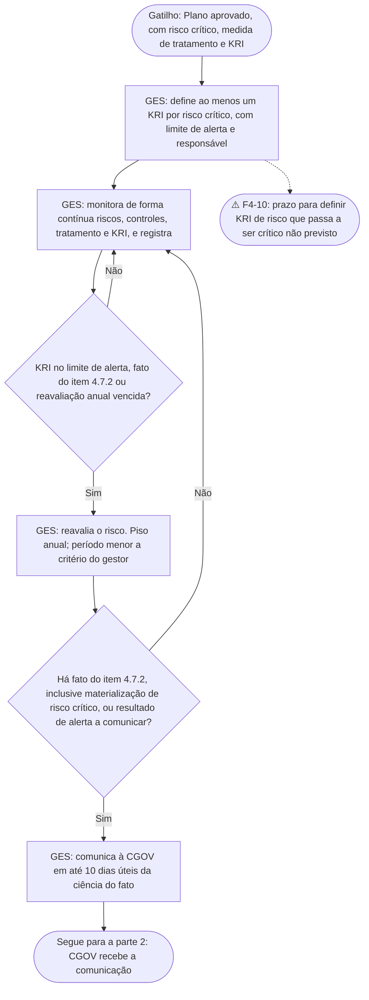
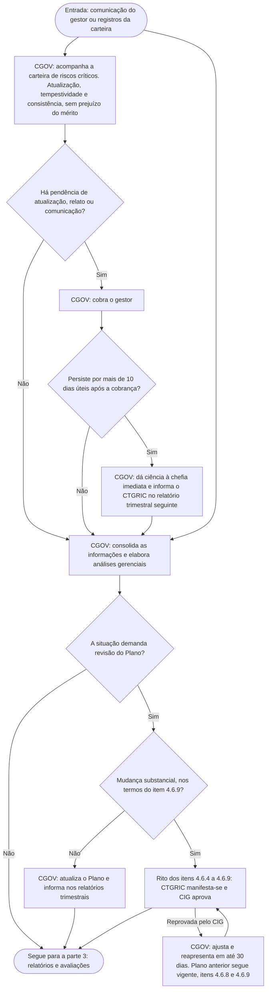
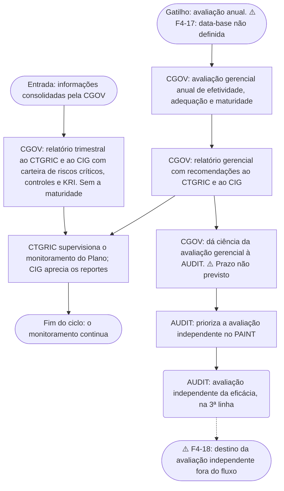
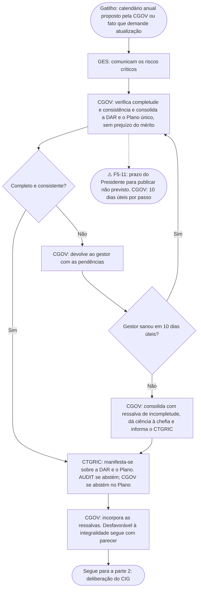
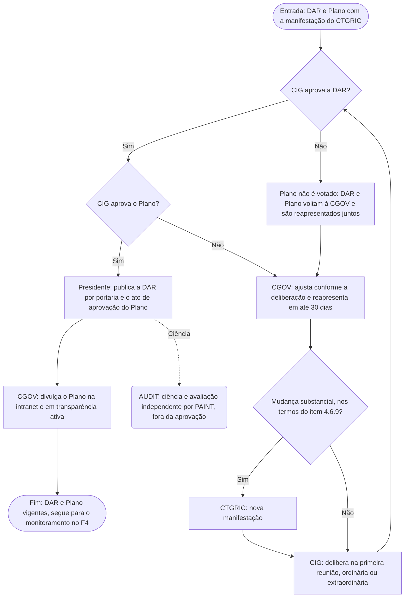

# Modelagem de Processos (BPMN) baseada na Normativa

**Dispositivos modelados:**
* **F4 v2:** Metodologia (SEI 024421455), itens 4.7, 4.7.1, 4.7.2 e 5; Política (SEI 024241420), Arts. 3º, 9º, 15, IX e X, e 16 (texto saneado).
* **F3 v3:** Metodologia, itens 4.6.1 a 4.6.11 e Anexo III; Política, Arts. 9º, 12, XI, e 13, §§ 1º a 3º (texto saneado).

**Convenções:** alertas novos do F4 a partir de F4-10; alertas novos do F3 a partir de F5-11 (os F5-xx valem para o F3 v1, v2 e v3). Cada diagrama tem no máximo 13 nós, por isso o F4 e o F3 saíram em partes. As siglas dos nós: GES (gestor de riscos, 1ª linha), CGOV (2ª linha), AUDIT (3ª linha).

---

# PARTE I. F4 v2: monitoramento, KRI, relato e avaliação

## 1. Atores (swimlanes)

* **Gestores de riscos (1ª linha):** executam. Definem o KRI, monitoram, registram, reavaliam e comunicam à CGOV (Política, Art. 17, I e IV; Metodologia 4.7 a 4.7.2).
* **CGOV (2ª linha):** executa e decide. Acompanha a carteira de riscos críticos, cobra pendências, consolida, decide se há revisão do Plano, reporta e faz a avaliação gerencial anual (Política, Art. 15, II, V, IX e X; Metodologia 4.7.2 e 5).
* **CTGRIC:** supervisiona o monitoramento do Plano, aprecia os relatórios e, havendo revisão substancial, manifesta-se (Política, Art. 13, II e VI).
* **CIG:** aprecia os reportes e aprova a revisão substancial (Política, Arts. 9º e 12, XII).
* **Chefia imediata do gestor:** é apenas notificada, na cobrança que persiste (Metodologia 4.7.2, novo parágrafo).
* **AUDIT (3ª linha):** recebe ciência da avaliação gerencial; faz a avaliação independente, se priorizada no PAINT (Política, Art. 16; RI, Art. 31, parágrafo único, II).

## 2. Análise do fluxo

**Gatilho:** Plano aprovado, com risco crítico, medida de tratamento e KRI. **Fim:** não há. É um ciclo contínuo (4.7, primeiro parágrafo); só os caminhos de revisão e de avaliação têm desfecho próprio.

| # | Ator | Ação | Dispositivo | Prazo |
| :-: | :--- | :--- | :--- | :--- |
| 1 | Gestor | Define ao menos um KRI por risco crítico (métrica, fonte, periodicidade de monitoramento, limite de alerta, responsável) | 4.7.1 e alíneas a) a f) | ⚠️ não há (F4-10) |
| 2 | Gestor | Monitora de forma contínua riscos, controles, tratamento e KRI; registra e mantém atualizado | 4.7, 3º parágrafo; 4.7.2, 1º parágrafo | contínuo |
| 3 | Gestor | Reavalia cada risco registrado ao menos uma vez por ano, antes se houver fato do 4.7.2; pode fixar período menor | 4.7 (caput do rol e novo parágrafo) | anual (piso) |
| 4 | Gestor | KRI acima do limite de alerta: reavalia o risco e comunica o resultado à CGOV | 4.7.1, parágrafo do alerta | 10 dias úteis (⚠️ contagem aberta, F4-11) |
| 5 | Gestor | Comunica à CGOV as hipóteses I a VI: mudança do residual (Quadro 8) ou do enquadramento no apetite; falha em controle de risco crítico que o reduza no Quadro 6; materialização de risco crítico; risco emergente; atraso no tratamento; situação que demande revisão do Plano | 4.7.2, caput e I a VI | 10 dias úteis da ciência do fato |
| 6 | CGOV | Acompanha a carteira de riscos críticos: atualização, tempestividade e consistência, sem prejuízo do mérito | Política, Art. 15, IX | ⚠️ sem periodicidade (F4-12) |
| 7 | CGOV | Cobra as pendências de atualização, relato e comunicação | 4.7.2, novo parágrafo | ⚠️ sem prazo para cobrar (F4-12) |
| 8 | CGOV | Persistindo a pendência por mais de 10 dias úteis após a cobrança: dá ciência à chefia imediata e informa o CTGRIC no relatório trimestral seguinte | 4.7.2, novo parágrafo | 10 dias úteis; informação em até um trimestre (F4-16) |
| 9 | CGOV | Consolida as informações e elabora análises gerenciais | 4.7.2 | ⚠️ não há |
| 10 | CGOV | Decide se a situação demanda revisão do Plano | 4.7.2, último parágrafo | 10 dias úteis (decisão de 20/11/2026, F4-14) |
| 11 | CGOV | Revisão não substancial: atualiza o Plano e informa nos relatórios trimestrais | 4.7.2; Política, Art. 9º | trimestral |
| 12 | CGOV, CTGRIC, CIG | Revisão substancial (critérios do 4.6.9): rito dos itens 4.6.4 a 4.6.9 (CTGRIC manifesta-se; CIG aprova; reprovada, a CGOV ajusta e reapresenta em 30 dias, com o Plano anterior vigente) | 4.7.2, último parágrafo | calendário do CTGRIC e do CIG; reprovação pelo 4.6.8 e 4.6.9 (decisão de 20/11/2026, F4-15) |
| 13 | CGOV | Relatório trimestral ao CTGRIC e ao CIG: carteira de riscos críticos, controles e KRI. A maturidade não entra | 4.7.2 | trimestral |
| 14 | CTGRIC e CIG | O CTGRIC supervisiona o monitoramento do Plano; ambos apreciam os reportes | Política, Arts. 12, XII, e 13, II e VI | reuniões trimestrais |
| 15 | CGOV | Avaliação gerencial anual de efetividade, adequação e maturidade; relatório com recomendações ao CTGRIC e ao CIG | 5, 1º e 2º parágrafos; Política, Art. 15, X | anual (⚠️ data-base não definida, F4-17) |
| 16 | CGOV | Dá ciência da avaliação gerencial à AUDIT, para subsidiar o PAINT | 5, novo 3º parágrafo | ⚠️ não há (F4-17) |
| 17 | AUDIT | Prioriza no PAINT e faz a avaliação independente da eficácia da gestão de riscos | Política, Art. 16; Estatuto da AUDIT, Arts. 4º, 6º e 8º, III | conforme o PAINT |

**Fim(ns):** a revisão substancial aprovada pelo CIG volta ao F3 (rito de aprovação) e o monitoramento continua. A revisão substancial reprovada pelo CIG segue o 4.6.8 e o 4.6.9, com o Plano anterior vigente (decisão de 20/11/2026, F4-15). A avaliação independente da AUDIT não tem destinatário definido no fluxo (F4-18).

## 3. Alertas de gargalo

**Resolvidos pelas escolhas de 20/11/2026 (já no texto saneado):** F4-01 (KRI só para risco crítico), F4-02 (alerta do KRI: reavaliar e comunicar em 10 dias úteis), F4-03 e F4-04 (relatórios trimestrais, avaliação anual), F4-05 (três verbos: monitorar, acompanhar, supervisionar), F4-06 (avaliação gerencial × independente), F4-07 ("alteração significativa" = mudança de nível no Quadro 8 ou de enquadramento no apetite), F4-08 (reavaliação ao menos anual) e F4-09 (10 dias úteis da ciência; "falha relevante" pelo Quadro 6; materialização como hipótese própria).

**Novos, abertos:**

> ⚠️ **F4-10 · Prazo para definir o KRI de risco que passa a ser crítico.** O 4.7.1 manda o gestor definir o KRI dos riscos críticos, mas não diz quando. Para o risco que já está no Plano, o KRI vem com o tratamento. Para o risco que passa a ser crítico depois, por mudança do residual (4.7.2, I) ou por risco emergente (4.7.2, IV), não há prazo, e é nesse intervalo que o risco crítico fica sem sinal de alerta.
>
> **Sugestão de ajuste normativo:** acrescentar ao 4.7.1: "O gestor de riscos definirá o KRI do risco que passe a ser crítico em até [prazo a escolher] dias úteis da comunicação de que trata o item 4.7.2." Prazo a escolher, sem recomendação minha: depende do tempo real de desenhar a métrica, e a Política não dá parâmetro.

> ⚠️ **F4-11 · Dois relógios de 10 dias úteis para o mesmo fato.** O alerta do KRI tem prazo de 10 dias úteis para reavaliar e comunicar o resultado (4.7.1), sem dizer de quando corre (L-40, ainda não aplicada). O 4.7.2 conta 10 dias úteis da ciência do fato. Um alerta de KRI que levar à mudança do nível do residual dispara os dois. O gestor pode entender que são duas comunicações, ou que o prazo do 4.7.2 só começa depois da reavaliação.
>
> **Sugestão de ajuste normativo:** aplicar o L-40 (prazo do alerta contado da ciência do alerta) e acrescentar: "A comunicação do resultado da reavaliação feita em razão do alerta do KRI supre, quando coincidirem, a comunicação do item 4.7.2, I a III, desde que feita no mesmo prazo."

> ⚠️ **F4-12 · A cobrança não tem gatilho nem periodicidade, e a CGOV só cobra o que vê.** O novo parágrafo do 4.7.2 manda a CGOV cobrar "as atualizações, os relatos e as comunicações pendentes", mas não diz quando a CGOV verifica nem como descobre a omissão. Se o gestor não registra nem comunica, a pendência não aparece nos dados da CGOV. A LS-06 ficou só parcialmente resolvida: a consequência existe, o gatilho não.
>
> **Sugestão de ajuste normativo:** fixar a verificação ao menos a cada relatório trimestral ("A CGOV verificará, antes de cada relatório trimestral, a atualização dos registros e dos KRIs da carteira de riscos críticos") e garantir à CGOV acesso de leitura aos registros e aos KRIs. ⚠️ O acesso é matéria do sistema, e não do texto: se a CGOV não tem acesso, o acompanhamento depende do gestor.

> ⚠️ **F4-13 · O acompanhamento e a cobrança alcançam só a carteira crítica, e a reavaliação anual alcança todo risco registrado.** O Art. 15, IX, limita a CGOV aos riscos críticos. A reavaliação anual do 4.7 vale para "cada risco registrado", e as hipóteses do 4.7.2 valem para qualquer risco (por exemplo, risco emergente). Para o risco não crítico, ninguém verifica se a reavaliação anual ocorreu.
>
> **Sugestão de ajuste normativo:** (a) estender a verificação anual da CGOV a todos os riscos registrados, só quanto à data da última reavaliação; ou (b) dizer que, para o risco não crítico, a verificação cabe à chefia do gestor. Convém ao Coordenador escolher.

> ⚠️ **F4-14 · A decisão da CGOV sobre revisão do Plano não tem prazo, forma nem critério além do 4.6.9.** O 4.7.2 manda a CGOV "decidir se a situação demanda revisão", mas não diz em quanto tempo, nem que a decisão é registrada ou comunicada ao gestor. O 4.6.9 define "mudança substancial", mas não "demanda revisão".
>
> **Sugestão de ajuste normativo:** "A CGOV decidirá em até [prazo a escolher] dias úteis do recebimento da comunicação e registrará a decisão, com ciência ao gestor." **Decisão (20/11/2026): 10 dias úteis**, a mesma medida dos demais prazos da seção. Resolvido.

> ⚠️ **F4-15 · Revisão substancial reprovada pelo CIG fica sem desfecho (lacuna terminal).** O 4.7.2 remete a revisão substancial "ao rito dos itens 4.6.4 a 4.6.7". O 4.6.8 (reprovação) e o 4.6.9 (volta ao CTGRIC) ficam de fora. Se o CIG não aprovar a revisão, o texto não diz se o Plano anterior segue vigente, nem quem reapresenta, nem em que prazo. O 4.6.3 (devolução e ressalva) também não alcança a revisão.
>
> **Decisão (20/11/2026): estender o 4.6.8 e o 4.6.9, opção recomendada. Resolvido.** Proposta de redação: trocar a remissão para "ao rito dos itens 4.6.4 a 4.6.9" e acrescentar: "Enquanto não aprovada a revisão, permanece vigente o Plano anterior."

> ⚠️ **F4-16 · A informação ao CTGRIC sobre a pendência persistente chega só no relatório trimestral seguinte.** No 4.6.3 (consolidação do Plano) a CGOV "informa o CTGRIC" sem esperar relatório. No 4.7.2 a informação vai "no relatório trimestral seguinte". Uma pendência que ultrapasse os 10 dias úteis logo após um relatório só chega ao CTGRIC cerca de um trimestre depois, mais os 10 dias úteis.
>
> **Sugestão de ajuste normativo:** manter como está e registrar a escolha como deliberada (o CTGRIC se reúne por trimestre, e a Portaria nº 4.529/2025 admite reunião extraordinária em 48 horas), ou prever a informação em até [prazo] dias úteis quando o risco pendente for crítico e a pendência afetar um KRI em alerta.

> ⚠️ **F4-17 · Avaliação anual sem data-base e ciência à AUDIT sem prazo.** O item 5 diz "anual" sem dizer anual a partir de quê (ano civil, data da aprovação do Plano, ciclo do PAINT). A ciência à AUDIT "para subsidiar o planejamento do PAINT" só serve se chegar antes da elaboração do PAINT, e o texto não fixa esse prazo. Seguem abertos o item 5 "anual" frente ao Art. 11 da Política (L-26) e o Art. 8º, III, do Estatuto da AUDIT, que pode limitar a avaliação independente de 2027.
>
> **Sugestão de ajuste normativo:** "A CGOV concluirá a avaliação gerencial até [data ou prazo] de cada ano e dará ciência à AUDIT em até [prazo] dias úteis da conclusão." ⚠️ Datas dependem do calendário do PAINT, que não conferi.

> ⚠️ **F4-18 · O destinatário da avaliação independente da AUDIT está fora do fluxo.** O RI (Art. 31, VII e IX) manda a AUDIT informar o Comitê Gestor. A Política atribui ao CIG a apreciação dos reportes. A relação entre os dois depende da Política de Governança, que não está publicada. O fluxo termina na avaliação da AUDIT sem dizer a quem ela se dirige. Não proponho texto, como já registrado em `Auditoria_Competencias_F4-05_F4-06_2026-11-20.md`, seção 5.

## 4. Veredito do F4 v2

O fluxo fecha como ciclo contínuo e tem desfecho nos caminhos normais (monitoramento, comunicação, relatório, avaliação). Tinha **uma lacuna terminal**, a reprovação da revisão substancial (F4-15), resolvida em 20/11/2026 pela extensão do 4.6.8 e do 4.6.9. Restam seis lacunas não terminais: prazo (F4-10 e F4-17), gatilho (F4-12), alcance (F4-13), duplicidade (F4-11) e latência (F4-16). O F4-18 depende de ato fora das minutas. O F4-14 (prazo da CGOV) foi resolvido na mesma data. Nenhuma contradição entre competências restou da auditoria (C-09 a C-11 resolvidos).

## 5. Diagramas (Mermaid)

### F4 v2, parte 1: monitoramento e comunicação pelo gestor

### F4 v2, parte 2: acompanhamento, cobrança e revisão do Plano pela CGOV

### F4 v2, parte 3: relatórios, avaliação gerencial anual e avaliação independente

---

# PARTE II. F3 v3: aprovação e publicação da DAR e do Plano de Gestão de Riscos

## 6. Atores (swimlanes)

* **Gestores de riscos (1ª linha):** comunicam os riscos críticos e sanam as pendências em 10 dias úteis (4.6.1 e 4.6.3).
* **CGOV (2ª linha):** verifica, consolida, devolve, incorpora ressalvas, ajusta, reapresenta, divulga e propõe o calendário anual (4.6.2 a 4.6.11). No CTGRIC, abstém-se de votar sobre o Plano e presta esclarecimentos como Secretaria-Executiva (Política, Art. 13, § 2º).
* **CTGRIC:** manifesta-se, previamente ao CIG, sobre a DAR e o Plano (Política, Art. 13, § 1º). Reúne-se por trimestre; admite reunião extraordinária em 48 horas (Portaria nº 4.529/2025, Arts. 7º e 8º).
* **CIG:** delibera, na mesma reunião e nesta ordem, sobre a DAR e o Plano (Política, Art. 12, XI; 4.6.6). Reúne-se por trimestre, com reunião extraordinária a critério do Presidente do CIG (minuta de 15/10/2026, SEI 024398218).
* **Presidente do ICMBio:** publica a DAR por portaria e o ato de aprovação do Plano (4.6.7).
* **Chefia imediata do gestor:** é apenas notificada, quando o risco é consolidado com ressalva (4.6.3).
* **AUDIT (3ª linha):** abstém-se de votar sobre a DAR e o Plano no CTGRIC (Política, Art. 13, § 3º); recebe ciência e avalia por PAINT, fora da aprovação.

## 7. Análise do fluxo

**Gatilho:** calendário anual proposto pela CGOV (4.6.11) ou fato que demande atualização do Plano (F4, parte 2). **Fim:** DAR e Plano vigentes, com passagem ao F4.

| # | Ator | Ação | Dispositivo | Prazo |
| :-: | :--- | :--- | :--- | :--- |
| 1 | CGOV | Propõe ao CTGRIC e ao CIG, no início do ano, o calendário das reuniões ordinárias, com o CTGRIC antes do CIG no mesmo trimestre | 4.6.11 | anual |
| 2 | Gestores | Comunicam os riscos críticos | 4.6.1; Política, Art. 17, II | ⚠️ não há (F5-11) |
| 3 | CGOV | Verifica completude e consistência e consolida a DAR e o Plano único, sem prejuízo do mérito | 4.6.2 | 10 dias úteis (decisão de 20/11/2026, F5-11) |
| 4 | CGOV | Constatada incompletude ou inconsistência, devolve o risco ao gestor, com as pendências | 4.6.3 | — |
| 5 | Gestor | Sana as pendências | 4.6.3 | 10 dias úteis |
| 6 | CGOV | Não sanadas: consolida o risco com ressalva de incompletude, dá ciência à chefia imediata e informa o CTGRIC | 4.6.3 | 10 dias úteis (decisão de 20/11/2026, F5-11) |
| 7 | CGOV | Encaminha ao CTGRIC a minuta da DAR e o Plano consolidado | 4.6.4 | 10 dias úteis (decisão de 20/11/2026, F5-11) |
| 8 | CTGRIC | Manifesta-se. A CGOV se abstém no Plano; a AUDIT, na DAR e no Plano | Política, Art. 13, §§ 1º a 3º | reunião trimestral |
| 9 | CGOV | Incorpora as ressalvas. A manifestação desfavorável à integralidade segue com o parecer | 4.6.5 | 10 dias úteis (decisão de 20/11/2026, F5-11) |
| 10 | CIG | Delibera, na mesma reunião e em votações sucessivas, sobre a DAR e depois sobre o Plano | 4.6.6; Política, Art. 12, XI | reunião trimestral |
| 11 | Presidente | Publica a DAR por portaria e o ato de aprovação do Plano | 4.6.7 | ⚠️ não há (F5-11, prazo do Presidente aberto) |
| 12 | CGOV | Divulga o Plano na intranet e em transparência ativa | 4.6.7 | 10 dias úteis (decisão de 20/11/2026, F5-11) |
| 13 | CGOV | Não aprovados: ajusta conforme a deliberação e reapresenta | 4.6.8 | 30 dias |
| 14 | CGOV | A reapresentação volta ao CTGRIC só se a mudança for substancial (4.6.9, I a III); o CIG pode reclassificar | 4.6.9 | primeira reunião subsequente do CIG |
| 15 | AUDIT | Ciência; avalia por PAINT | Política, Art. 16 | conforme o PAINT |

## 8. Estado dos alertas F5

**Resolvidos e já no texto saneado:** F5-01 (10 dias úteis), F5-01b (ressalva de incompletude, 4.6.3), F5-02 (ressalvas incorporadas pela CGOV), F5-03 e F5-03b (reapresentação em 30 dias; primeira reunião subsequente, ordinária ou extraordinária), F5-04 (calendário anual, 4.6.11), F5-05 (abstenção da CGOV), F5-06 (mesma reunião, em ordem), F5-07 (só a revisão substancial vai ao CTGRIC e ao CIG), F5-08 (portaria do Presidente aprova o Plano; a CGOV divulga), F5-09 (abstenção da AUDIT) e F5-10 (critério objetivo de "mudança substancial").

**Seguem abertos de rodadas anteriores:** F5-08b (falta o modelo de portaria que aprova o Plano no Anexo III) e F5-09b (a Portaria nº 4.529/2025, Arts. 2º, IV, e 6º, I, mantém o voto pleno da AUDIT; levar à PFE com o L-13).

**Novos, abertos:**

> ⚠️ **F5-11 · Só o gestor tem prazo; a CGOV e o Presidente não têm.** O único prazo do 4.6 que fala de unidade de gestão é o do gestor (10 dias úteis). Não têm prazo: a verificação e consolidação pela CGOV (4.6.2), o encaminhamento ao CTGRIC (4.6.4), a incorporação das ressalvas (4.6.5), a ciência à chefia no caso de ressalva (4.6.3), a publicação pelo Presidente e a divulgação pela CGOV (4.6.7). O prazo total do ciclo só é conhecido na parte que depende do calendário dos colegiados.
>
> **Sugestão de ajuste normativo:** **Decisão (20/11/2026): 10 dias úteis para cada passo da CGOV** (passos 3, 6, 7, 9 e 12 da tabela). Segue aberto o prazo do Presidente para publicar (passo 11): ⚠️ a Metodologia é portaria da Presidência, e prazo imposto ao próprio Presidente é fórmula a conferir com a PFE.

> ⚠️ **F5-12 · O laço de devolução não diz quantas vezes pode ocorrer.** O 4.6.3 manda devolver e o gestor sanar em 10 dias úteis. Depois do saneamento, a CGOV verifica de novo (4.6.2). O texto não diz se essa nova verificação pode gerar uma segunda devolução, nem se o prazo reinicia. Em tese, cada rodada nova reabre 10 dias úteis, e o risco pode não chegar à consolidação antes da reunião do CTGRIC.
>
> **Sugestão de ajuste normativo:** "A devolução ocorrerá uma única vez por risco. Persistindo a incompletude ou a inconsistência após o prazo, aplica-se a ressalva de incompletude."

> ⚠️ **F5-13 · DAR reprovada e destino do Plano na mesma reunião.** O 4.6.6 manda votar primeiro a DAR e depois o Plano. O 4.6.8 trata o caso de "não aprovados os instrumentos", sem distinguir se um só foi reprovado. Se a DAR for reprovada e o Plano for votado em seguida, o Plano seria aprovado sem DAR vigente e sem a definição de risco crítico que dela decorre (Política, Art. 8º, § 1º). O 4.6.6 só admite apreciar o Plano sem DAR "se não houver DAR vigente", e a reprovação da DAR em curso não é o mesmo que a ausência dela.
>
> **Decisão (20/11/2026): o Plano fica suspenso até a DAR, opção recomendada.** Proposta de redação, a acrescentar ao 4.6.6: "O Plano de Gestão de Riscos somente será deliberado se a Declaração de Apetite a Riscos for aprovada. Não aprovada a Declaração, os dois instrumentos serão ajustados e reapresentados em conjunto, na forma do item 4.6.8." Resolvido.

> ⚠️ **F5-14 · A definição de "mudança substancial" está no parágrafo da reapresentação, mas é usada também na revisão do Plano.** O 4.6.9 diz "O Plano e a Declaração reapresentados voltarão ao CTGRIC apenas se a mudança for substancial" e define a mudança por três critérios. A Política (Art. 9º) e o 4.7.2 remetem a esse item para a revisão do Plano vigente. Na reapresentação, a base de comparação é a versão que o CIG não aprovou. Na revisão, é o Plano vigente. O texto não diz isso, e o critério II ("inclua ou exclua risco crítico da carteira") muda de sentido conforme a base.
>
> **Sugestão de ajuste normativo:** separar em item próprio (por exemplo 4.6.9-A) a definição de "mudança substancial", com a base de comparação em cada caso: "em relação à versão submetida ao CIG, na reapresentação; e em relação ao Plano vigente, na revisão".

> ⚠️ **F5-15 · Todo risco crítico novo ou excluído depende do CTGRIC e do CIG.** Pelo critério II do 4.6.9, incluir ou excluir risco crítico da carteira é mudança substancial. Pela Política (Art. 9º), a revisão substancial depende de manifestação do CTGRIC e de aprovação do CIG. Um risco emergente que se torne crítico espera, no pior caso, a reunião do CTGRIC e a do CIG do trimestre (F5-04), e até dois trimestres se uma reunião falhar. Nada diz quando se convoca reunião extraordinária para isso, e a decisão fica com o Presidente do CIG. Nesse intervalo, o risco crítico pode ficar fora da carteira que a CGOV acompanha (F4, parte 2).
>
> **Decisão (20/11/2026): reunião extraordinária a pedido da CGOV, opção recomendada.** Proposta de redação, a acrescentar ao 4.6.9: "Quando a CGOV indicar como urgente a inclusão de risco crítico, o CTGRIC e o Comitê Interno de Governança poderão ser convocados em reunião extraordinária, e o gestor de riscos manterá o monitoramento e o KRI do risco enquanto a revisão tramita." ⚠️ O critério de urgência segue a definir. A convocação do CIG cabe ao seu Presidente; a CGOV apenas solicita.

> ⚠️ **F5-16 · A abstenção da CGOV vale só para o Plano, e a CGOV prepara também a DAR; o quórum não foi conferido.** O § 2º do Art. 13 manda a CGOV se abster apenas "na manifestação sobre o Plano". A CGOV minuta a DAR e a encaminha ao CTGRIC (4.6.4), e elabora os instrumentos (Política, Art. 15, I). O conflito que justifica a abstenção no Plano (a CGOV consolida o que vota) vale também na DAR. Além disso, com as abstenções da CGOV e da AUDIT, o número de votantes cai, e não conferi o quórum e o critério de desempate do CTGRIC.
>
> **Sugestão de ajuste normativo:** estender o § 2º à DAR, ou registrar por que a DAR é tratada diferente. ⚠️ Conferir o quórum na Portaria nº 4.529/2025 antes de fechar a redação.

> ⚠️ **F5-17 · Efeito da ressalva de incompletude fora do fluxo.** O risco consolidado com ressalva entra no Plano aprovado. O texto não diz se ele integra a carteira que a CGOV acompanha e se exige KRI desde logo (F4), nem como e quando a ressalva é retirada. O CTGRIC e o CIG aprovam o Plano com um risco incompleto sem saber o prazo para completá-lo.
>
> **Sugestão de ajuste normativo:** "O risco consolidado com ressalva integra a carteira do Plano, e o gestor o completará em até [prazo] dias úteis, sob acompanhamento da CGOV."

## 9. Veredito do F3 v3

O fluxo fecha no caminho normal e nos laços de retorno (devolução, reprovação, reapresentação). Não há mais fim travado como o do F3 v2, resolvido pela ressalva de incompletude. O laço CIG, ajuste e CIG não tem limite de rodadas, o que é aceitável: cada volta depende de nova deliberação do colegiado. A lacuna de decisão relevante (F5-13) foi resolvida em 20/11/2026, e o F5-15 recebeu rito de reunião extraordinária. Restam lacunas não terminais: prazo do Presidente (F5-11), rodada (F5-12), definição (F5-14), simetria (F5-16), efeito (F5-17) e o critério de urgência do F5-15.

## 10. Diagramas (Mermaid)

### F3 v3, parte 1: consolidação, devolução e manifestação do CTGRIC

### F3 v3, parte 2: deliberação do CIG, publicação e reapresentação

---

# PARTE III. Pontos para decisão do Coordenador e limites

## 11. Decisões do Coordenador (20/11/2026, quarta rodada, todas as recomendadas)

| Alerta | Decisão tomada |
| :--- | :--- |
| F4-15 | Estender o 4.6.8 e o 4.6.9 à revisão substancial; Plano anterior vigente enquanto não aprovada a revisão |
| F5-13 | O Plano só é deliberado se a DAR for aprovada; reprovada a DAR, ambos voltam à CGOV e são reapresentados juntos |
| F5-15 | Reunião extraordinária do CTGRIC e do CIG a pedido da CGOV; o gestor mantém monitoramento e KRI enquanto a revisão tramita |
| F4-14 e F5-11 | 10 dias úteis para cada passo da CGOV (decidir sobre a revisão; verificar, consolidar, encaminhar ao CTGRIC, incorporar ressalvas e divulgar) |

As escolhas ainda não foram aplicadas ao texto saneado das minutas: as redações propostas estão nos alertas acima, para o Capítulo 4 da NT. As demais (F4-10 a F4-13, F4-16 a F4-18; F5-12, F5-14, F5-16, F5-17), o critério de urgência do F5-15 e o prazo do Presidente (F5-11) vão ao cotejo e à NT como propostas de redação, para decisão no fechamento do Capítulo 4.

## 12. Limites desta modelagem

* É modelagem do **texto saneado e das escolhas de 20/11/2026**, e não do texto das minutas. Os dispositivos ainda não foram aplicados às minutas.
* Não conferi o quórum e o critério de desempate do CTGRIC (Portaria nº 4.529/2025), a convocação extraordinária do CIG na minuta da Política de Governança (SEI 024398218, só pelo que o `NT_ESTADO.md` registra) nem o calendário do PAINT.
* Seguem abertos os pontos de `Saneamento_Legistica_F4-05_a_F4-09_2026-11-20.md` (L-40, L-41, L-14, L-19, L-21, L-26, localização das definições no Art. 3º da Política) e F5-08b e F5-09b. A leitura da IN Conjunta MP/CGU nº 1/2016 segue pendente (fora do acervo).
* Os diagramas foram validados no Mermaid, mas não foram exportados para a pasta do processo no projeto do Mermaid desta sessão (a ferramenta disponível só valida e renderiza). Nomes sugeridos: "F4 v2 - parte 1/2/3" e "F3 v3 - parte 1/2".

**Próxima etapa:** `COMPARAR_VERSOES` com as Portarias nº 255/2020 e nº 975/2021.
