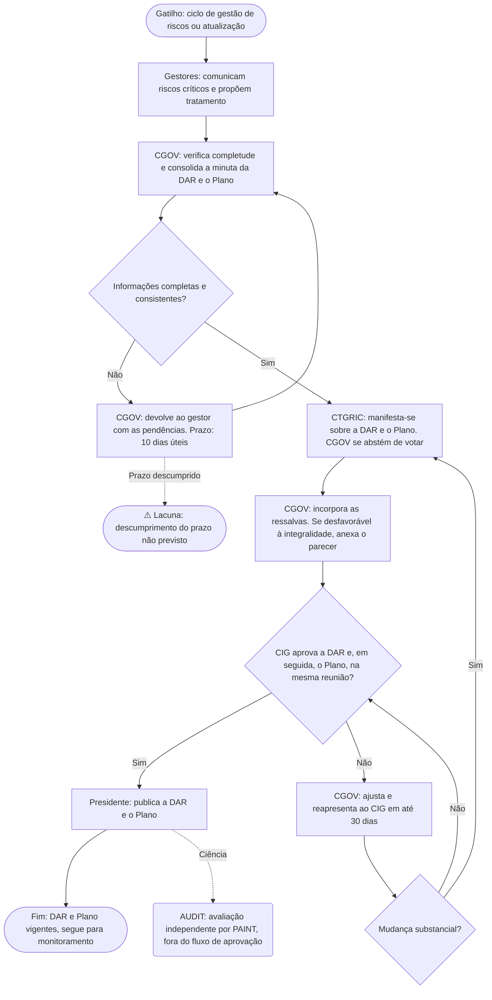

# Modelagem do fluxo corrigido (versão 2): aprovação e publicação da DAR e do Plano de Gestão de Riscos

**Processo:** SEI 02070.001696/2026-31 | **Data:** 20/11/2026 | **Versão:** 2 (substitui a versão das 10h50, que não tinha as escolhas F5)
**Base:** Minutas da Política (SEI 024241420) e da Metodologia (SEI 024421455); RACI ajustada (seção 9 da auditoria); minuta da Política de Governança de 15/10/2026 (SEI 024398218).
**Escolhas aplicadas:** 1A, 2A, 3A, 4B refinada, F5-01 a F5-03, F5-05 e F5-06 (ver `Saneamento_Legistica_Aprovacao_Plano_DAR_2026-11-20.md`, seção 0).
**Nível:** macro. **Status:** fluxo-alvo (TO-BE); não é o texto das minutas.

## 1. Atores

* **Gestores de riscos (1ª linha):** comunicam os riscos críticos e sanam pendências em 10 dias úteis.
* **CGOV (2ª linha):** verifica, consolida, devolve, incorpora as ressalvas e reapresenta. Na manifestação do CTGRIC sobre o Plano, abstém-se de votar e presta esclarecimentos como Secretaria-Executiva (4.529, Art. 6º, VI).
* **CTGRIC:** manifesta-se, previamente ao CIG, sobre a DAR e o Plano. Reúne-se trimestralmente.
* **CIG:** delibera, na mesma reunião, primeiro sobre a DAR e depois sobre o Plano. Reúne-se trimestralmente (minuta de 15/10/2026, Art. 11); extraordinárias convocadas pelo Presidente.
* **Presidente do ICMBio:** publica a DAR (por portaria) e o Plano.
* **AUDIT (3ª linha):** só avaliação independente e consultoria por PAINT. Fora do fluxo de aprovação.

## 2. Passos

| # | Ator | Ação | Dispositivo | Prazo |
| :-: | :--- | :--- | :--- | :--- |
| 1 | Gestores | Comunicam os riscos críticos | Política, Art. 17, II | ⚠️ não previsto |
| 2 | CGOV | Verifica completude e consistência; consolida a minuta da DAR e o Plano | Metodologia 4.6.1 e 4.6.2 (proposta) | ⚠️ não previsto |
| 3 | CGOV | Decide: completo e consistente? Não: devolve ao gestor. Sim: segue | 4.6.3 (proposta) | 10 dias úteis para o gestor sanar |
| 4 | CTGRIC | Manifesta-se sobre a DAR e o Plano; CGOV se abstém de votar | Política, Art. 13, § 1º e § 2º (proposta); 4.529, Art. 6º, VI | reunião trimestral |
| 5 | CGOV | Incorpora as ressalvas; se a manifestação for desfavorável à integralidade, anexa o parecer | 4.6.5 (proposta) | ⚠️ não previsto |
| 6 | CIG | Delibera sobre a DAR e, em seguida, sobre o Plano | Política, Art. 12, XI (proposta) | reunião trimestral |
| 7 | Presidente | Publica a DAR e o Plano | 4.6.7 (proposta) | ⚠️ não previsto |
| 8 | CGOV | Se o CIG não aprovar: ajusta e reapresenta; volta ao CTGRIC só se a mudança for substancial | 4.6.8 e 4.6.9 (proposta) | 30 dias para reapresentar |
| 9 | AUDIT | Recebe ciência; avalia por PAINT | Política, Art. 16; RI, Art. 31 | conforme PAINT |

**Gatilho:** ciclo anual de gestão de riscos ou atualização por risco emergente (⚠️ a periodicidade não está definida nas minutas).
**Fins:** DAR e Plano publicados e vigentes, em monitoramento. Um ponto ainda trava: o descumprimento do prazo de 10 dias úteis pelo gestor.

## 3. Alertas

* **F5-01 (resolvido):** devolução ao gestor, em 10 dias úteis. **F5-01b (aberto):** o que ocorre se o gestor não sanar no prazo.
* **F5-02 (resolvido):** ressalvas incorporadas pela CGOV; desfavorável integral vai ao CIG com parecer.
* **F5-03 (resolvido):** CGOV ajusta e reapresenta em 30 dias. **F5-03b (aberto):** a deliberação depende da reunião seguinte do CIG, trimestral; sem reunião extraordinária, a reprovação pode custar até um trimestre.
* **F5-04 (aberto):** CTGRIC e CIG trimestrais; o ciclo completo pode levar até dois trimestres. Não conferi as reuniões extraordinárias do CTGRIC.
* **F5-05 (resolvido):** a Portaria 4.529, Art. 6º, VI, já prevê abstenção quando o membro declara conflito de interesses, inclusive para discutir a matéria. A proposta ressalva os esclarecimentos da CGOV como Secretaria-Executiva.
* **F5-06 (resolvido):** mesma reunião, em ordem (DAR, depois Plano).
* **F5-07 (novo):** revisão do Plano a qualquer tempo (Política, Art. 9º) exige aprovação do CIG?
* **F5-08 (novo):** forma de publicação do Plano; só a da DAR (portaria) está definida no Anexo III.
* **F5-09 (novo):** a AUDIT segue membro com voto no CTGRIC (4.529, Arts. 2º, IV, e 6º, I).
* **F5-10 (novo):** "mudança substancial" é reconhecida pelo CIG na própria deliberação (escolha minha; confirmar).

**Veredito:** o fluxo fecha no caminho normal e nos dois laços de retorno (devolução e reprovação). Resta uma lacuna terminal (F5-01b).

## 4. Diagrama (Mermaid)

**Exportação:** pasta "SEI_02070.001696_2026-31_gestao-riscos" no projeto do Mermaid, com dois diagramas: "F3 v1 - Aprovação e publicação do Plano e da DAR (fluxo corrigido, antes das escolhas F5)" e "F3 v2 - Aprovação e publicação da DAR e do Plano (escolhas aplicadas)". O código acima é o da v2. Em 20/11/2026 eles foram renomeados (antes "F5 v1" e "F5 v2"), por decisão do Coordenador de Governança; os códigos de alerta F5-xx continuam valendo. Título, código e renderização foram conferidos após recarregar a pasta.
