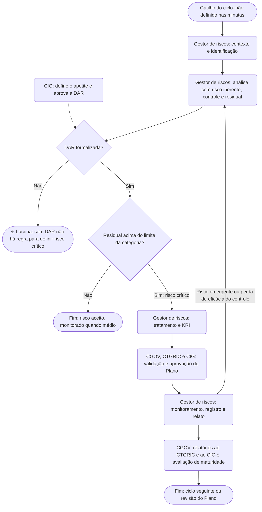
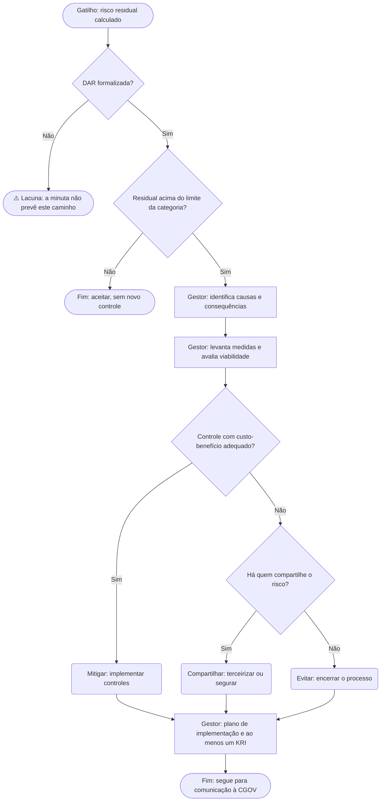
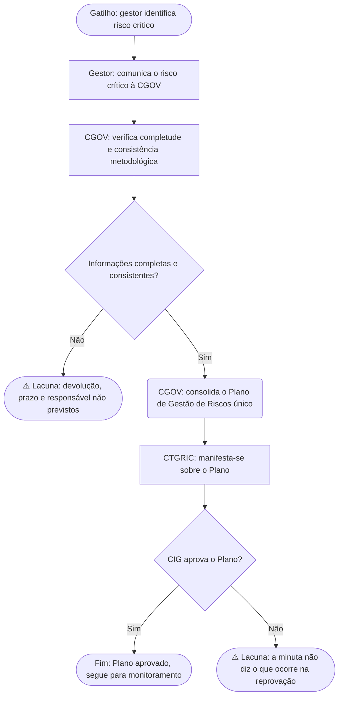
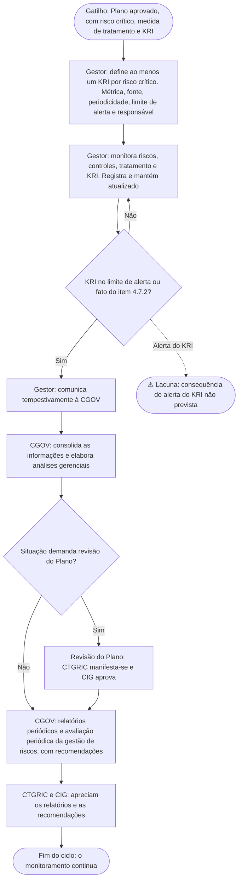

# Modelagem de Processos (BPMN) baseada na Normativa

**Dispositivo modelado:** Política (Arts. 6º a 19) e Metodologia (itens 3 a 5 e Anexos II e III), nível macro.

**Fontes lidas:** as duas minutas na íntegra, a partir das transcrições em Markdown desta pasta (Política: Arts. 1º a 21; Metodologia: itens 1 a 5 e Anexos I a III).

**Diagramas no Mermaid (projeto "SEI_02070.001696_2026-31_gestao-riscos"):** F1, F2 e F3 (minuta atual), com o mesmo código reproduzido na seção 4; F3 v1 e F3 v2 (aprovação corrigida; ver `Modelagem_Fluxo_Aprovacao_Plano_DAR_2026-11-20.md`); e F4 (seção 6, atualização de 20/11/2026). Os alertas "F5-xx" pertencem às versões corrigidas do F3.

## 1. Atores (swimlanes)

* **Comitê Interno de Governança (CIG):** define o apetite, aprova políticas e metodologias, aprova o Plano, fixa alçadas e dirime conflitos (Política, Arts. 12 e 19; Metodologia 4.6).
* **CTGRIC:** consultivo e propositivo. Manifesta-se sobre planos e normas e supervisiona o Plano (Política, Art. 13).
* **CGGE:** supervisiona e orienta, em conjunto com o CTGRIC (Política, Art. 14).
* **CGOV (2ª linha):** elabora os instrumentos, orienta os gestores, consolida o Plano, monitora a carteira de riscos críticos e reporta (Política, Art. 15).
* **Gestores de riscos (1ª linha):** de Presidente a Chefe de UC, executam todas as etapas do ciclo (Política, Art. 17).
* **AUDIT (3ª linha):** avaliação e consultoria, dependentes do PAINT (Política, Art. 16).

## 2. Subprocessos e veredito

| # | Subprocesso | Base | Modelável? |
|---|---|---|---|
| SP0 | Instrumentos e Declaração de Apetite a Riscos (DAR) | Política 7º e 12; Metodologia 4.1 e Anexo III | **Não.** Não há fluxo descrito (F1-02) |
| SP1 | Contexto e identificação | 4.1 e 4.2 | Sim, é linear e executado pelo gestor |
| SP2 | Análise (inerente, controle, residual) | 4.3 | Sim |
| SP3 | Avaliação | 4.4 | Sim, mas depende da DAR |
| SP4 | Tratamento | 4.5 | Sim (F2) |
| SP5 | Validação e aprovação do Plano | 4.6; Política 8º e 9º | **Parcial** (F3) |
| SP6 | Monitoramento, KRI, registro e relato | 4.7 | Parcial. Não há periodicidade nem consequência do alerta |
| SP7 | Avaliação da gestão e da maturidade | Item 5; Política 15 II e X | Sim, mas sem periodicidade |
| T | Comunicação e capacitação | 3.3 e 3.4 | Transversal, sem gatilho |

## 3. Fluxos e alertas de gargalo

### F1 – Ciclo completo (macro)

O gatilho não existe no texto. O fim "ciclo seguinte ou revisão do Plano" é inferência da análise, porque nenhuma minuta diz como o ciclo recomeça.

> ⚠️ **F1-01 · Gatilho e seleção dos objetos indefinidos.** O Art. 12, IX da Política dá ao CIG a aprovação do método de priorização. A Metodologia (3.2) só diz que "inicialmente" serão priorizados os processos que afetam os objetivos estratégicos. Falta definir quem convoca os gestores, quando e para quais objetos.
>
> ⚠️ **F1-02 · A DAR não tem fluxo nem regra de transição.** O Art. 7º, IV e o Art. 12, V dizem que o CIG define o apetite. O item 4.1 só fala em "subsidiar a elaboração". O item 4.6 admite aprovar o Plano "quando este estiver formalizado". O Anexo III é um modelo em branco, que cita "Comitê Gestor" em vez do CIG. Sem DAR não é possível apurar risco crítico, que a Política (Art. 8º, §1º) e a Metodologia (2.V) definem como residual fora do apetite. **Sugestão:** descrever o ciclo da DAR (quem elabora, CTGRIC, CIG, publicação) e dizer o que vale enquanto ela não existir.
>
> ⚠️ **F1-03 · Quase nenhum prazo.** Só aparecem "90 dias" (sugestão no exemplo) e "trimestral" (KRIs do exemplo). A periodicidade do Plano fica para "o respectivo instrumento" (4.6). Os reportes são "tempestivos". Sem prazos não dá para testar se o fluxo é exequível.
>
> ⚠️ **F1-04 · Portaria 975/2021 não é revogada.** O Art. 10 da Política ainda a cita, e o Art. 20 só revoga a Portaria 255/2020. A Metodologia nova tem dois artigos e não revoga a 975. Há risco de duas réguas coexistindo (Regime A e Regime B).
>
> ⚠️ **F1-05 · Competências (levar à AUDITORIA_COMPETENCIAS).** O parágrafo único do Art. 15 diz que a AUDIT, 3ª linha, apoia a CGOV nos incisos I, II e III. Isso põe a 3ª linha na elaboração, na orientação e na avaliação de maturidade. Além disso, CIG, CTGRIC, CGGE e CGOV "supervisionam" ou "coordenam" a mesma implementação (Arts. 12 VII, 13 II, 14 I e 15 VII).

### F2 – Avaliação e tratamento (itens 4.4 e 4.5 e Tabela 8)

> ⚠️ **F2-01 · A avaliação compara o nível errado.** O item 4.3 diz que o residual é a referência das etapas seguintes. Mas o primeiro passo do 4.4 manda identificar riscos acima do limite "na matriz de probabilidade x impacto", que é o inerente. **Sugestão:** redigir "comparar o risco residual com o limite da categoria".
>
> ⚠️ **F2-02 · O limite é por categoria e binário.** O Anexo III só tem apetite Baixo (trata médio, alto e extremo) e Moderado (trata alto e extremo). Extremo sempre é tratado. Não há regra para categoria com apetite em branco. O texto "médios apenas monitorados" (4.4) só vale com apetite Moderado. O aplicativo deve derivar o limite da categoria do risco, e não de uma régua única.
>
> ⚠️ **F2-03 · Faixa sem classificação.** O Quadro 8 começa em 1, mas inerente 1 × fator 0,5 a 0,9 dá residual entre 0,5 e 0,9. Isso afeta só riscos de inerente 1.
>
> ⚠️ **F2-04 · A eficácia do controle é autodeclarada.** O item 4.3 cita "evidências de funcionamento" como aspecto da avaliação, mas não há teto nem verificação. A CGOV só confere "completude e consistência", sem entrar no mérito (4.6). Como o residual decide se o risco é crítico, o gestor pode tirá-lo da carteira escolhendo um fator menor. A regra "sem evidência não passa de Fraco" **não está literalmente nas minutas**. Ou entra no texto, ou fica registrada como regra de sistema.
>
> ⚠️ **F2-05 · Sem saída para risco acima do limite com todas as respostas inviáveis, e sem alçada.** A Tabela 8 só admite "Aceitar" abaixo do limite, e "Evitar" significa encerrar o processo. O CIG pode fixar alçadas (Art. 12, VIII), mas nenhum parâmetro existe. Falta uma aceitação formal excepcional e uma alçada para decidir "Evitar".

### F3 – Validação e aprovação do Plano (item 4.6)

O passo do CTGRIC no diagrama vem da Política (Arts. 9º e 13, I e II). O item 4.6 não o menciona.

> ⚠️ **F3-01 · CTGRIC fora do 4.6.** A Política o põe na manifestação sobre planos. A Metodologia vai direto da consolidação da CGOV para o CIG. A ordem, o prazo e o efeito da manifestação (consultiva ou obrigatória) não estão definidos.
>
> ⚠️ **F3-02 · Sem devolução nem reprovação.** Não há previsão para quando a CGOV achar inconsistência ou quando o CIG não aprovar. O fluxo termina sem saída nos dois casos.
>
> ⚠️ **F3-03 · Cadência do CIG e revisões.** O Art. 9º permite revisar o Plano "a qualquer tempo", exigindo só a manifestação do CTGRIC. O item 4.6 manda o Plano consolidado para o CIG. Não está dito quem aprova uma revisão. Se for o CIG, cada risco emergente depende da agenda dele.
>
> ⚠️ **F3-04 · O fluxo do aplicativo não tem base nas minutas.** O fluxo do piloto é: preliminar da CGOV, validação da chefia, homologação do Diretor ou Presidente. Nenhuma das duas minutas prevê validação pela chefia nem homologação pelo Diretor. O Art. 17 dá ao gestor tanto o registro quanto a manutenção do risco. Quando a CGOV importa a ficha, a 2ª linha faz trabalho da 1ª. **Decisão do projeto:** registrar isso como procedimento transitório do piloto, ou levar o desenho à Metodologia.

### F4 – Monitoramento e avaliação (itens 4.7 e 5; versão inicial só em tabela, substituída pela seção 6)

| Passo | Ator | Ação | Dispositivo | Prazo |
|---|---|---|---|---|
| 1 | Gestor | Define pelo menos um KRI por risco crítico ou "relevante" | 4.7.1 | não há |
| 2 | Gestor | Acompanha riscos, controles e tratamentos e mantém o registro | 4.7 e 4.7.2 | "periódico" |
| 3 | Gestor | Comunica à CGOV mudanças, falhas, emergentes e atrasos | 4.7.2, I a V | "tempestivamente" |
| 4 | CGOV | Consolida e reporta ao CTGRIC e ao CIG | 4.7.2 e item 5 | "periódicos" |

> ⚠️ **F4-01 · "Relevantes" sem definição.** O item 4.7.1 exige KRI para riscos "críticos ou relevantes", mas "relevante" não existe nos Quadros 7 e 8. O Art. 8º, §2º da Política exige KRI só para o crítico. O aplicativo não sabe quais riscos exigem KRI.
>
> ⚠️ **F4-02 · O alerta do KRI não tem consequência.** O item 4.7.1, alínea e, manda fixar limites de alerta, mas não diz o que acontece ao ultrapassá-los (reavaliar, comunicar, revisar o Plano).
>
> ⚠️ **F4-03 · Reavaliação periódica citada e não definida.** O fim do 4.7.1 fala na "avaliação periódica dos riscos prevista nesta metodologia", mas nenhum item a prevê nem fixa período.

## Conferência com as regras de negócio do projeto RADAR

* **Confirmadas nas minutas:**
  * Matriz de tabela fixa de 25 células, sem fórmula. Os 25 valores são distintos. P=1, I=5 dá 15 e P=5, I=1 dá 11.
  * Níveis do Quadro 8.
  * "Crítico" é residual fora do apetite, e não um nível.
  * Nenhuma minuta usa "PGR" para Plano de Gestão de Riscos.
  * Fatores do Quadro 6, sem divergência.
* **Sem base literal nas minutas:** o teto "Fraco" sem evidência (F2-04) e o Teste de Integridade com as subcategorias do Quadro 3. A Metodologia só classifica o risco em subcategorias (4.2.2.1) e remete ao Integra+, que ela não descreve.
* **Erros materiais que afetam regra:**
  * O Anexo II diz "faixa 18 a 25", enquanto o Quadro 8 diz "> 17 a 25". Com residual decimal, 17,5 é Extremo.
  * O Anexo III cita "Comitê Gestor".
  * O texto remete a "Tabela 6" e "Tabela 8", mas os quadros são numerados como Quadro.
  * A CGGE aparece como "Governança e Gestão Estratégica". Conferido: é a grafia correta (Regimento Interno, Art. 36). A Portaria 4.529/2025 usa o nome anterior, "Gestão Estratégica".

## 4. Representação visual (Mermaid.js)

### F1 – Ciclo de gestão de riscos (macro)

### F2 – Avaliação e tratamento do risco

### F3 – Validação e aprovação do Plano de Gestão de Riscos

## 5. Próximos passos sugeridos

* **AUDITORIA_COMPETENCIAS** sobre a Política, para aprofundar o F1-05.
* **COMPARAR_VERSOES** para os itens 4.4 e 4.6 da Metodologia (F2-01 e F3-01).
* Modelar o fluxo da DAR (SP0) quando houver proposta de redação. O diagrama do F4 foi feito em 20/11/2026 (seção 6).

## 6. F4 modelado (atualização de 20/11/2026): monitoramento, KRI, registro, relato e avaliação

**Dispositivo modelado:** Metodologia (SEI 024421455), itens 4.7, 4.7.1, 4.7.2 e 5; Política (SEI 024241420), Arts. 8º, § 2º, 11 e 15, V, IX e X. **Nível:** macro. **Natureza:** o texto atual das minutas (AS-IS).

### 6.1 Atores

* **Gestores de riscos (1ª linha):** definem o KRI, monitoram, registram e comunicam à CGOV.
* **CGOV (2ª linha):** consolida, analisa, decide se o Plano precisa de revisão, reporta e avalia a gestão de riscos.
* **CTGRIC:** aprecia os relatórios e, havendo revisão do Plano, manifesta-se.
* **CIG:** aprecia os relatórios e aprova a revisão do Plano.

### 6.2 Passos

| # | Ator | Ação | Dispositivo | Prazo |
| :-: | :--- | :--- | :--- | :--- |
| 1 | Gestor | Define ao menos um KRI por risco crítico, com métrica, fonte, periodicidade, limite de alerta e responsável | 4.7.1, a) a f); Política, Art. 8º, § 2º | ⚠️ não há |
| 2 | Gestor | Monitora riscos, controles, tratamento e KRI; registra e mantém atualizado | 4.7 e 4.7.2 | "periódico" (sem período) |
| 3 | Gestor | Comunica tempestivamente à CGOV: mudança do residual, falha de controle, risco emergente, atraso no tratamento, situação que demande revisão do Plano | 4.7.2, I a V | "tempestivamente" (sem prazo) |
| 4 | CGOV | Consolida as informações e elabora análises gerenciais | 4.7.2 | ⚠️ não há |
| 5 | CGOV | Decide se a situação demanda revisão do Plano; se sim, a revisão segue o fluxo de aprovação (CTGRIC manifesta-se; CIG aprova) | 4.7.2, V; Política, Art. 9º | ⚠️ não há |
| 6 | CGOV | Produz relatórios periódicos (carteira de riscos críticos, controles, KRI, maturidade) e avalia periodicamente a gestão de riscos, com recomendações | 4.7.2 e item 5; Política, Art. 15, II, V e X | "periódicos" (sem período) |
| 7 | CTGRIC e CIG | Apreciam os relatórios e as recomendações | Política, Arts. 12, XI (atual) e 13, VI | reunião trimestral |

**Gatilho:** Plano aprovado, com risco crítico, medida de tratamento e KRI. **Fim:** não há fim; o ciclo é contínuo (4.7, primeiro parágrafo).

### 6.3 Alertas revisados

* **F4-01 (revisado):** o item 4.7.1 exige KRI para risco "crítico ou relevante", mas "relevante" não existe nos Quadros 7 e 8. O Art. 8º, § 2º, da Política exige KRI só para o crítico. **Decisão (20/11/2026): só risco crítico.** Proposta: no 4.7.1, trocar "críticos ou relevantes" por "críticos".
* **F4-02 (revisado):** o limite de alerta do KRI (4.7.1, e) não tem consequência, e o 4.7.2 não o liga à comunicação. **Decisão: reavaliar e comunicar à CGOV.** Proposta: "Ultrapassado o limite de alerta do KRI, o gestor de riscos reavaliará o risco e comunicará o resultado à CGOV em até [prazo a definir] dias úteis; a CGOV decidirá se a situação demanda revisão do Plano." ⚠️ O prazo não foi escolhido.
* **F4-03 (revisado):** o fim do 4.7.1 cita "avaliação periódica dos riscos prevista nesta metodologia", que nenhum item prevê. **Decisão: relatório trimestral e avaliação anual da gestão de riscos.** Proposta: suprimir a remissão ou apontá-la ao item 5, e fixar a avaliação do item 5 como anual.
* **F4-04 (novo):** "acompanhamento periódico", "relatórios periódicos" e "avaliações periódicas" sem período. **Decisão:** relatórios trimestrais da CGOV, coincidentes com as reuniões do CTGRIC e do CIG; acompanhamento do gestor conforme a periodicidade do KRI (4.7.1, d). ⚠️ Não conferi a regra das reuniões extraordinárias do CTGRIC.
* **F4-05 (novo, para a auditoria de competências):** "monitorar" aparece com o gestor (4.7) e com a CGOV (Política, Art. 15, IX). A fronteira entre a 1ª e a 2ª linha deve ser dita.
* **F4-06 (novo):** a "avaliação da gestão de riscos" do item 5 é feita pela CGOV (2ª linha), e a AUDIT faz avaliação independente (3ª linha, Art. 16). Convém distinguir, no item 5, a avaliação gerencial da CGOV da avaliação independente da AUDIT.
* **F4-07 (novo):** o item 4.7.2 manda comunicar "alterações significativas nos níveis de risco residual" sem definir "significativas".

### 6.4 Veredito

O fluxo fecha como ciclo contínuo e não trava em nenhum ponto terminal. Ele tem decisões sem critério (F4-02, F4-07), prazos e períodos ausentes (F4-03, F4-04) e um termo sem definição (F4-01). Com as quatro decisões acima, as três primeiras ficam sanáveis por redação; a F4-05 vai à auditoria de competências.

### 6.5 Diagrama (Mermaid)

**Exportação:** diagrama "F4 - Monitoramento, KRI, relato e avaliação (itens 4.7 e 5)" na pasta do processo no Mermaid. Nomes na pasta, por decisão de 20/11/2026: F3 (minuta atual), F3 v1, F3 v2 (antes "F5 v1" e "F5 v2") e F4.
