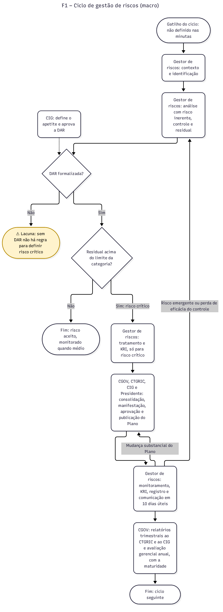
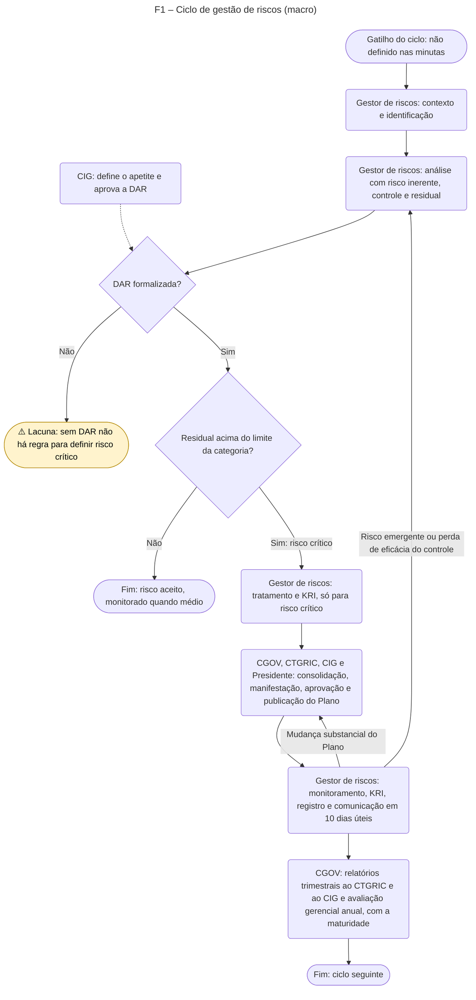

# F1 – Ciclo de gestão de riscos (macro)

**Processo:** SEI 02070.001696/2026-31 (revisão da Política RADAR e da Metodologia de Gestão de Riscos)
**Versão:** v2, atualizado em 20/11/2026
**Substitui:** F1 do projeto no Mermaid (antes das escolhas de F4-01, F4-06 e F5-08)
**Escopo:** Visão macro do ciclo: contexto, análise, avaliação, tratamento, aprovação do Plano, monitoramento e avaliação (Metodologia, itens 4.1 a 5).
**Análise completa (atores, passos, alertas e veredito):** `Modelagem_Fluxos_Gestao_Riscos_2026-11-20.md`
**Estado das decisões:** `NT_ESTADO.md`, seção "Estado da revisão em 20/11/2026"

## Diagrama

Os nós em amarelo marcam lacunas apontadas pela modelagem.

## Alertas do tipo F1-NN (títulos; o estado de cada um está no documento de origem e no `NT_ESTADO.md`)

- **F1-01** · Gatilho e seleção dos objetos indefinidos
- **F1-02** · A DAR não tem fluxo nem regra de transição
- **F1-03** · Quase nenhum prazo
- **F1-04** · Portaria 975/2021 não é revogada
- **F1-05** · Competências (levar à AUDITORIA_COMPETENCIAS)
