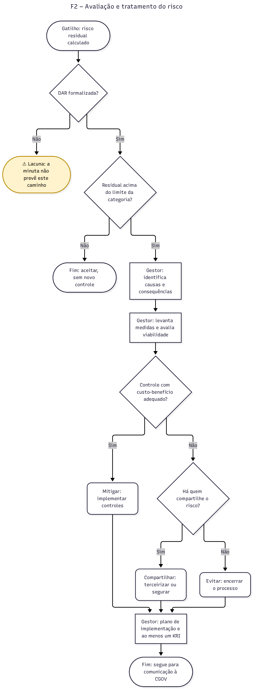
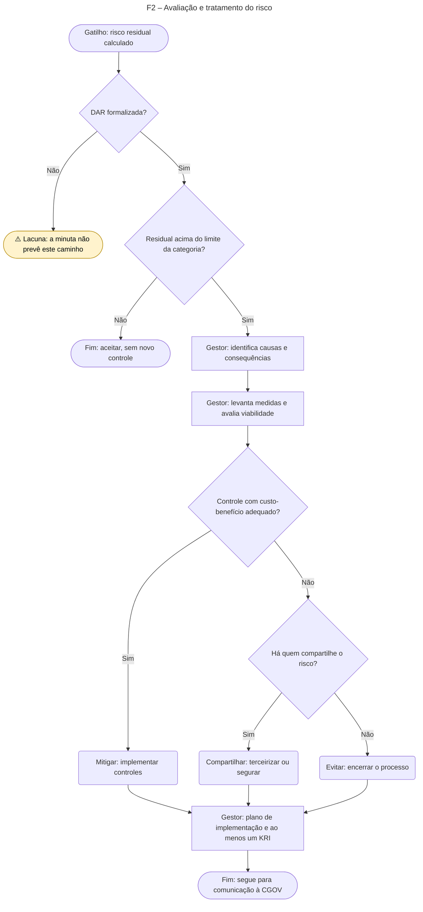

# F2 – Avaliação e tratamento do risco

**Processo:** SEI 02070.001696/2026-31 (revisão da Política RADAR e da Metodologia de Gestão de Riscos)
**Versão:** v1, conferido em 20/11/2026 (sem alteração)
**Substitui:** —
**Escopo:** Avaliação do residual contra o limite da categoria e escolha da resposta (Metodologia, itens 4.4 e 4.5 e Tabela 8). Continua válido: risco acima do limite é o risco crítico, que já exige KRI (F4-01).
**Análise completa (atores, passos, alertas e veredito):** `Modelagem_Fluxos_Gestao_Riscos_2026-11-20.md`
**Estado das decisões:** `NT_ESTADO.md`, seção "Estado da revisão em 20/11/2026"

## Diagrama

Os nós em amarelo marcam lacunas apontadas pela modelagem.

## Alertas do tipo F2-NN (títulos; o estado de cada um está no documento de origem e no `NT_ESTADO.md`)

- **F2-01** · A avaliação compara o nível errado
- **F2-02** · O limite é por categoria e binário
- **F2-03** · Faixa sem classificação
- **F2-04** · A eficácia do controle é autodeclarada
- **F2-05** · Sem saída para risco acima do limite com todas as respostas inviáveis, e sem alçada
