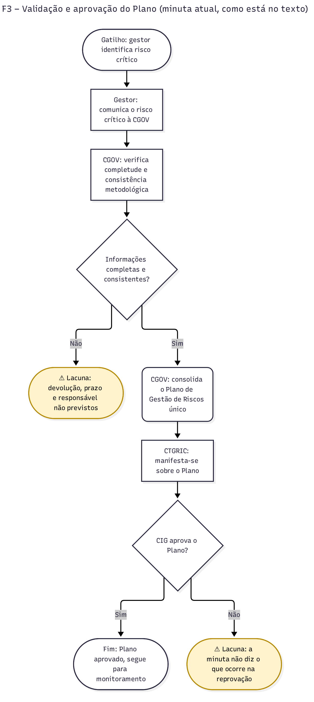
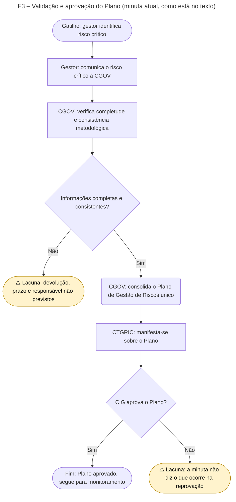

# F3 – Validação e aprovação do Plano (minuta atual, como está no texto)

**Processo:** SEI 02070.001696/2026-31 (revisão da Política RADAR e da Metodologia de Gestão de Riscos)
**Versão:** v1, conferido em 20/11/2026 (sem alteração; retrato da minuta, não da proposta)
**Substitui:** —
**Escopo:** Retrato fiel do item 4.6 da minuta, com as lacunas. Serve de base de comparação para o F3 v3.
**Análise completa (atores, passos, alertas e veredito):** `Modelagem_Fluxos_Gestao_Riscos_2026-11-20.md`
**Estado das decisões:** `NT_ESTADO.md`, seção "Estado da revisão em 20/11/2026"

## Diagrama

Os nós em amarelo marcam lacunas apontadas pela modelagem.

## Alertas do tipo F3-NN (títulos; o estado de cada um está no documento de origem e no `NT_ESTADO.md`)

- **F3-01** · CTGRIC fora do 4.6
- **F3-02** · Sem devolução nem reprovação
- **F3-03** · Cadência do CIG e revisões
- **F3-04** · O fluxo do aplicativo não tem base nas minutas
