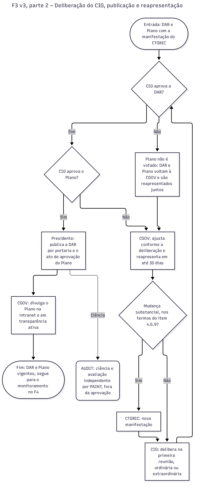
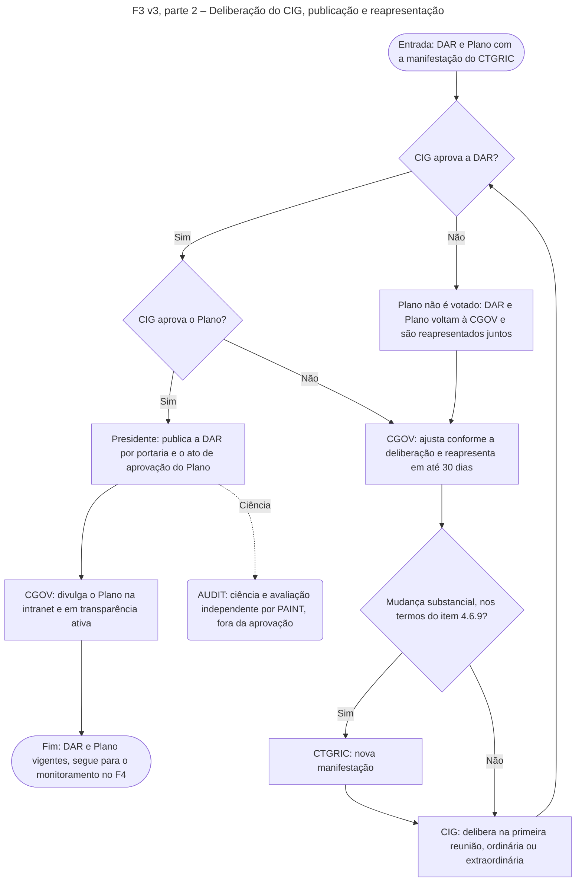

# F3 v3, parte 2 – Deliberação do CIG, publicação e reapresentação

**Processo:** SEI 02070.001696/2026-31 (revisão da Política RADAR e da Metodologia de Gestão de Riscos)
**Versão:** v3, 20/11/2026
**Substitui:** F3 v1 e F3 v2 do projeto no Mermaid
**Escopo:** Deliberação do CIG (DAR e depois Plano), publicação pelo Presidente, divulgação pela CGOV e reapresentação (Metodologia 4.6.6 a 4.6.9).
**Análise completa (atores, passos, alertas e veredito):** `Modelagem_F4_v2_e_F3_v3_2026-11-20.md`
**Estado das decisões:** `NT_ESTADO.md`, seção "Estado da revisão em 20/11/2026"

## Diagrama

Os nós em amarelo marcam lacunas apontadas pela modelagem.

## Alertas do tipo F5-NN (títulos; o estado de cada um está no documento de origem e no `NT_ESTADO.md`)

- **F5-11** · Só o gestor tem prazo; a CGOV e o Presidente não têm
- **F5-12** · O laço de devolução não diz quantas vezes pode ocorrer
- **F5-13** · DAR reprovada e destino do Plano na mesma reunião
- **F5-14** · A definição de "mudança substancial" está no parágrafo da reapresentação, mas é usada também na revisão do Plano
- **F5-15** · Todo risco crítico novo ou excluído depende do CTGRIC e do CIG
- **F5-16** · A abstenção da CGOV vale só para o Plano, e a CGOV prepara também a DAR; o quórum não foi conferido
- **F5-17** · Efeito da ressalva de incompletude fora do fluxo
