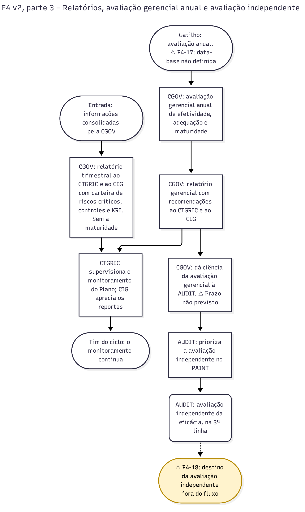
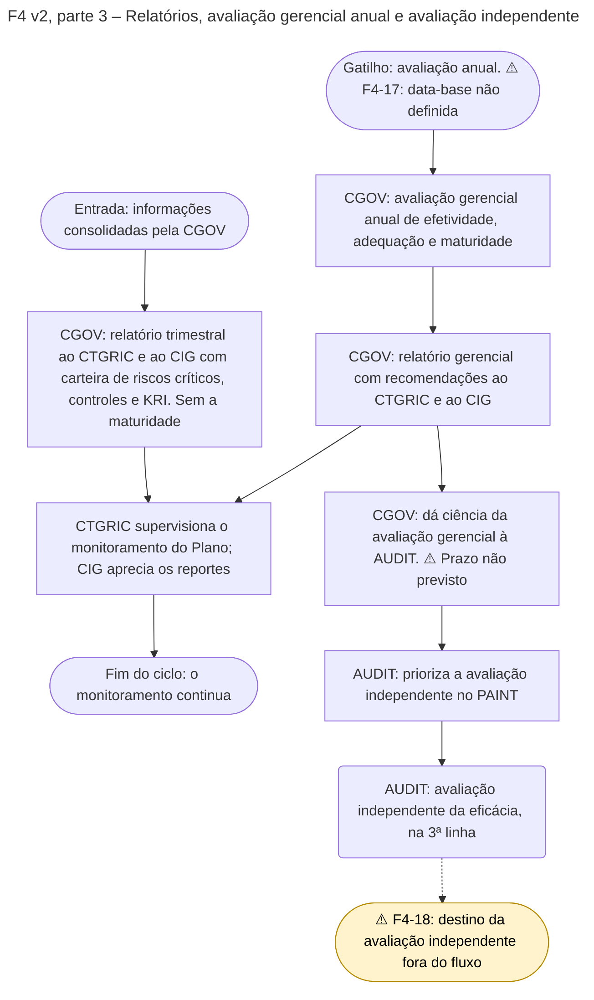

# F4 v2, parte 3 – Relatórios, avaliação gerencial anual e avaliação independente

**Processo:** SEI 02070.001696/2026-31 (revisão da Política RADAR e da Metodologia de Gestão de Riscos)
**Versão:** v2, 20/11/2026
**Substitui:** F4 do projeto no Mermaid
**Escopo:** Relatórios trimestrais, avaliação gerencial anual da CGOV e avaliação independente da AUDIT (Metodologia, item 5).
**Análise completa (atores, passos, alertas e veredito):** `Modelagem_F4_v2_e_F3_v3_2026-11-20.md`
**Estado das decisões:** `NT_ESTADO.md`, seção "Estado da revisão em 20/11/2026"

## Diagrama

Os nós em amarelo marcam lacunas apontadas pela modelagem.

## Alertas do tipo F4-NN (títulos; o estado de cada um está no documento de origem e no `NT_ESTADO.md`)

- **F4-01** · "Relevantes" sem definição
- **F4-02** · O alerta do KRI não tem consequência
- **F4-03** · Reavaliação periódica citada e não definida
- **F4-10** · Prazo para definir o KRI de risco que passa a ser crítico
- **F4-11** · Dois relógios de 10 dias úteis para o mesmo fato
- **F4-12** · A cobrança não tem gatilho nem periodicidade, e a CGOV só cobra o que vê
- **F4-13** · O acompanhamento e a cobrança alcançam só a carteira crítica, e a reavaliação anual alcança todo risco registrado
- **F4-14** · A decisão da CGOV sobre revisão do Plano não tem prazo, forma nem critério além do 4.6.9
- **F4-15** · Revisão substancial reprovada pelo CIG fica sem desfecho (lacuna terminal)
- **F4-16** · A informação ao CTGRIC sobre a pendência persistente chega só no relatório trimestral seguinte
- **F4-17** · Avaliação anual sem data-base e ciência à AUDIT sem prazo
- **F4-18** · O destinatário da avaliação independente da AUDIT está fora do fluxo
