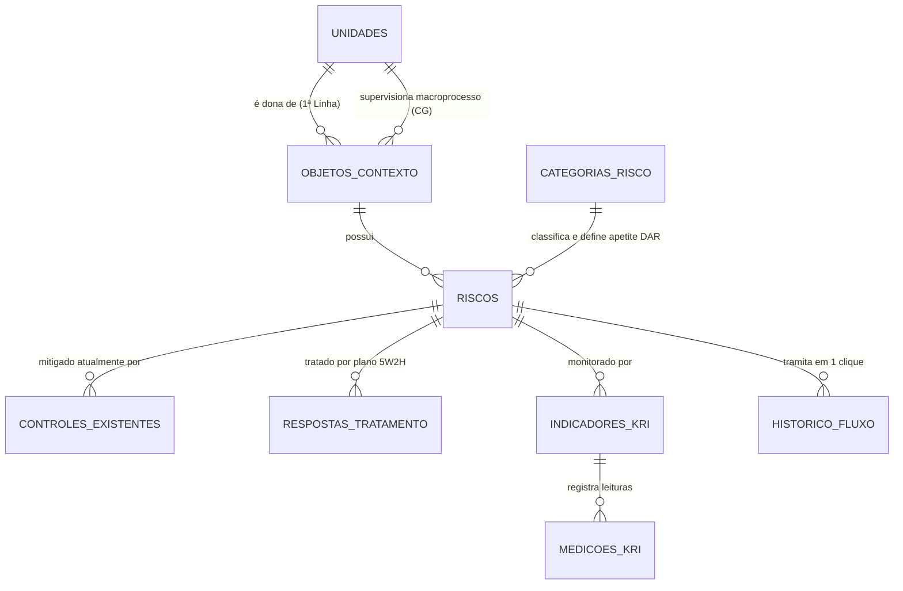

# Modelo Entidade-Relacionamento (MER) — Sistema RADAR (`cgov-riscos`)

> **Documento Técnico-Executivo para a CGTI/ICMBio**  
> **Banco de Dados:** PostgreSQL 15+ (Compatível com Supabase e PostgreSQL On-Premises ICMBio)

---

## 1. Visão Geral da Modelagem (Opção A — Enxuta e 100% Normativa)

O modelo relacional do **Sistema RADAR** foi projetado especificamente para operacionalizar a **Política de Gestão de Riscos (SEI 024241420)** e a **Metodologia de Gestão de Riscos do ICMBio (SEI 024421455)**, eliminando campos desnormalizados de antigas listas do SharePoint e garantindo integridade matemática no próprio SGBD.



---

## 2. Garantias de Integridade no Banco de Dados

1. **Unidades Organizacionais (`unidades`):** contempla explicitamente `'coordenacao-geral'` como instância supervisora dos Macroprocessos da Cadeia de Valor do ICMBio.
2. **Cálculo Assimétrico no Servidor (`calcular_nivel_inerente_q7`):** função imutável em PL/pgSQL que aplica exatamente as 25 células do **Quadro 7** da Metodologia.
3. **Trava de Evidência de Controle (`trigger_calcular_risco_radar`):** impede que controles sem evidência comprovada recebam fator melhor que `0.90` (`Fraco`).
4. **Classificação sem Arredondamento Prévio (`classificar_nivel_q8`):** classifica valores residuais decimais (`NUMERIC(5,2)`) diretamente nas faixas do **Quadro 8**.

---

## 3. Etapa B1 — unidades reais, perfis, alcance, fluxo e trilha (migrações `20261115001` a `20261115005`)

### 3.1 O que mudou nas tabelas

| Tabela | Novidade |
| --- | --- |
| `unidades` | Colunas `icmbio_id` (identificador oficial, único), `hierarquia`, `nome_completo`, `grupo_regional`, `atualizado_em` e **`coordenacao_territorial_id`**. A `sigla` deixou de ser única e obrigatória. O `tipo` passou de 8 para 16 valores (entre os novos: `coordenacao-territorial`, `divisao`, `servico`, `setor`, `base-avancada`). |
| `processos_cadeia_valor` (nova) | Os 90 processos da Cadeia de Valor: `proc_id`, `nome`, `macroprocesso`, `proc_tipo`, `unidade_lider_id`, `unidade_supervisora_id`, `ativo`. O `objetos_contexto` ganhou `processo_id` (opcional). |
| `perfis_usuarios` | Vínculo com `auth.users` (apaga junto), colunas `ativo` e `titular_chefia`, e os **10 perfis** em `papel_governanca`: `gestor`, `coordenador_territorial`, `gerente_regional`, `coordenador_geral`, `diretor`, `presidencia`, `auditoria`, `cgov`, `cgge`, `gabin` (o antigo `lider_cg` virou `coordenador_geral`). |
| `historico_fluxo` | Colunas `usuario_id` (quem agiu, `auth.uid()`) e `sequencia` (ordem das linhas). Servem à segregação D1: o fluxo sabe quem **enviou** o risco. |
| `auditoria_log` | Colunas `objeto_id`, `usuario_id` e `dados_anteriores`; `registro_id` passou a aceitar nulo (linhas da DAR, cujo id é número). |

### 3.2 O vínculo com a Coordenação Territorial (decisão R9, ver [[decisoes-tecnicas-b1]])

Na lista do SharePoint a CT **não** é mãe das UCs e dos NGIs: eles ficam sob a Gerência Regional. O
vínculo vem só no texto do `microgrupo` ("CT Curitiba"). Por isso há **duas ligações separadas**:

```text
FLONA de Caçador ──unidade_pai_id──────────────▶ GR5            (árvore hierárquica)
FLONA de Caçador ──coordenacao_territorial_id──▶ CT Curitiba    (vínculo de CT, opcional)
```

O importador preenche `coordenacao_territorial_id` e só aceita como alvo uma unidade do tipo
`coordenacao-territorial` (erros 23503 e 23514 se não for). Hoje só a CT Curitiba tem unidades
vinculadas (lacuna de dados do SharePoint, ver `guia-supabase-local.md`, seção 7).

### 3.3 Funções de alcance (`20261115002`)

Todas são `SECURITY DEFINER` com `search_path = ''`, e só `authenticated` pode executá-las.

| Função | O que faz (uma frase) |
| --- | --- |
| `meu_perfil()` | Devolve a linha **ativa** de `perfis_usuarios` de quem está logado (vazia se não houver). |
| `unidades_descendentes(raiz)` | A unidade `raiz` e todas as unidades abaixo dela na árvore (termina mesmo com ciclo). |
| `unidades_visiveis()` | As unidades cujos riscos a pessoa vê: todas (alcance total: `diretor`, `presidencia`, `auditoria`, `cgov`, `cgge`, `gabin`) ou a própria unidade com as descendentes (a CT soma as unidades vinculadas). |
| `pode_ler_objeto(objeto)` | Diz se a pessoa lê o objeto de contexto e, portanto, os riscos dele (inclui a visão por processo das Coordenações-Gerais). |
| `pode_escrever_unidade(unidade)` | Diz se a pessoa grava fichas na unidade: só a própria, mais as subunidades internas (`divisao`, `servico`, `setor`, `base-avancada`). |
| `pode_escrever_objeto(objeto)` | O mesmo, olhando a unidade dona do objeto. |
| `pode_criar_objeto_em(unidade)` | Diz se a pessoa cria um objeto novo na unidade (a CGOV pode criar em qualquer uma). |
| `chefia_imediata(unidade)` | A unidade que **valida**: a CT, se a unidade tem vínculo de CT e a mãe é a GR; senão, a unidade-mãe. |
| `homologador_de(unidade)` | A unidade que **homologa**: o 1º ancestral que for GR; senão Diretoria; senão Presidência (nulo para a própria Presidência). |
| `e_titular_de(unidade)` | Diz se a pessoa é o titular (chefe ou substituto em exercício) da unidade. |

A segurança por linha (`20261115003`) usa essas funções nas políticas de `objetos_contexto`,
`riscos`, `controles_existentes`, `respostas_tratamento`, `indicadores_kri`, `medicoes_kri` e
`historico_fluxo`. O `status_fluxo` só muda pelas funções do fluxo (gatilho
`trg_riscos_status_fluxo_so_pelo_fluxo`).

### 3.4 Fluxo de aprovação em 3 degraus (`20261115004`)

Estados de `riscos.status_fluxo`: `preliminar_cgov`, `rascunho`, `em_validacao_cg`,
`em_homologacao_dir`, `aprovado`, `devolvido`. "Exige homologação" = `is_critico = true` **ou**
`status_critico = 'pendente_dar'`.

| Função | De | Para | Quem pode |
| --- | --- | --- | --- |
| `assumir_risco_preliminar` | `preliminar_cgov` | `rascunho` | quem grava no objeto (a unidade) |
| `enviar_para_validacao` | `rascunho`, `devolvido` | `em_validacao_cg` | quem grava no objeto (a unidade) |
| `validar_risco` | `em_validacao_cg` | `em_homologacao_dir` (se exige homologação) ou `aprovado` | titular do **validador efetivo** |
| `homologar_risco` | `em_homologacao_dir` | `aprovado` | titular do **homologador efetivo** |
| `devolver_risco` (motivo obrigatório) | `em_validacao_cg` | `devolvido` | titular do validador efetivo |
| `devolver_risco` (motivo obrigatório) | `em_homologacao_dir` | `devolvido` | titular do homologador efetivo |
| gatilho de reabertura | `aprovado` | `em_validacao_cg` | automático, quando se edita P, I, evidência, eficácia ou fator do controle, categoria, objeto, controles, tratamento ou KRI — ou quando o cálculo muda a criticidade (`is_critico`/`status_critico`) |

**Validador e homologador efetivos (decisão D1, segregação "sobe um nível").** O ponto de partida é
`chefia_imediata` (para validar) e `homologador_de` (para homologar). Se quem **enviou** o risco (ou
o reabriu ao editar) é o titular dessa unidade, o degrau **sobe** para o nível seguinte. Exemplo: o
Gerente da GR5 envia um risco do SAT1-GR5 (Serviço da própria GR) → a Presidência valida e homologa.
Sem nível acima → recusa `55000`.

Se o validador e o homologador efetivos forem a mesma unidade (ex.: UC sem CT, em que a GR valida e
homologa), `validar_risco` já aprova ("validado e homologado pela mesma chefia").

**Excluir risco (decisão D2):** só em `rascunho`, `devolvido` ou `preliminar_cgov`. Risco `aprovado` não
se apaga — nem pela exclusão do objeto (cascata) — e a mensagem orienta a editar a ficha.

Erros: `42501` sem permissão, `55000` estado não permite (ou ficha travada, ou não há quem valide),
`22023` devolução sem motivo, `P0002` risco inexistente; mensagens começam com `RADAR:`. Detalhes e
motivos de cada decisão: [[decisoes-tecnicas-b1]].

### 3.5 Trilha de auditoria (`20261115005`)

O gatilho `fn_registrar_auditoria()` grava em `auditoria_log` toda inclusão, alteração e exclusão em
`objetos_contexto`, `riscos`, `controles_existentes`, `respostas_tratamento`, `indicadores_kri` e
`medicoes_kri`, com `usuario_id`, `objeto_id`, `dados_anteriores` e `dados_novos`. Também registra
`perfis_usuarios` (troca de perfil, unidade e **titularidade**, que decide quem valida e homologa) e
`categorias_risco` (mudanças da DAR), com `objeto_id` nulo. Ninguém grava na trilha à mão. A CGOV lê
tudo (inclusive as linhas sem objeto); os demais leem a trilha dos objetos que podem ler
(`pode_ler_objeto`).
`objeto_id` não tem chave estrangeira de propósito: a trilha sobrevive ao objeto apagado.

### 3.6 Regras da B1.1 (`20261116001` a `20261116004`)

- **Presidência (`001`):** `chefia_imediata` e `homologador_de` recriadas: os riscos da Presidência e da Assessoria (`10.0001`) são validados pelo GABIN (`10.0002`) e homologados pela Presidência; o envio é recusado (`55000`) se o risco exige homologação e não há homologador efetivo.
- **Unidade ativa (`002`):** `pode_criar_objeto_em` exige unidade ativa (nem a CGOV cria objeto em unidade inativa).
- **Processo ativo (`002`):** novo vínculo de objeto com processo da Cadeia de Valor só com processo ativo; quem já estava ligado continua visível.
- **Supervisor pelo banco (`002`):** `macroprocesso_supervisor_id` é preenchido pelo gatilho `regras_objeto_contexto` e propagado por `propagar_supervisor_processo`; sem processo, só a CGOV preenche; sair do processo limpa o supervisor.
- **Reatribuir objeto (`002`):** RPC `reatribuir_objeto(objeto, nova_unidade)`, só CGOV, de unidade inativa para unidade ativa.
- **Preliminar da CGOV (`003`):** `cgov_grava_no_risco_preliminar` libera a CGOV para gravar controles, respostas, KRIs e medições e para apagar o risco `preliminar_cgov`.
- **DAR (`004`):** o gatilho `trg_categorias_dar_reavalia_aprovados` recalcula os riscos aprovados da categoria; quem vira Crítico volta a `em_homologacao_dir` (ação `reaberto_mudanca_dar`); `devolver_risco` aceita a CGOV quando não há ator efetivo.
- **Importador:** `sync:estrutura` ignora o vínculo com CT de outra GR e avisa no relatório.

Motivos e custos: [[decisoes-tecnicas-b1]], seção 5.
