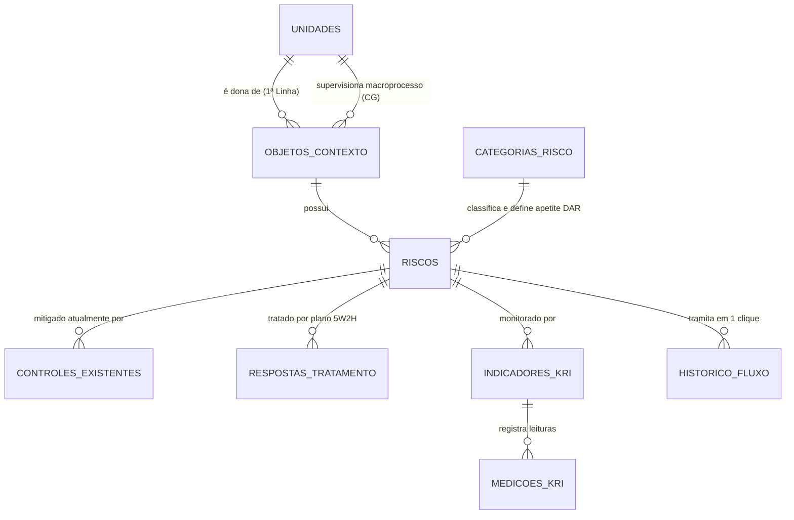

# Modelo Entidade-Relacionamento (MER) — Sistema RADAR (`cgov-riscos`)

> **Documento Técnico-Executivo para a CGTI/ICMBio**  
> **Banco de Dados:** PostgreSQL 15+ (Compatível com Supabase e PostgreSQL On-Premises ICMBio)

---

## 1. Visão Geral da Modelagem (Opção A — Enxuta e 100% Normativa)

O modelo relacional do **Sistema RADAR** foi projetado especificamente para operacionalizar a **Política de Gestão de Riscos (SEI 024241420)** e a **Metodologia de Gestão de Riscos do ICMBio (SEI 024421455)**, eliminando campos desnormalizados de antigas listas do SharePoint e garantindo integridade matemática no próprio SGBD.

---

## 2. Garantias de Integridade no Banco de Dados

1. **Unidades Organizacionais (`unidades`):** contempla explicitamente `'coordenacao-geral'` como instância supervisora dos Macroprocessos da Cadeia de Valor do ICMBio.
2. **Cálculo Assimétrico no Servidor (`calcular_nivel_inerente_q7`):** função imutável em PL/pgSQL que aplica exatamente as 25 células do **Quadro 7** da Metodologia.
3. **Trava de Evidência de Controle (`trigger_calcular_risco_radar`):** impede que controles sem evidência comprovada recebam fator melhor que `0.90` (`Fraco`).
4. **Classificação sem Arredondamento Prévio (`classificar_nivel_q8`):** classifica valores residuais decimais (`NUMERIC(5,2)`) diretamente nas faixas do **Quadro 8**.
