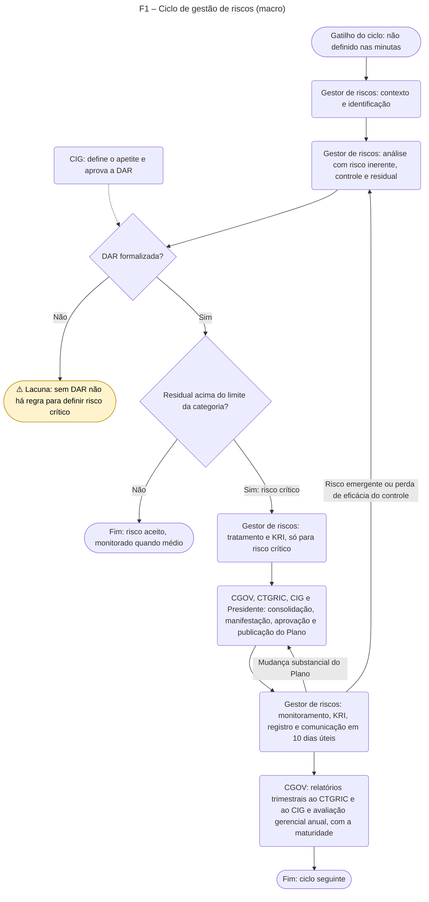

# F1 — Ciclo de gestão de riscos (macro)

> **Versão:** F1 v2, de 20/11/2026.
> **Fonte:** diagrama [[01_F1_ciclo-macro]] (`docs/01-normativos/revisao-2026/fluxos-origem/01_F1_ciclo-macro.mmd`); análise em [[Modelagem_Fluxos_Gestao_Riscos_2026-11-20]], §2 (subprocessos SP0 a SP7) e §3 (F1).
> **Situação normativa:** modela a **minuta** da Metodologia (SEI `024421455`, itens 4.1 a 5) e da Política (SEI `024241420`), já com as escolhas de F4-01, F4-06 e F5-08 (texto saneado). Ainda não é norma publicada. Alertas abertos que afetam o fluxo: **F1-01** (gatilho), **F1-02** (DAR sem regra de transição), **F1-03** (prazos), **F1-04** (Portaria nº 975/2021 não revogada). Situação de cada alerta: [[registro-alertas-f4-f5]].
> Volta ao [[mapa-processos]].

## Para que serve este fluxo

É a visão de cima do processo inteiro: o gestor de riscos (1ª linha) identifica, analisa e avalia; o risco que fica **fora do apetite da DAR** (o **risco crítico**, Política art. 8º, § 1º) recebe tratamento e KRI; a CGOV consolida o Plano de Gestão de Riscos, que passa pelo CTGRIC, pelo CIG e pelo Presidente; depois vem o monitoramento e os relatórios. Os detalhes estão nos fluxos [[F2-avaliacao-tratamento]], [[F3-aprovacao-dar-plano]] e [[F4-monitoramento-relato-avaliacao]].

## Diagrama (copiado do `.mmd`, sem alteração)

O nó amarelo marca uma lacuna. O gatilho (`INICIO`) e os fins não são atividades.

## Atividades

> Numeração atribuída nesta documentação (não há tabela oficial).

Ordem: a do caminho do fluxo, a partir do gatilho. A coluna "Atividade" traz, entre parênteses, o nó do diagrama. Entrada e Saída não existem na fonte: foram derivadas do texto dos nós e dos subprocessos da modelagem (§2) e vão marcadas "(derivado)".

| Atividade (Fn.NN) | Executor | Entrada | Saída | Regra (Política art./Metodologia item) | Prazo |
| --- | --- | --- | --- | --- | --- |
| **F1.01** Contexto e identificação (`GES_CTX`) | Gestor de riscos (1ª linha) | Objeto de gestão (processo, projeto, unidade) (derivado) | Riscos identificados: causa, evento, consequência, categoria (derivado) | Metodologia 4.1 e 4.2 (SP1); Política art. 17, I | ⚠️ não há (F1-01, F1-03) |
| **F1.02** Análise: risco inerente, controle e residual (`GES_AN`) | Gestor de riscos | Riscos identificados (derivado) | Risco inerente (Quadro 7, tabela fixa), fator do controle (Quadro 6) e residual = inerente × fator, classificado pelo Quadro 8 sem arredondar (derivado) | Metodologia 4.3, Quadros 6, 7 e 8 (SP2) | ⚠️ não há (F1-03) |
| **F1.03** Definir o apetite e aprovar a DAR (`CIG_DAR`) | CIG | Minuta da DAR (derivado) | DAR aprovada e publicada (derivado) | Política arts. 7º, IV, e 12, V; Metodologia 4.1 e Anexo III (SP0); rito detalhado no [[F3-aprovacao-dar-plano]] | ⚠️ não há (F1-02) |
| **F1.04** Decisão: DAR formalizada? (`DAR_OK`) | Gestor de riscos (consulta a DAR) | DAR vigente ou ausente (derivado) | Sim: segue para a avaliação. Não: fim travado (derivado) | Política art. 8º, § 1º (risco crítico = residual fora do apetite) | — |
| **F1.05** Avaliação: residual acima do limite da categoria? (`GES_AV`) | Gestor de riscos | Residual e apetite da categoria na DAR (derivado) | Risco crítico (segue) ou risco aceito, monitorado quando Médio (derivado) | Metodologia 4.4 (SP3); detalhado no [[F2-avaliacao-tratamento]] | — |
| **F1.06** Tratamento e KRI, só para risco crítico (`GES_TRAT`) | Gestor de riscos | Risco crítico (derivado) | Medidas de tratamento e ao menos um KRI (derivado) | Metodologia 4.5 e 4.7.1 (SP4); Política art. 8º, § 2º | ⚠️ não há (F1-03) |
| **F1.07** Consolidação, manifestação, aprovação e publicação do Plano (`CGOV_PLANO`) | CGOV, CTGRIC, CIG e Presidente | Riscos críticos comunicados (derivado) | Plano de Gestão de Riscos aprovado e publicado (derivado) | Metodologia 4.6 (SP5); Política arts. 9º, 12, XI, e 13; detalhado no [[F3-aprovacao-dar-plano]] | ver F3 |
| **F1.08** Monitoramento, KRI, registro e comunicação (`GES_MON`) | Gestor de riscos | Plano aprovado (derivado) | Registros atualizados; comunicação à CGOV; volta à análise (risco emergente ou perda de eficácia) ou à revisão do Plano (mudança substancial) (derivado) | Metodologia 4.7, 4.7.1 e 4.7.2 (SP6); detalhado no [[F4-monitoramento-relato-avaliacao]] | 10 dias úteis para comunicar (4.7.2) |
| **F1.09** Relatórios trimestrais e avaliação gerencial anual (`CGOV_REL`) | CGOV | Informações consolidadas (derivado) | Relatórios ao CTGRIC e ao CIG; avaliação anual com a maturidade (derivado) | Metodologia 4.7.2 e item 5 (SP7); Política art. 15, X | trimestral; anual |

O subprocesso transversal **T** (comunicação e capacitação, Metodologia 3.3 e 3.4) não tem nó no diagrama nem gatilho, e por isso não recebeu ID.

## Alertas e lacunas

| Alerta | Onde pega | Situação ([[registro-alertas-f4-f5]]) |
| --- | --- | --- |
| **F1-01** Gatilho e seleção dos objetos indefinidos | `INICIO`, F1.01 | aberto |
| **F1-02** A DAR não tem fluxo nem regra de transição | F1.03, F1.04 (nó `FIM_TRAVADO`) | aberto |
| **F1-03** Quase nenhum prazo | F1.01, F1.02, F1.06 | aberto |
| **F1-04** Portaria nº 975/2021 não revogada (duas réguas) | todo o fluxo | aberto |
| **F1-05** Competências (AUDIT na 2ª linha; vários "supervisionam") | F1.07, F1.09 | resolvido no texto saneado |
| **LS-04** Ninguém inicia o ciclo nem seleciona os objetos | `INICIO` | aberto |

Lacunas norma × sistema (diagnóstico §5.4): **LAC-01** (Plano único) e **LAC-02** (CTGRIC e CIG) em F1.07; **LAC-08** (rito da DAR) em F1.03; **LAC-03** (KRI) em F1.06 e F1.08; **LAC-04** (comunicação das 6 hipóteses) em F1.08; **LAC-05** (relatórios trimestrais) e **LAC-06** (avaliação anual) em F1.09; **LAC-10** (reavaliação anual) em F1.08. O fluxo interno de validação do sistema ([[FS-01-validacao-interna-risco]], **LAC-11**) não aparece no F1: ele fica entre F1.06 e F1.07.
