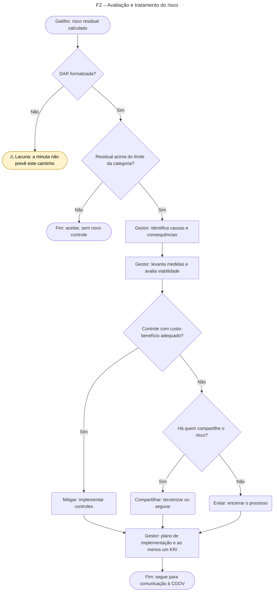

# F2 — Avaliação e tratamento do risco

> **Versão:** F2 v1, conferido em 20/11/2026 (sem alteração).
> **Fonte:** diagrama [[02_F2_avaliacao-tratamento]] (`docs/01-normativos/revisao-2026/fluxos-origem/02_F2_avaliacao-tratamento.mmd`); análise em [[Modelagem_Fluxos_Gestao_Riscos_2026-11-20]], §2 (SP3 e SP4) e §3 (F2).
> **Situação normativa:** modela o **texto da minuta** da Metodologia (itens 4.4, 4.5 e "Tabela 8", que na minuta é o quadro das respostas). Nenhum alerta do F2 foi decidido: **F2-01 a F2-05 estão abertos** ([[registro-alertas-f4-f5]]). Continua válido que o risco acima do limite é o risco crítico, que exige KRI (F4-01, resolvido no texto saneado).
> Volta ao [[mapa-processos]].

## Para que serve este fluxo

Detalha o passo F1.05 e o F1.06 do [[F1-ciclo-gestao-riscos]]: com o residual calculado, o gestor compara com o limite da categoria na DAR. Se o risco está dentro do apetite, aceita. Se está fora (risco crítico), escolhe uma resposta (mitigar, compartilhar ou evitar), monta o plano de implementação e define ao menos um KRI.

## Diagrama (copiado do `.mmd`, sem alteração)

## Atividades

> Numeração atribuída nesta documentação (não há tabela oficial).

Ordem: a dos nós do diagrama no caminho do fluxo (`A1` a `A11`); o gatilho `A0` e os fins `A3`, `A12` e `A_TRAVA` não são atividades. Entrada e Saída foram derivadas do texto dos nós e marcadas "(derivado)". Executor: em todos os passos, o gestor de riscos (1ª linha), conforme os nós e a Política, art. 17, I.

| Atividade (Fn.NN) | Executor | Entrada | Saída | Regra (Política art./Metodologia item) | Prazo |
| --- | --- | --- | --- | --- | --- |
| **F2.01** Decisão: DAR formalizada? (`A1`) | Gestor de riscos | Residual calculado (derivado) | Sim: segue. Não: caminho sem previsão na minuta (derivado) | Política art. 8º, § 1º; Metodologia 4.6 ("quando este estiver formalizado") | — |
| **F2.02** Decisão: residual acima do limite da categoria? (`A2`) | Gestor de riscos | Residual e apetite da categoria (derivado) | Não: aceitar, sem novo controle. Sim: risco crítico, segue ao tratamento (derivado) | Metodologia 4.4 e Anexo III | — |
| **F2.03** Identificar causas e consequências (`A4`) | Gestor de riscos | Risco crítico (derivado) | Causas e consequências a tratar (derivado) | Metodologia 4.5 | ⚠️ não há (F1-03) |
| **F2.04** Levantar medidas e avaliar a viabilidade (`A5`) | Gestor de riscos | Causas e consequências (derivado) | Medidas possíveis, com viabilidade avaliada (derivado) | Metodologia 4.5 | ⚠️ não há (F1-03) |
| **F2.05** Decisão: controle com custo-benefício adequado? (`A6`) | Gestor de riscos | Medidas avaliadas (derivado) | Sim: mitigar. Não: verificar compartilhamento (derivado) | Metodologia 4.5.1 ("Tabela 8") | — |
| **F2.06** Mitigar: implementar controles (`A7`) | Gestor de riscos | Medida viável (derivado) | Resposta "Mitigar" escolhida (derivado) | Metodologia 4.5.1 ("Tabela 8") | — |
| **F2.07** Decisão: há quem compartilhe o risco? (`A8`) | Gestor de riscos | Medida sem custo-benefício (derivado) | Sim: compartilhar. Não: evitar (derivado) | Metodologia 4.5.1 ("Tabela 8") | — |
| **F2.08** Compartilhar: terceirizar ou segurar (`A9`) | Gestor de riscos | Parceiro para o risco (derivado) | Resposta "Compartilhar" escolhida (derivado) | Metodologia 4.5.1 ("Tabela 8") | — |
| **F2.09** Evitar: encerrar o processo (`A10`) | Gestor de riscos | Nenhuma resposta viável (derivado) | Resposta "Evitar" escolhida (derivado) | Metodologia 4.5.1 ("Tabela 8"); ⚠️ sem alçada (F2-05) | — |
| **F2.10** Plano de implementação e ao menos um KRI (`A11`) | Gestor de riscos | Resposta escolhida (derivado) | Plano de implementação e KRI; segue para a comunicação à CGOV (Metodologia 4.6.1) (derivado) | Metodologia 4.5 e 4.7.1; Política art. 8º, § 2º | ⚠️ não há (F1-03; F4-10 para risco que passa a ser crítico depois) |

## Alertas e lacunas

| Alerta | Onde pega | Situação ([[registro-alertas-f4-f5]]) |
| --- | --- | --- |
| **F2-01** A avaliação compara o nível errado (o 4.4 fala da matriz, que é o inerente) | F2.02 | aberto |
| **F2-02** Limite por categoria e binário; categoria sem apetite sem regra | F2.01, F2.02 | aberto |
| **F2-03** Faixa sem classificação (residual entre 0,5 e 0,9) | F2.02 | aberto |
| **F2-04** Eficácia do controle autodeclarada; trava "sem evidência, no máximo Fraco" sem base literal | antes do F2.01 (cálculo do residual) | aberto |
| **F2-05** Sem saída para risco acima do limite com todas as respostas inviáveis; sem alçada para "Evitar" | F2.05 a F2.09 | aberto |
| **F1-02** DAR sem regra de transição (nó `A_TRAVA`) | F2.01 | aberto |
| **LS-03** Aceitação excepcional e alçada para "Evitar" | F2.09 | aberto |

Lacunas norma × sistema (diagnóstico §5.4): **LAC-03** (KRI obrigatório para risco crítico) em F2.10; **LAC-08** (rito da DAR) em F2.01. O passo seguinte ao F2.10 é a comunicação à CGOV (F3.02); no sistema, antes dela, o risco passa pelo [[FS-01-validacao-interna-risco]] (**LAC-11**).
