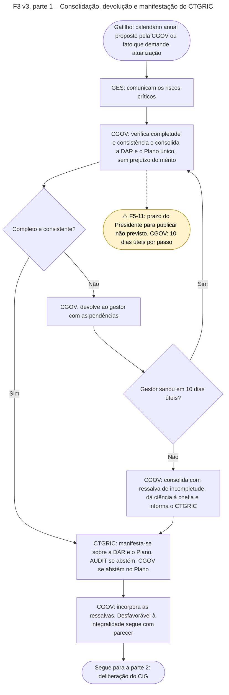
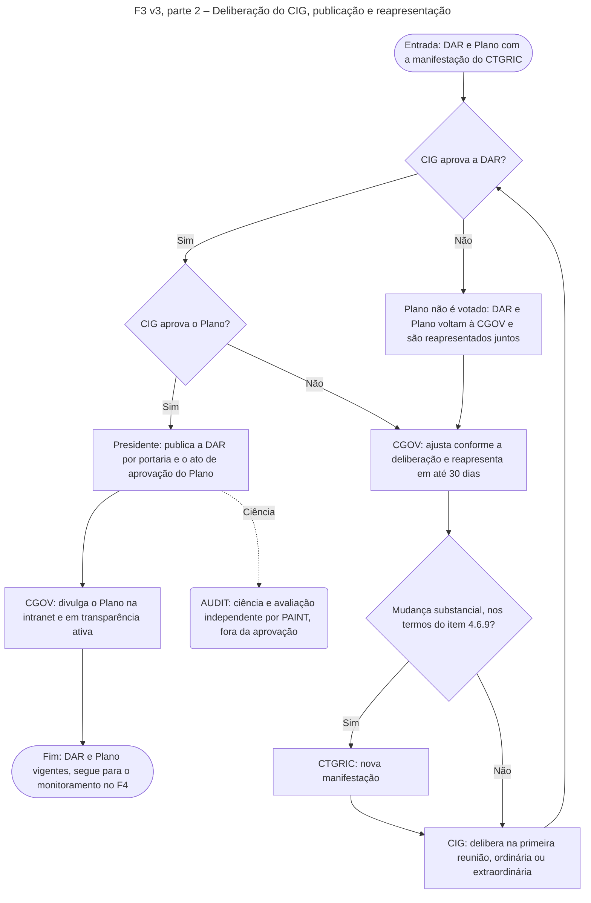
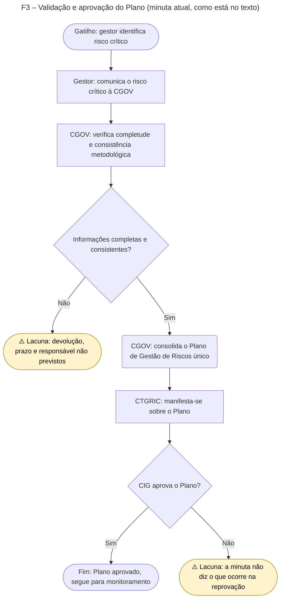

# F3 — Aprovação e publicação da DAR e do Plano de Gestão de Riscos

> **Versão:** F3 v3, de 20/11/2026, em duas partes (substitui o F3 v1 e o F3 v2).
> **Fonte:** diagramas [[04_F3_v3_parte1_consolidacao-devolucao-CTGRIC]] e [[05_F3_v3_parte2_CIG-publicacao-reapresentacao]] (pasta `docs/01-normativos/revisao-2026/fluxos-origem/`); tabela de passos em [[Modelagem_F4_v2_e_F3_v3_2026-11-20]], §7 (passos 1 a 15); atores no §6; alertas no §8.
> **Situação normativa:** modela o **texto saneado** ([[Saneamento_Legistica_Aprovacao_Plano_DAR_2026-11-20]], seção 3) **mais as escolhas de 20/11/2026 que ainda não foram aplicadas ao texto** (fonte, §11): **F5-11** (10 dias úteis por passo da CGOV), **F5-13** (o Plano só é votado se a DAR for aprovada) e **F5-15** (reunião extraordinária a pedido da CGOV), todos "decidido, não aplicado" no [[registro-alertas-f4-f5]]. É fluxo-alvo (TO-BE), não o texto da minuta de 15/09 (este está na última seção). A DAR tramita junto com o Plano: por isso não existe fluxo separado da DAR (diagnóstico §5.2, sem F-05).
> Volta ao [[mapa-processos]].

## Para que serve este fluxo

Começa quando os gestores comunicam os riscos críticos à CGOV (Metodologia 4.6.1) e termina com a DAR e o Plano vigentes, publicados pelo Presidente. No meio: a CGOV verifica e consolida (com devolução ao gestor ou ressalva), o CTGRIC se manifesta, o CIG delibera a DAR e depois o Plano, e, se não aprovar, a CGOV ajusta e reapresenta em até 30 dias.

## Diagrama — parte 1: consolidação, devolução e CTGRIC (copiado do `.mmd`, sem alteração)

## Diagrama — parte 2: CIG, publicação e reapresentação (copiado do `.mmd`, sem alteração)

## Atividades

`F3.NN` = passo NN da tabela oficial ([[Modelagem_F4_v2_e_F3_v3_2026-11-20]], §7). Ator, ação, dispositivo e prazo são os da tabela. A tabela oficial **não tem** Entrada nem Saída: essas células foram derivadas do texto do passo e dos diagramas e vão marcadas "(derivado)". Entre parênteses, o nó do diagrama (p1 = parte 1; p2 = parte 2). O passo 7 não tem nó próprio: é a seta que leva ao `CTG` da parte 1.

| Atividade (Fn.NN) | Executor | Entrada | Saída | Regra (Política art./Metodologia item) | Prazo |
| --- | --- | --- | --- | --- | --- |
| **F3.01** Propõe ao CTGRIC e ao CIG, no início do ano, o calendário das reuniões ordinárias, com o CTGRIC antes do CIG no mesmo trimestre (p1 `GAT`) | CGOV | Início do ano (derivado) | Calendário anual das reuniões (derivado) | Metodologia 4.6.11 | anual |
| **F3.02** Comunicam os riscos críticos (p1 `GES`) | Gestores de riscos | Riscos críticos com tratamento e KRI (saída do F2.10) (derivado) | Comunicação dos riscos críticos à CGOV (derivado) | Metodologia 4.6.1; Política art. 17, II | ⚠️ não há (F5-11) |
| **F3.03** Verifica completude e consistência e consolida a DAR e o Plano único, sem prejuízo do mérito (p1 `CGOV1`, `D1`) | CGOV | Comunicações dos gestores (derivado) | Minuta da DAR e Plano consolidado, ou pendências (derivado) | Metodologia 4.6.2 | 10 dias úteis (decisão de 20/11/2026, F5-11) |
| **F3.04** Constatada incompletude ou inconsistência, devolve o risco ao gestor, com as pendências (p1 `DEV`) | CGOV | Risco incompleto ou inconsistente (derivado) | Risco devolvido com a lista de pendências (derivado) | Metodologia 4.6.3 | — |
| **F3.05** Sana as pendências (p1 `D2`) | Gestor de riscos | Risco devolvido com pendências (derivado) | Risco corrigido, de volta à verificação (F3.03) (derivado) | Metodologia 4.6.3 | 10 dias úteis |
| **F3.06** Não sanadas: consolida o risco com ressalva de incompletude, dá ciência à chefia imediata e informa o CTGRIC (p1 `RESS`) | CGOV | Pendência não sanada no prazo (derivado) | Risco no Plano com ressalva; ciência à chefia; informação ao CTGRIC (derivado) | Metodologia 4.6.3 | 10 dias úteis (decisão de 20/11/2026, F5-11) |
| **F3.07** Encaminha ao CTGRIC a minuta da DAR e o Plano consolidado (p1, seta para `CTG`) | CGOV | Minuta da DAR e Plano consolidado (derivado) | Pauta do CTGRIC (derivado) | Metodologia 4.6.4 | 10 dias úteis (decisão de 20/11/2026, F5-11) |
| **F3.08** Manifesta-se. A CGOV se abstém no Plano; a AUDIT, na DAR e no Plano (p1 `CTG`) | CTGRIC | Minuta da DAR e Plano (derivado) | Manifestação, com ressalvas ou desfavorável (derivado) | Política art. 13, §§ 1º a 3º | reunião trimestral |
| **F3.09** Incorpora as ressalvas. A manifestação desfavorável à integralidade segue com o parecer (p1 `RES`) | CGOV | Manifestação do CTGRIC (derivado) | DAR e Plano com a manifestação, prontos para o CIG (derivado) | Metodologia 4.6.5 | 10 dias úteis (decisão de 20/11/2026, F5-11) |
| **F3.10** Delibera, na mesma reunião e em votações sucessivas, sobre a DAR e depois sobre o Plano (p2 `CIG1`, `CIG2`, `SUSP`) | CIG | DAR e Plano com a manifestação do CTGRIC (derivado) | DAR e Plano aprovados; ou reprovados (DAR reprovada: o Plano não é votado, F5-13) (derivado) | Metodologia 4.6.6; Política art. 12, XI | reunião trimestral |
| **F3.11** Publica a DAR por portaria e o ato de aprovação do Plano (p2 `PRES`) | Presidente do ICMBio | DAR e Plano aprovados pelo CIG (derivado) | Portaria da DAR e ato de aprovação do Plano (derivado) | Metodologia 4.6.7 | ⚠️ não há (F5-11, prazo do Presidente aberto) |
| **F3.12** Divulga o Plano na intranet e em transparência ativa (p2 `DIV`) | CGOV | Plano publicado (derivado) | Plano divulgado; DAR e Plano vigentes, segue ao F4 (derivado) | Metodologia 4.6.7 | 10 dias úteis (decisão de 20/11/2026, F5-11) |
| **F3.13** Não aprovados: ajusta conforme a deliberação e reapresenta (p2 `AJU`) | CGOV | Deliberação de reprovação do CIG (derivado) | DAR e Plano ajustados (derivado) | Metodologia 4.6.8 | 30 dias |
| **F3.14** A reapresentação volta ao CTGRIC só se a mudança for substancial (4.6.9, I a III); o CIG pode reclassificar (p2 `D3`, `CTG`, `CIGN`) | CGOV | DAR e Plano ajustados (derivado) | Nova manifestação do CTGRIC (se substancial) e nova deliberação do CIG (volta ao F3.10) (derivado) | Metodologia 4.6.9 | primeira reunião subsequente do CIG |
| **F3.15** Ciência; avalia por PAINT (p2 `AUD`) | AUDIT | Ato de aprovação publicado (derivado) | Avaliação independente, se priorizada no PAINT, fora da aprovação (derivado) | Política art. 16 | conforme o PAINT |

## Alertas e lacunas

| Alerta | Onde pega | Situação ([[registro-alertas-f4-f5]]) |
| --- | --- | --- |
| **F5-11** Só o gestor tinha prazo; a CGOV passa a ter 10 dias úteis por passo; o Presidente segue sem prazo | F3.02, F3.03, F3.06, F3.07, F3.09, F3.11, F3.12 | decidido, não aplicado |
| **F5-12** O laço de devolução não diz quantas vezes pode ocorrer | F3.04, F3.05 | aberto |
| **F5-13** DAR reprovada e destino do Plano na mesma reunião | F3.10 (`SUSP`) | decidido, não aplicado |
| **F5-14** "Mudança substancial" definida só para a reapresentação | F3.14 | aberto |
| **F5-15** Todo risco crítico novo ou excluído depende do CTGRIC e do CIG | F3.14 (e revisão no F4.12) | decidido, não aplicado |
| **F5-16** Abstenção da CGOV só no Plano; quórum não conferido | F3.08 | aberto |
| **F5-17** Efeito da ressalva de incompletude fora do fluxo | F3.06 | aberto |
| **F5-08b** Falta o modelo de portaria que aprova o Plano no Anexo III | F3.11 | aberto |
| **F5-09b** A Portaria nº 4.529/2025 mantém o voto pleno da AUDIT | F3.08 | fora das minutas |
| **F3-01** CTGRIC fora do item 4.6 (leitura da 4.529 vai à PFE, L-13) | F3.07 a F3.09 | decidido, não aplicado |
| **F3-04** O fluxo do aplicativo (3 degraus) não tem base nas minutas | antes do F3.02 | aberto |
| **LS-02** Elaboração e rito da DAR | F3.03, F3.07, F3.10, F3.11 | decidido, não aplicado |
| **LS-05** Revisão do Plano e riscos emergentes | F3.14 | decidido, não aplicado |

Resolvidos no texto saneado e já refletidos no fluxo: F5-01, F5-01b, F5-02, F5-03, F5-03b, F5-04, F5-05, F5-06, F5-07, F5-08, F5-09, F5-10, F3-02 e F3-03.

Lacunas norma × sistema (diagnóstico §5.4): **LAC-01** (carteira, consolidação, devolução, ressalva, versões e calendário) em F3.01 a F3.06; **LAC-02** (CTGRIC, CIG, publicação e reapresentação) em F3.07 a F3.14; **LAC-08** (rito da DAR; hoje a CGOV altera o apetite direto em `/dar`) em F3.03, F3.07, F3.10 e F3.11; **LAC-11** (fluxo interno de 3 degraus, [[FS-01-validacao-interna-risco]]) antes do F3.02.

## Versão da minuta de 15/09 (histórico)

Retrato fiel do item 4.6 da minuta, **antes** das correções: sem devolução, sem CTGRIC no 4.6 e sem saída para a reprovação. Serve só de comparação com o F3 v3; não gera atividades. Fonte: [[03_F3_minuta-atual]] (F3 v1, conferido em 20/11/2026); alertas F3-01 a F3-04 em [[Modelagem_Fluxos_Gestao_Riscos_2026-11-20]], §3.

