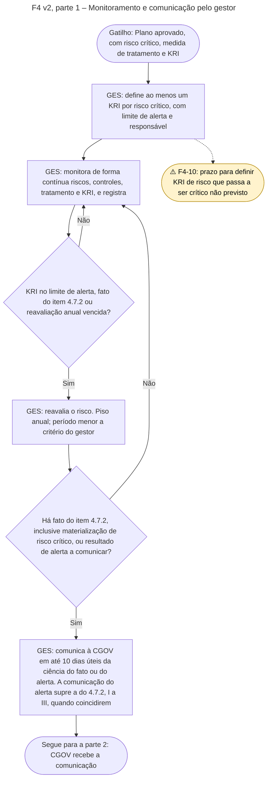
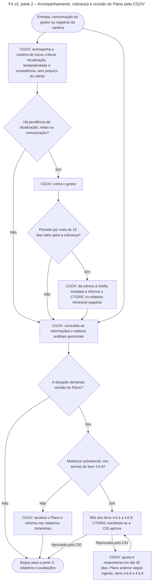
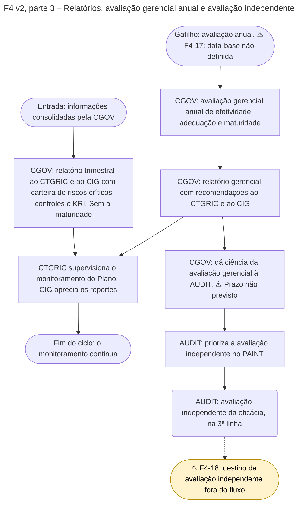

# F4 — Monitoramento, relato e avaliação

> **Versão:** F4 v2, de 20/11/2026 (L-40 aplicado), em três partes (substitui o F4 da seção 6 de [[Modelagem_Fluxos_Gestao_Riscos_2026-11-20]]).
> **Fonte:** diagramas [[06_F4_v2_parte1_monitoramento-comunicacao-gestor]], [[07_F4_v2_parte2_acompanhamento-cobranca-revisao-CGOV]] e [[08_F4_v2_parte3_relatorios-avaliacao-anual]] (pasta `docs/01-normativos/revisao-2026/fluxos-origem/`); tabela de passos em [[Modelagem_F4_v2_e_F3_v3_2026-11-20]], §2 (passos 1 a 17); atores no §1; alertas no §3.
> **Situação normativa:** modela o **texto saneado** ([[Saneamento_Legistica_F4-05_a_F4-09_2026-11-20]], seção 3) **mais as escolhas de 20/11/2026 que ainda não foram aplicadas ao texto** (fonte, §11): **F4-14** (a CGOV decide sobre a revisão do Plano em 10 dias úteis) e **F4-15** (revisão substancial reprovada segue o 4.6.8 e o 4.6.9, com o Plano anterior vigente), ambos "decidido, não aplicado" no [[registro-alertas-f4-f5]]. É fluxo-alvo (TO-BE). A avaliação anual faz parte deste fluxo (parte 3): por isso não existe fluxo separado da avaliação (diagnóstico §5.2, sem F-06).
> Volta ao [[mapa-processos]].

## Para que serve este fluxo

Começa com o Plano aprovado ([[F3-aprovacao-dar-plano]], F3.12) e **não tem fim**: é um ciclo contínuo (Metodologia 4.7). O gestor monitora, reavalia e comunica (parte 1); a CGOV acompanha a carteira de riscos críticos, cobra pendências e decide se o Plano precisa de revisão (parte 2); a CGOV relata por trimestre, faz a avaliação gerencial anual e dá ciência à AUDIT (parte 3). A revisão substancial do Plano volta ao rito do F3.

## Diagrama — parte 1: monitoramento e comunicação pelo gestor (copiado do `.mmd`, sem alteração)

## Diagrama — parte 2: acompanhamento, cobrança e revisão do Plano pela CGOV (copiado do `.mmd`, sem alteração)

## Diagrama — parte 3: relatórios, avaliação gerencial anual e avaliação independente (copiado do `.mmd`, sem alteração)

## Atividades

`F4.NN` = passo NN da tabela oficial ([[Modelagem_F4_v2_e_F3_v3_2026-11-20]], §2). Ator, ação, dispositivo e prazo são os da tabela. A tabela oficial **não tem** Entrada nem Saída: essas células foram derivadas do texto do passo e dos diagramas e vão marcadas "(derivado)". Entre parênteses, o nó do diagrama (p1, p2, p3 = partes 1, 2 e 3). Dispositivo sem "Política" é item da Metodologia.

| Atividade (Fn.NN) | Executor | Entrada | Saída | Regra (Política art./Metodologia item) | Prazo |
| --- | --- | --- | --- | --- | --- |
| **F4.01** Define ao menos um KRI por risco crítico (métrica, fonte, periodicidade de monitoramento, limite de alerta, responsável) (p1 `G1`) | Gestor de riscos | Risco crítico do Plano aprovado (derivado) | KRI cadastrado com limite de alerta e responsável (derivado) | Metodologia 4.7.1 e alíneas a) a f) | ⚠️ não há (F4-10) |
| **F4.02** Monitora de forma contínua riscos, controles, tratamento e KRI; registra e mantém atualizado (p1 `G2`) | Gestor de riscos | Riscos, controles, tratamento e KRI (derivado) | Registros e medições atualizados (derivado) | Metodologia 4.7, 3º parágrafo; 4.7.2, 1º parágrafo | contínuo |
| **F4.03** Reavalia cada risco registrado ao menos uma vez por ano, antes se houver fato do 4.7.2; pode fixar período menor (p1 `D1`, `G3`) | Gestor de riscos | Reavaliação anual vencida ou fato do 4.7.2 (derivado) | Risco reavaliado (derivado) | Metodologia 4.7 (caput do rol e novo parágrafo) | anual (piso) |
| **F4.04** KRI acima do limite de alerta: reavalia o risco e comunica o resultado à CGOV (p1 `D1`, `G3`, `G4`) | Gestor de riscos | KRI no limite de alerta (derivado) | Risco reavaliado e comunicação do resultado à CGOV (derivado) | Metodologia 4.7.1, parágrafo do alerta | 10 dias úteis (⚠️ contagem aberta, F4-11; o L-40 conta da ciência do alerta) |
| **F4.05** Comunica à CGOV as hipóteses I a VI: mudança do residual (Quadro 8) ou do enquadramento no apetite; falha em controle de risco crítico que o reduza no Quadro 6; materialização de risco crítico; risco emergente; atraso no tratamento; situação que demande revisão do Plano (p1 `D2`, `G4`) | Gestor de riscos | Fato de uma das 6 hipóteses (derivado) | Comunicação à CGOV (entrada da parte 2) (derivado) | Metodologia 4.7.2, caput e I a VI | 10 dias úteis da ciência do fato |
| **F4.06** Acompanha a carteira de riscos críticos: atualização, tempestividade e consistência, sem prejuízo do mérito (p2 `C2`) | CGOV | Comunicações do gestor e registros da carteira (derivado) | Pendências identificadas, se houver (derivado) | Política art. 15, IX | ⚠️ sem periodicidade (F4-12) |
| **F4.07** Cobra as pendências de atualização, relato e comunicação (p2 `D1`, `C3`) | CGOV | Pendência identificada (derivado) | Cobrança ao gestor (derivado) | Metodologia 4.7.2, novo parágrafo | ⚠️ sem prazo para cobrar (F4-12) |
| **F4.08** Persistindo a pendência por mais de 10 dias úteis após a cobrança: dá ciência à chefia imediata e informa o CTGRIC no relatório trimestral seguinte (p2 `D2`, `C4`) | CGOV | Pendência não resolvida após a cobrança (derivado) | Ciência à chefia imediata; registro para o relatório trimestral (derivado) | Metodologia 4.7.2, novo parágrafo | 10 dias úteis; informação em até um trimestre (F4-16) |
| **F4.09** Consolida as informações e elabora análises gerenciais (p2 `C1`) | CGOV | Comunicações e registros da carteira (derivado) | Informações consolidadas e análises gerenciais (derivado) | Metodologia 4.7.2 | ⚠️ não há |
| **F4.10** Decide se a situação demanda revisão do Plano (p2 `D3`) | CGOV | Informações consolidadas (derivado) | Decisão registrada: sem revisão, revisão não substancial ou substancial (derivado) | Metodologia 4.7.2, último parágrafo | 10 dias úteis (decisão de 20/11/2026, F4-14) |
| **F4.11** Revisão não substancial: atualiza o Plano e informa nos relatórios trimestrais (p2 `D4`, `C5`) | CGOV | Decisão de revisão não substancial (derivado) | Plano atualizado (derivado) | Metodologia 4.7.2; Política art. 9º | trimestral |
| **F4.12** Revisão substancial (critérios do 4.6.9): rito dos itens 4.6.4 a 4.6.9 (CTGRIC manifesta-se; CIG aprova; reprovada, a CGOV ajusta e reapresenta em 30 dias, com o Plano anterior vigente) (p2 `D4`, `REV`, `RJ`) | CGOV, CTGRIC e CIG | Decisão de revisão substancial (derivado) | Revisão aprovada (volta ao rito do [[F3-aprovacao-dar-plano]], F3.07 a F3.14) ou reapresentação (derivado) | Metodologia 4.7.2, último parágrafo | calendário do CTGRIC e do CIG; reprovação pelo 4.6.8 e 4.6.9 (decisão de 20/11/2026, F4-15) |
| **F4.13** Relatório trimestral ao CTGRIC e ao CIG: carteira de riscos críticos, controles e KRI. A maturidade não entra (p3 `R1`) | CGOV | Informações consolidadas (derivado) | Relatório trimestral (derivado) | Metodologia 4.7.2 | trimestral |
| **F4.14** O CTGRIC supervisiona o monitoramento do Plano; ambos apreciam os reportes (p3 `INST`) | CTGRIC e CIG | Relatórios trimestrais e relatório gerencial anual (derivado) | Reportes apreciados (derivado) | Política arts. 12, XII, e 13, II e VI | reuniões trimestrais |
| **F4.15** Avaliação gerencial anual de efetividade, adequação e maturidade; relatório com recomendações ao CTGRIC e ao CIG (p3 `GA`, `A1`, `A2`) | CGOV | Dados do ano da gestão de riscos (derivado) | Relatório gerencial anual com recomendações (derivado) | Metodologia item 5, 1º e 2º parágrafos; Política art. 15, X | anual (⚠️ data-base não definida, F4-17) |
| **F4.16** Dá ciência da avaliação gerencial à AUDIT, para subsidiar o PAINT (p3 `A3`) | CGOV | Relatório gerencial anual (derivado) | Ciência à AUDIT (derivado) | Metodologia item 5, novo 3º parágrafo | ⚠️ não há (F4-17) |
| **F4.17** Prioriza no PAINT e faz a avaliação independente da eficácia da gestão de riscos (p3 `AU1`, `AU2`) | AUDIT | Ciência da avaliação gerencial (derivado) | Avaliação independente (destino fora do fluxo, F4-18) (derivado) | Política art. 16; Estatuto da AUDIT, arts. 4º, 6º e 8º, III | conforme o PAINT |

## Alertas e lacunas

| Alerta | Onde pega | Situação ([[registro-alertas-f4-f5]]) |
| --- | --- | --- |
| **F4-10** Prazo para definir o KRI do risco que passa a ser crítico | F4.01 | aberto |
| **F4-11** Dois relógios de 10 dias úteis para o mesmo fato | F4.04, F4.05 | resolvido no texto saneado (L-40) |
| **F4-12** A cobrança não tem gatilho nem periodicidade; a CGOV só cobra o que vê | F4.06, F4.07 | aberto |
| **F4-13** Acompanhamento só da carteira crítica; reavaliação anual de todo risco sem verificação | F4.03, F4.06 | aberto |
| **F4-14** Prazo da decisão da CGOV sobre a revisão do Plano | F4.10 | decidido, não aplicado |
| **F4-15** Revisão substancial reprovada sem desfecho | F4.12 | decidido, não aplicado |
| **F4-16** Pendência persistente chega ao CTGRIC só no relatório seguinte | F4.08 | aberto |
| **F4-17** Avaliação anual sem data-base; ciência à AUDIT sem prazo | F4.15, F4.16 | aberto |
| **F4-18** Destinatário da avaliação independente fora do fluxo | F4.17 | fora das minutas |
| **F5-14** Base de comparação da "mudança substancial" na revisão | F4.12 | aberto |
| **F5-15** Risco crítico novo depende do CTGRIC e do CIG | F4.12 | decidido, não aplicado |
| **LS-05** Revisão do Plano e riscos emergentes | F4.10 a F4.12 | decidido, não aplicado |
| **LS-06** Omissão do gestor sem consequência | F4.07, F4.08 | resolvido no texto saneado (gatilho segue aberto no F4-12) |

Resolvidos no texto saneado e já refletidos no fluxo: F4-01 a F4-09 e F4-11.

Lacunas norma × sistema (diagnóstico §5.4): **LAC-03** (KRI obrigatório, grupo de riscos correlatos, consequência do alerta) em F4.01 e F4.04; **LAC-04** (comunicação das 6 hipóteses em 10 dias úteis) em F4.05; **LAC-09** (acompanhamento e cobrança) em F4.06 a F4.08; **LAC-07** (revisão do Plano, substancial × ordinária) em F4.10 a F4.12; **LAC-05** (relatórios trimestrais) em F4.13; **LAC-06** (avaliação gerencial anual) em F4.15 e F4.16; **LAC-10** (reavaliação anual de todo risco) em F4.03.
