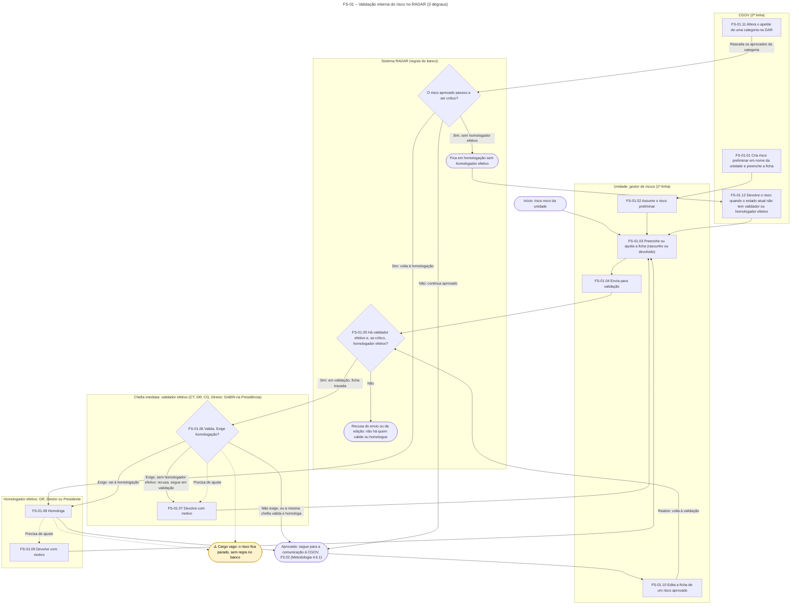

# FS-01 — Validação interna do risco no RADAR (3 degraus)

> **Origem: decisão da CGOV, sem base nas minutas (LAC-11).**
> Nenhum fluxo oficial (F1 a F4) prevê validação pela chefia nem homologação pelo diretor **risco a risco**. Pela norma, o gestor comunica os riscos críticos à CGOV (Metodologia 4.6.1) e a CGOV verifica e consolida (4.6.2). Os 3 degraus do RADAR vêm das decisões da CGOV: matriz P1 a P8 e P-B1-1 a P-B1-8 ([[matriz-acesso-responsabilidades]] §5, §6 linhas 4 e 5, e §9) e D1 "sobe um nível" ([[decisoes-tecnicas-b1]] §1 e §5, B11-1 a B11-9). O alerta **F3-04** ([[registro-alertas-f4-f5]]) pedia que a CGOV decidisse se este fluxo fica como etapa anterior ao 4.6.1 (diagnóstico §5.2, B2). **Decidido em 2026-11-22:** fica, como controle de qualidade da unidade ([[0018-manter-fluxo-interno-como-etapa-anterior-ao-4-6-1|ADR-0018]]).

> **Versão:** FS-01 v1, de 20/11/2026, derivada do banco tal como está.
> **Fonte:** migrações `supabase/migrations/20261115004_fluxo_aprovacao.sql`, `20261116001_fluxo_presidencia.sql`, `20261116003_preliminar_cgov.sql` e `20261116004_dar_reavalia_aprovados.sql` (e as políticas do preliminar em `20261115003`); testes pgTAP `supabase/tests/050_fluxo.test.sql`, `070_fluxo_presidencia.test.sql`, `072_preliminar_cgov.test.sql`, `073_dar_reavalia.test.sql` e `080_acoes_no_fluxo.test.sql`.
> **Situação normativa:** regra de sistema (procedimento do piloto), sem dispositivo nas minutas. Não há tabela oficial: a numeração `FS-01.NN` foi atribuída nesta documentação, na ordem do processo.
> Volta ao [[mapa-processos]].

## Para que serve este fluxo

É o caminho que uma ficha de risco percorre **dentro do RADAR** antes de entrar no Plano de Gestão de Riscos: a unidade (1ª linha) preenche e **envia**; a chefia imediata **valida** (2º degrau); se o risco é **crítico** (residual fora do apetite da DAR) ou a categoria ainda não tem apetite (`pendente_dar`), um homologador **homologa** (3º degrau). Quem enviou nunca valida nem homologa o próprio risco: o degrau **sobe um nível** (D1). Aqui se descreve o **processo de negócio, com os atores**; a máquina de estados técnica (`riscos.status_fluxo`) fica no nível 5 (Tarefa 17 do plano).

Estados citados: `preliminar_cgov`, `rascunho`, `em_validacao_cg`, `em_homologacao_dir`, `aprovado`, `devolvido`. Ações gravadas em `historico_fluxo.acao`: `assumido`, `submetido`, `validado`, `validado_e_homologado`, `homologado`, `devolvido_ajuste`, `reaberto_mudanca_nota` e `reaberto_mudanca_dar`.

## Diagrama

Desenhado nesta documentação a partir das migrações (não há `.mmd` oficial). Raias por perfil.

## Atividades

> Numeração atribuída nesta documentação (não há tabela oficial).

Não há dispositivo nas minutas para nenhuma destas atividades: a coluna "Regra" cita a decisão da CGOV, a **função SQL** e o bloco do **teste pgTAP** que prova o comportamento. Prazo: o banco não controla prazo em nenhum passo (a devolução de 10 dias úteis do F3.04/F3.05 é da CGOV na consolidação, não deste fluxo; ver LAC-01).

| Atividade (Fn.NN) | Executor | Entrada | Saída | Regra (Política art./Metodologia item) | Prazo |
| --- | --- | --- | --- | --- | --- |
| **FS-01.01** Criar risco preliminar em nome da unidade e preencher controles, tratamento, KRI e medições; pode apagá-lo enquanto preliminar | CGOV | Ficha preliminar importada (tela Importar) ou preenchida no aplicativo | Risco em `preliminar_cgov` | Decisão P-B1-5 e spec 7.1. Políticas "Riscos: cria no próprio objeto (CGOV: preliminar em qualquer um)" (`20261115003`), políticas dos filhos do preliminar (`20261116003`) e função `salvar_ficha_risco` (`20261117001`, aceita `preliminar_cgov` só da CGOV). Testes: `050` bloco 11; `072` blocos 1 a 6; `081` caso (f) | sem prazo |
| **FS-01.02** Assumir o risco preliminar como rascunho próprio (a CGOV perde a edição) | Unidade (titular ou gestor que grava no objeto) | Risco em `preliminar_cgov` | Risco em `rascunho`; histórico `assumido` | Metodologia 4.6 (o mérito é da 1ª linha), como citado na migração. Função `assumir_risco_preliminar` (`20261115004`). Testes: `050` bloco 11; `072` bloco 6 | sem prazo |
| **FS-01.03** Preencher ou ajustar a ficha (ficha livre; cálculo pelo gatilho dos Quadros 6, 7 e 8). Exclusão só aqui (D2) | Unidade | Risco novo, `rascunho` ou `devolvido` (com o motivo) | Ficha pronta para envio | Decisão D2 (exclusão só em `rascunho`, `devolvido` ou `preliminar_cgov`). Gatilho `fn_trava_reabertura_risco` (`20261115004`). Testes: `050` blocos 1 (rascunho livre), 8b (exclusão) e 10 (devolvido não travado) | sem prazo |
| **FS-01.04** Enviar para validação | Unidade | Ficha em `rascunho` ou `devolvido` | Risco em `em_validacao_cg`; histórico `submetido`; ficha **travada** | Função `enviar_para_validacao` (`20261115004`, recriada em `20261116001`). Recusa (55000): unidade sem chefia imediata (R18); quem envia é titular de todas as chefias acima (D1); risco crítico sem homologador efetivo (B11-8). Testes: `050` blocos 1, 8d, 10 (reenvio do `devolvido`) e 12; `070` bloco 5 | sem prazo |
| **FS-01.05** Definir quem valida e quem homologa: "sobe um nível" quando quem enviou é o titular; Presidência e Assessoria são validadas pelo GABIN e homologadas pelo Presidente | Sistema RADAR (banco) | Unidade do risco e quem o enviou | Validador e homologador **efetivos**, ou recusa | Decisões D1 e P-B1-1 (B11-7). Funções `fn_fluxo_validador_efetivo`, `fn_fluxo_homologador_efetivo` (`20261115004`, ajustada em `20261116001`), `chefia_imediata` e `homologador_de` (`20261116001`); trava `fn_fluxo_aplicar_trava`. Testes: `050` blocos 3 (trava) e 8d; `070` blocos 1 a 4 | automático |
| **FS-01.06** Validar (2º degrau). O banco recalcula a criticidade: não exige homologação → aprovado; validador e homologador efetivos iguais → aprovado ("mesma chefia"); senão → homologação; exige e não há homologador efetivo → **recusa e o risco segue em `em_validacao_cg`**: a mensagem manda o validador devolver (FS-01.07); a CGOV **não** pode devolver, porque o validador efetivo existe (`devolver_risco` responde 42501) | Titular (chefe ou substituto em exercício) do validador efetivo | Risco em `em_validacao_cg` | `aprovado` (`validado` ou `validado_e_homologado`), `em_homologacao_dir` (`validado`) ou recusa com o risco em `em_validacao_cg` | Decisão P4 e spec 7.1 ("exige homologação" = `is_critico` ou `pendente_dar`). Função `validar_risco` (`20261115004`, recriada em `20261116001`). Testes: `050` blocos 1, 4, 5, 6, 9, 10 e 10b; `070` blocos 2, 3, 4 e 5b | sem prazo |
| **FS-01.07** Devolver para ajuste, com motivo obrigatório | Titular do validador efetivo | Risco em `em_validacao_cg` (inclusive o que teve a validação recusada por falta de homologador efetivo) | Risco em `devolvido`; histórico `devolvido_ajuste` com o motivo; a unidade reenvia, por outro servidor se quem enviou era o titular do homologador | Função `devolver_risco` (`20261115004`, recriada em `20261116004`); mensagem de `validar_risco` (`20261116001`): "Devolva a ficha para que outro servidor da unidade a envie". Quem enviou não devolve (D1). Testes: `050` bloco 8d (recusa ao remetente); `080` (varredura de quem pode devolver) | sem prazo |
| **FS-01.08** Homologar (3º degrau) | Titular do homologador efetivo (Gerente Regional, Diretor ou Presidente) | Risco em `em_homologacao_dir` | Risco em `aprovado`; histórico `homologado` | Decisões P4 e P-B1-1. Função `homologar_risco` (`20261115004`). Testes: `050` blocos 1, 5 e 9; `070` bloco 3; `073` bloco 3b (homologa de novo depois da mudança da DAR) | sem prazo |
| **FS-01.09** Devolver para ajuste, com motivo obrigatório | Titular do homologador efetivo | Risco em `em_homologacao_dir` | Risco em `devolvido`; histórico `devolvido_ajuste` | Função `devolver_risco`. Testes: `050` bloco 10 (motivo vazio ou nulo recusado; validador não devolve em homologação; homologador devolve) | sem prazo |
| **FS-01.10** Editar a ficha de um risco aprovado (probabilidade, impacto, controles, tratamento, KRI, categoria ou objeto): o risco **reabre** e volta à validação; quem editou conta como quem enviou. Recusa se não houver validador, ou homologador quando crítico | Unidade | Risco em `aprovado` | Risco em `em_validacao_cg`; histórico `reaberto_mudanca_nota` | Decisão D1 (leitura ii). Funções `fn_trava_reabertura_risco` (gatilho `trg_riscos_trava_reabertura`), `fn_trava_reabertura_ficha` (gatilhos `trg_controles_trava_reabertura`, `trg_respostas_trava_reabertura` e `trg_kris_trava_reabertura`, nas tabelas filhas), `fn_fluxo_aplicar_trava` e `fn_fluxo_exigir_validador_na_reabertura` (`20261115004`; 3º parâmetro em `20261116001`). Testes: `050` blocos 2, 7, 8 e 8c; `070` blocos 5c e 5d | sem prazo |
| **FS-01.11** Alterar o apetite de uma categoria na DAR: o banco reavalia os riscos aprovados da categoria; o que **passa a ser crítico** volta à homologação; o que deixa de ser só tem a criticidade atualizada | CGOV (gatilho do banco reavalia) | Nova DAR da categoria (`categorias_risco.apetite_declarado`) | Riscos que passaram a ser críticos em `em_homologacao_dir`; histórico `reaberto_mudanca_dar` | Decisões P-B1-8, B11-5 e B11-6. Função `fn_dar_reavaliar_aprovados` e gatilho `trg_categorias_dar_reavalia_aprovados` (`20261116004`). Testes: `073` blocos 1 a 5; `050` bloco 10b (DAR muda com o risco em validação) e `070` bloco 5b | sem prazo |
| **FS-01.12** Devolver o risco que não tem ator efetivo no estado atual (sem homologador em homologação, ou sem validador em validação) | CGOV (perfil `cgov` ativo) | Risco preso em `em_homologacao_dir` ou `em_validacao_cg` | Risco em `devolvido`; a unidade reenvia, se preciso por outro servidor | Decisão B11-4. Função `devolver_risco` (`20261116004`). Teste: `073` bloco 3b (caso da homologação); o caso da validação **não tem teste** ([[decisoes-tecnicas-b1]] §5, pendência 2) | sem prazo |

## Caminhos de exceção que o banco já trata

| Exceção | Onde | Como o banco responde | Teste |
| --- | --- | --- | --- |
| Unidade sem chefia imediata na árvore | FS-01.04 | Recusa o envio (55000); a mensagem manda procurar a CGOV | sem teste próprio desde a P-B1-1 (a Presidência, antes o único caso, passou a ser validada pelo GABIN: `050` bloco 12) |
| Envio pelo próprio titular | FS-01.05 | Sobe um nível (D1); sem nível acima, recusa | `050` bloco 8d |
| Presidência e Assessoria | FS-01.05, FS-01.06, FS-01.08 | GABIN valida, Presidente homologa (P-B1-1); o Presidente nunca homologa o próprio risco | `070` blocos 2 a 5d |
| Risco preliminar da CGOV | FS-01.01, FS-01.02 | A CGOV prepara; a unidade assume | `050` bloco 11; `072` |
| Devolução | FS-01.07, FS-01.09 | Motivo obrigatório (22023); só o ator efetivo devolve (42501) | `050` blocos 8d e 10 |
| Reabertura por edição | FS-01.10 | Aprovado volta à validação | `050` blocos 2, 7, 8 e 8c; `070` 5c e 5d |
| Reabertura por mudança da DAR | FS-01.11 | Aprovado que passa a ser crítico volta à homologação (`reaberto_mudanca_dar`) | `073` blocos 3 a 5 |
| Sem homologador efetivo | FS-01.04, FS-01.06, FS-01.07, FS-01.11, FS-01.12 | **No envio:** recusa (55000), o risco fica onde estava (B11-8). **Na validação** (a DAR mudou durante a espera): recusa, o risco **segue em `em_validacao_cg`** e quem devolve é o **validador** (FS-01.07); a CGOV recebe 42501, porque há validador efetivo. **Na mudança da DAR com o risco aprovado:** o risco vai a `em_homologacao_dir` e fica lá até a **CGOV** devolver (B11-4, FS-01.12) | `070` blocos 5 e 5b; `073` bloco 3b |
| **Cargo vago** (unidade sem titular ativo) | FS-01.06, FS-01.08 | **Não tratado:** o validador ou homologador efetivo existe na árvore, mas ninguém é titular; o risco fica parado e a CGOV não pode devolver (só devolve quando não há ator efetivo) | sem teste ([[decisoes-tecnicas-b1]] §5, pendência 1: "delegação ou substituto") |

## Alertas e lacunas

- **LAC-11** — fluxo interno de 3 degraus sem base nas minutas; a CGOV decidiu, em 2026-11-22, que ele fica antes do 4.6.1, como controle de qualidade da unidade ([[0018-manter-fluxo-interno-como-etapa-anterior-ao-4-6-1|ADR-0018]]; diagnóstico §5.4).
- **F3-04** — "o fluxo do aplicativo não tem base nas minutas" (aberto, [[registro-alertas-f4-f5]]).
- **F3-02** (resolvido no texto saneado) — a devolução da norma é da CGOV na consolidação (F3.04), com 10 dias úteis; a devolução do RADAR é da chefia ou do homologador, sem prazo (impacto anotado no registro; LAC-01).
- **F5-12** (aberto) — o número de devoluções não é limitado (`devolver_risco`; LAC-01).
- **F2-04** e **LS-01** — a trava "sem evidência, no máximo Fraco (0,9)" é regra do sistema, aplicada pelo gatilho de cálculo antes do FS-01.04 (aberto).
- **F3-03** e **F5-07** (resolvidos no texto saneado) e **LAC-07** — a reabertura por edição (FS-01.10) não separa revisão substancial de ordinária.
- **F5-06** (resolvido no texto saneado) e **LAC-08** — a DAR é alterada pela CGOV direto em `/dar` (FS-01.11), sem CTGRIC nem CIG.
- Pendência sem ID: cargo vago trava o fluxo ([[decisoes-tecnicas-b1]] §5, pendência 1).
