# FS-02 — Análise de ato normativo pelas skills da CGOV e importação no RADAR

> **Origem: prática da CGOV com as skills do plugin `cgov-escritorio`; ferramenta da 2ª linha, sem base nas minutas como fluxo.**
> Nenhuma das minutas descreve este fluxo. O que o justifica é a competência da CGOV como 2ª linha na Política (minuta SEI `024241420`, art. 15): **inciso III**, "orientar tecnicamente os gestores de riscos quanto à identificação, análise, avaliação, tratamento e monitoramento de riscos", e **inciso I**, "elaborar e manter atualizados os instrumentos de Gestão de Riscos" (texto conferido em [[Minuta_Portaria_Politica_Gestao_Riscos_SEI_024241420]]). O inciso II (avaliação da maturidade) não se aplica aqui. A ficha que sai deste fluxo é **preliminar**: probabilidade e impacto ficam para o gestor de riscos validar (cgov-gestao-riscos §3.9, item 5).

> **Versão:** FS-02 v1, de 21/11/2026, derivada das skills e do código tal como estão nesta data.
> **Versão das skills lidas (as skills mudam):** `SKILL.md` lidos em 21/11/2026, só para consulta, na pasta do plugin `~/.claude/plugins/synced/…/cgov-escritorio/skills/`: `cgov-triagem-processo-sei`, `cgov-transcrever-normativos`, `cgov-nt-01-triagem`, `cgov-modelar-fluxo`, `cgov-auditoria-competencias`, `cgov-comparar-versoes`, `cgov-saneamento-legistica`, `cgov-cadeia-valor`, `cgov-integridade` e `cgov-gestao-riscos` (§0, §3.2, §3.3, §3.9 e §4); da `cgov-air-arr`, só a seção de uso como subsídio. Quando uma skill mudar, confira de novo a ordem e o "Contrato com o Importar".
> **Fonte do lado do RADAR:** `src/utils/importadorSkillMarkdown.ts`, `src/views/ImportadorSkillView.vue`, `src/stores/riscosStore.ts` (`importarMarkdownDaSkill`), `src/services/dados/conversores.ts` (`fichaDaSkillParaSalvar`) e `src/utils/calculadoraRiscoRadar.ts` (`validarRegraIntegridade`, `calcularRiscoCompletoRadar`); testes `tests/unit/importadorSkillMarkdown.spec.ts` e `tests/unit/importarPagina.spec.ts`; regras RN-033 e RN-104 ([[regras-negocio]]); decisão P5 ([[matriz-acesso-responsabilidades]]).
> **Situação normativa:** prática de trabalho, sem dispositivo nas minutas. A numeração `FS-02.NN` foi atribuída nesta documentação, na ordem do processo.
> Volta ao [[mapa-processos]].

## Para que serve este fluxo

Descreve como a CGOV parte de um **ato normativo do ICMBio** (portaria, instrução normativa ou minuta) e chega a **fichas preliminares de risco** dentro do RADAR. A análise é feita **fora do sistema**, por uma cadeia de skills do Claude (o "escritório virtual" da CGOV), com o analista decidindo nos pontos marcados. O RADAR só entra no fim: recebe a tabela pela tela **Importar**, confere, recalcula e grava as fichas no estado `preliminar_cgov`. Dali em diante vale o [[FS-01-validacao-interna-risco]] (FS-01.01 e FS-01.02).

Isto é coerente com a [[visao-produto]]: o RADAR **recebe** o produto da análise e **não executa a análise por inteligência artificial** (§1, "Problema"); e a §4, "Não-objetivos", exclui o "robô de IA dentro do site": a skill roda fora do sistema. A pergunta "onde fica o um clique" está no fim desta página, sem decisão.

**Como a ordem foi tirada das skills.** A ordem dos subsídios vem da `cgov-nt-01-triagem`, que é a porta de entrada de toda Nota Técnica da CGOV e, em análise de ato normativo, fixa cinco subsídios obrigatórios e a ordem deles (Passo 3.2 e "Encadeamento da suíte"): fluxos → competências → (cotejo de versões, se houver norma anterior) → legística → riscos → AIR. A `cgov-gestao-riscos` §3.9, item 1, confirma o lado da entrada: os insumos da análise de riscos são "os fluxos, as competências, a legística e os pontos jurídicos já levantados". Por isso a `cgov-nt-01-triagem` entrou na cadeia, embora não estivesse na lista inicial. **Tensão entre skills:** a descrição da `cgov-modelar-fluxo` diz que ela "costuma vir depois" da comparação de versões ou da auditoria de competências, o contrário da ordem da nt-01. O FS-02 segue a nt-01, porque ela diz "nesta ordem" e é a regra do roteiro de NT de ato normativo; a frase da modelar-fluxo descreve o uso avulso, e a própria seção "Como subsídio de Nota Técnica" dela manda não iniciar a auditoria nesta etapa. A `cgov-cadeia-valor` e a `cgov-integridade` **não** estão no roteiro da `cgov-nt-01`: entram por decisão do analista, e as skills não fixam a ordem delas em relação aos subsídios 1 a 3 (paralelo / ordem livre); só precisam vir antes dos riscos, porque a `cgov-integridade` (modo 4, item 3) manda a análise e a matriz para a `cgov-gestao-riscos`.

## Diagrama

Desenhado nesta documentação a partir das skills e do código (não há `.mmd` oficial). Raias: analista, skills, RADAR. Validado na ferramenta do Mermaid Chart em 21/11/2026.

```mermaid
---
title: FS-02 – Análise de ato normativo pelas skills da CGOV e importação no RADAR
---
flowchart TD
  INI(["Início: ato normativo ou minuta a analisar"])
  subgraph ANA["Analista da CGOV"]
    A01["FS-02.01 Recebe a demanda e escolhe o ato (decisão do analista)"]
    A04["FS-02.04 Valida o texto transcrito (decisão do analista)"]
    D10{"Usa a Cadeia de Valor? (decisão do analista)"}
    D11{"Roda a integridade? (decisão do analista)"}
    A12["FS-02.12 Declara o regime: B para o RADAR (decisão do analista)"]
    A14["FS-02.14 Revisa a matriz e salva o .md (decisão do analista)"]
    A15["FS-02.15 Cola ou envia a tabela na tela Importar"]
    A17["FS-02.17 Escolhe o objeto de destino"]
  end
  subgraph SKL["Skills (Claude, plugin cgov-escritorio)"]
    S02["FS-02.02 cgov-triagem-processo-sei: triagem e roteamento"]
    D03{"O texto é legível por máquina?"}
    S03["FS-02.03 cgov-transcrever-normativos: PDF para Markdown"]
    S05["FS-02.05 cgov-nt-01-triagem: enquadramento, roteiro e NT_ESTADO.md"]
    S06["FS-02.06 cgov-modelar-fluxo: fluxos e alertas"]
    S07["FS-02.07 cgov-auditoria-competencias: conflitos, lacunas e RACI"]
    D08{"Substitui norma vigente ou há versões em disputa?"}
    S08["FS-02.08 cgov-comparar-versoes: redação saneada"]
    S09["FS-02.09 cgov-saneamento-legistica: erros e texto limpo"]
    S10["FS-02.10 cgov-cadeia-valor: processo e SIPOC (ordem livre)"]
    S11["FS-02.11 cgov-integridade, modo 4: riscos para a integridade"]
    S13["FS-02.13 cgov-gestao-riscos §3.9 e §4: matriz do Regime B (16 colunas)"]
    NT(["A NT segue fora do FS-02: cgov-air-arr e capítulos nt-03 a nt-07"])
  end
  subgraph RAD["RADAR (perfil cgov)"]
    R16{"FS-02.16 Prévia: lê, valida e recalcula. Há erro?"}
    R18["FS-02.18 Grava cada linha como preliminar_cgov, com código do RADAR"]
    FIM(["Fim: fichas em preliminar_cgov; seguem no FS-01 (FS-01.01 e FS-01.02)"])
  end

  INI --> A01
  A01 -->|"chega por processo SEI"| S02
  A01 -->|"pedido direto de NT"| D03
  S02 --> D03
  D03 -->|"Não"| S03 --> A04 --> S05
  D03 -->|"Sim"| S05
  S05 --> S06 --> S07 --> D08
  D08 -->|"Sim"| S08 --> S09
  D08 -->|"Não"| S09
  S09 --> D10
  D10 -->|"Sim"| S10 --> D11
  D10 -->|"Não"| D11
  D11 -->|"Sim"| S11 --> A12
  D11 -->|"Não"| A12
  A12 --> S13
  S13 --> A14
  S13 -.-> NT
  A14 --> A15 --> R16
  R16 -->|"Sim: corrige a tabela"| A14
  R16 -->|"Não"| A17 --> R18 --> FIM
  R18 -.->|"linha recusada pelo banco: tenta de novo só as recusadas"| A17
```

No diagrama, a Cadeia de Valor (FS-02.10) aparece depois da legística só para não cruzar setas: pelas skills, ela pode rodar em qualquer ponto antes da integridade e dos riscos.

## Atividades

> Numeração atribuída nesta documentação. "(decisão do analista)" marca o ponto em que, hoje, uma pessoa escolhe. A coluna "Regra" cita o item da skill (ex.: "cgov-gestao-riscos §3.9, 2") ou a RN do RADAR.

| Atividade | Executor (pessoa ou skill) | Entrada | Saída | Regra | Observação |
| --- | --- | --- | --- | --- | --- |
| **FS-02.01** Receber a demanda e escolher o ato a analisar (decisão do analista) | Analista da CGOV | Processo SEI com o ato ou a minuta, ou pedido direto da Coordenação | Ato escolhido e caminho de entrada (por processo SEI ou direto para a NT) | cgov-nt-01-triagem, Fase 1 (objeto, processo, gatilho, destino) | Também decide o foco (só o conteúdo do ato ou também o trâmite), que a nt-01 manda registrar |
| **FS-02.02** Fazer a triagem do processo e rotear | Skill `cgov-triagem-processo-sei` | Autos do processo SEI | Metadados, objeto, competência no Art. 37 (sim, não ou parcial) e encaminhamento: para NT, a `cgov-nt-01-triagem` | cgov-triagem-processo-sei §1 (roteamento) e §2, Passos 0 a 6 | Só quando o ato chega por processo SEI (decisão do analista). O Passo 0 interrompe se o PDF não tiver texto legível |
| **FS-02.03** Transcrever o PDF para Markdown | Skill `cgov-transcrever-normativos` | PDF do ato (ou de norma de referência do acervo) sem camada de texto confiável | Arquivo `.md` fiel ao PDF, com frontmatter, nota editorial e relatório de revisão | cgov-transcrever-normativos §2 a §5 (OCR local, segunda revisão, barreira de qualidade) | Só se o texto não for legível por máquina. Ordem livre com o FS-02.02: a triagem pode apontar a necessidade, ou o analista transcreve antes. Processamento local: o acervo não vai a serviço externo (§ "Limites e segurança") |
| **FS-02.04** Validar o texto transcrito (decisão do analista) | Analista da CGOV | `.md` transcrito e relatório de revisão | Texto aceito como base da análise | cgov-transcrever-normativos §5 (gravação só depois da aprovação; não sobrescrever `.md` existente sem pedido) | A skill marca `[trecho ilegível no PDF]` quando não resolve a dúvida: quem decide seguir é o analista |
| **FS-02.05** Enquadrar a demanda e montar o roteiro | Skill `cgov-nt-01-triagem` | Ato, processo, destino do produto, existência de norma anterior | Ficha de Enquadramento (Tipo A), roteiro com os cinco subsídios e o arquivo `NT_ESTADO.md` na pasta do processo | cgov-nt-01-triagem, Passos 1 a 4 e Passo 3.2 | Só o Coordenador de Governança dispensa um subsídio, com registro no `NT_ESTADO.md` (Passo 3.2, "Dispensa") |
| **FS-02.06** Modelar os fluxos do ato | Skill `cgov-modelar-fluxo` | Texto do ato | Um fluxo por macroetapa (Mermaid), tabela de passos, veredito "o fluxo fecha?" e alertas `F1-01`… | cgov-modelar-fluxo, Fase 1 ("Como subsídio de Nota Técnica"); cgov-nt-01, Passo 3.2, subsídio 1 | Não começa a auditoria de competências: só indica os alertas a aprofundar nela |
| **FS-02.07** Auditar as competências | Skill `cgov-auditoria-competencias` | Texto do ato e alertas dos fluxos | Mapa de verbos (E/A/I), conflitos `C-NN`, lacunas `LS-NN` e Matriz RACI | cgov-auditoria-competencias, Fases 2 e 3; cgov-nt-01, Passo 3.2, subsídio 2 | Ordem fixa depois dos fluxos (cgov-nt-01, "Encadeamento da suíte") |
| **FS-02.08** Comparar versões e propor redação saneada | Skill `cgov-comparar-versoes` | Versões do dispositivo e manifestações das áreas | Análise da controvérsia e proposta de redação saneada | cgov-nt-01, Fase 1, pergunta 7, e Passo 3.2 | Só se o ato substituir norma vigente ou houver versões em disputa (decisão do analista, registrada na triagem) |
| **FS-02.09** Revisar a técnica legislativa | Skill `cgov-saneamento-legistica` | Texto do ato (ou o saneado do FS-02.08) | Relatório com erros `E-NN` e `L-NN` e texto limpo | cgov-saneamento-legistica, Fases 2 e 3; cgov-nt-01, Passo 3.2, subsídio 3 | Conflito com norma superior vira bloco "conflito hierárquico" com encaminhamento à PFE: é um dos "pontos jurídicos" que a análise de riscos usa |
| **FS-02.10** Localizar o processo na Cadeia de Valor (SIPOC) (decisão do analista) | Skill `cgov-cadeia-valor` | Cadeia de Valor vigente (fornecida pelo usuário) e o ato | Processo e macroprocesso afetados, SIPOC | cgov-cadeia-valor, Fases 2 e 3; ajuda a cgov-gestao-riscos §3.1 (objetos de gestão de riscos, Quadro 1) | Fora do roteiro da nt-01. Paralelo / ordem livre em relação aos FS-02.06 a FS-02.09; a skill não cria dado institucional sem base documental |
| **FS-02.11** Mapear os riscos para a integridade (decisão do analista) | Skill `cgov-integridade`, modo 4 (RISCOS_INTEGRIDADE) | Ato, processo da Cadeia de Valor afetado, Plano de Integridade | Por risco: subcategoria, processo, causa, evento, consequência e medida do Plano de Integridade que o cobre (ou lacuna) | cgov-integridade, modo 4, itens 1 a 3 | Opcional: o Teste de Integridade já é feito dentro da `cgov-gestao-riscos` (§3.2 e §3.9, 2). O item 3 manda a matriz para a `cgov-gestao-riscos` "Regime A", e o RADAR só lê o Regime B (ver FS-02.12) |
| **FS-02.12** Declarar o regime de cálculo (decisão do analista) | Analista da CGOV | Situação das minutas e destino do produto | Regime declarado; para importar no RADAR, **Regime B** | cgov-gestao-riscos §0 ("Como escolher") | Pela skill, análise de risco real usa o Regime A enquanto a RADAR não for publicada, e o B como simulação rotulada. O RADAR só calcula pelo Regime B. Ver "Alertas" |
| **FS-02.13** Analisar os riscos da aplicação do ato e entregar a matriz | Skill `cgov-gestao-riscos` | Fluxos, competências, legística, pontos jurídicos (e, se houver, Cadeia de Valor e riscos para a integridade) | Matriz do Regime B de 16 colunas (riscos `RSC-NN`), diagnóstico de conformidade, tratamento (medidas, bow tie, KRIs dos críticos) e síntese executiva | cgov-gestao-riscos §3.9, 1 a 5; §3.2 (sintaxe e Teste de Integridade); §3.3 (Quadros 4 a 8); §4, item 1 (colunas do Regime B) | Controles: só os previstos no ato ou comprovados nos autos; sem evidência, no máximo Fraco (§3.9, 3). Categoria Legal inclui vício de competência ou de rito (§3.9, 4). P e I são preliminares (§3.9, 5). Depois, pelo roteiro da nt-01, vem a `cgov-air-arr`, que usa esta matriz: fica fora do FS-02 |
| **FS-02.14** Revisar a matriz e salvar a tabela em `.md` (decisão do analista) | Analista da CGOV | Matriz da skill e, no retorno do FS-02.16, os erros da prévia | Tabela de 16 colunas pronta para o Importar, em arquivo `.md` ou `.txt` | cgov-triagem-processo-sei §4, 6 (revisão humana de toda minuta feita com IA); "Contrato com o Importar" abaixo | Hoje é aqui que o analista ajusta a tabela ao que o importador aceita (categoria, P e I em número). Esse ajuste à mão é o maior atrito da cadeia |
| **FS-02.15** Colar ou enviar a tabela na tela Importar | Analista da CGOV (perfil `cgov`) | Arquivo `.md`, `.txt` ou `.markdown`, ou texto colado | Texto na caixa da tela | RN-033 (só a CGOV importa em lote; decisão P5) | Rota `importar-skill`, só para o perfil `cgov` |
| **FS-02.16** Ver a prévia: ler, validar e recalcular (nada é gravado) | RADAR (`importarTabelaMarkdownSkill`) | Texto da tabela | Fichas recalculadas, **erros** (bloqueiam) e **avisos** (não bloqueiam) | RN-001 a RN-004 e RN-013 (recalcula pelos Quadros 6, 7 e 8, com a trava de evidência); RN-016 (categoria mista recusada) | **Qualquer erro bloqueia a importação inteira**: o botão só libera com zero erros. Com erro, o analista volta ao FS-02.14 |
| **FS-02.17** Escolher o objeto de destino | Analista da CGOV | Lista de objetos de unidades **ativas** | Objeto escolhido (obrigatório) | Spec B3 §5.3 (citada no código da tela) | A coluna "Objeto de GR" da tabela não é usada: todas as linhas vão para o objeto escolhido aqui |
| **FS-02.18** Gravar as fichas como preliminares da CGOV | RADAR (`importarMarkdownDaSkill` e `salvar_ficha_risco`) | Fichas da prévia e o objeto | Riscos em `preliminar_cgov`, com código do RADAR (o código `RSC-NN` da skill é descartado) | RN-104 (entra como preliminar da CGOV; decisões P5 e P-B1-5); RN-048 | Cada linha é gravada sozinha: se o banco recusar uma, as outras entram e a tela oferece "importar de novo só as recusadas". Segue no FS-01.01 e no FS-01.02 |

## Contrato de dados (o que cada passo entrega ao seguinte)

| De | Para | O que passa | Onde fica |
| --- | --- | --- | --- |
| FS-02.02 | FS-02.05 | Metadados do processo, objeto e competência (Art. 37) | Relatório de triagem, no chat |
| FS-02.03 e FS-02.04 | FS-02.05 em diante | Texto do ato em Markdown, fiel ao PDF | Acervo normativo (o rascunho da transcrição nunca é versionado) |
| FS-02.05 | FS-02.06 a FS-02.13 | Enquadramento, regime de trabalho, roteiro e decisões do projeto | `NT_ESTADO.md` na pasta de trabalho do processo |
| FS-02.06 | FS-02.07 e FS-02.13 | Fluxos, alertas `F1-NN`, desfechos sem saída | NT_ESTADO (achados) e arquivo do subsídio |
| FS-02.07 | FS-02.13 | Conflitos `C-NN`, lacunas `LS-NN`, RACI | Idem |
| FS-02.08 e FS-02.09 | FS-02.13 | Texto saneado, erros `E-NN`/`L-NN`, conflitos hierárquicos (pontos jurídicos) | Idem |
| FS-02.10 e FS-02.11 | FS-02.13 | Processo afetado (SIPOC) e riscos para a integridade com subcategoria | Idem |
| FS-02.13 | FS-02.14 | Matriz do Regime B (16 colunas), diagnóstico, tratamento e síntese | Chat e arquivo do subsídio |
| FS-02.14 | FS-02.15 e FS-02.16 | **Só a tabela de 16 colunas.** Diagnóstico, bow tie, medidas e síntese ficam de fora | Arquivo `.md` local do analista |
| FS-02.18 | FS-01.01 e FS-01.02 | Riscos em `preliminar_cgov` no objeto escolhido | Banco do RADAR |

## Contrato com o Importar

Conferido no código em 21/11/2026. O importador lê **por posição** (1ª coluna, 2ª coluna…), não pelo nome do cabeçalho. A ordem das 16 colunas que ele espera é a mesma do §4, item 1, da `cgov-gestao-riscos` para o Regime B.

### Coluna a coluna

| Coluna entregue pela skill (§4, Regime B) | Coluna/campo lido pelo importador | Situação (igual / diferente / a skill entrega e o importador ignora / o importador exige e a skill não entrega) |
| --- | --- | --- |
| 1. ID (`RSC-NN`, §3.9) | 1ª coluna → `codigoRadar` | **diferente:** aparece na prévia e nas mensagens de erro, mas é **descartado** ao gravar; o RADAR dá o próprio código. Se a 1ª célula for "ID", "Código" ou "Codigo", a linha é tratada como cabeçalho |
| 2. Objeto de GR | 2ª coluna → `nomeObjeto` | **a skill entrega e o importador ignora:** só aparece na prévia; o risco vai para o objeto escolhido no FS-02.17 |
| 3. Descrição na sintaxe ("Devido o(a) <causa>, poderá ocorrer o(a) <evento>, ocasionando o(a) <consequência> e impactando o alcance do <objetivo>", §3.2) | 3ª coluna → separada em causas, evento, consequências e objetivo | **igual**, com ressalva: se a frase não seguir o modelo, a linha **entra assim mesmo**, com um aviso, e o RADAR grava textos genéricos ("Identificado preliminarmente via análise normativa CGOV", "Impacto na conformidade ou execução do processo"…) como causa, consequência e objetivo, e a frase inteira como evento. A frase completa não é gravada, só as 4 partes |
| 4. Categoria | 4ª coluna → `categoriaNome`, conferida contra a lista do RADAR | **diferente (LAC-14):** a linha só passa se a categoria for, letra por letra, uma das 8 do RADAR. Das 8 da skill (Quadro 2 da minuta), só **Operacional** e **Integridade** passam. **Legal**, **Financeiro/Orçamentário**, **Reputação**, **Riscos da visitação**, **Ocupacionais** e **Privacidade e Proteção de Dados** viram **erro e bloqueiam a importação** (o RADAR tem "Conformidade/Legal", "Orçamentário/Financeiro", "Imagem/Reputação", e não tem as três últimas). A categoria mista proibida é recusada nos dois lados (RN-016) |
| 4a. Subcategoria (dentro da coluna Categoria, "se Integridade") | 4ª coluna, no formato `Integridade: <subcategoria>` | **diferente (LAC-15):** o importador só entende o separador dois-pontos. Com "Integridade: <texto>", aceita **qualquer texto** como subcategoria (não confere a lista). Com "Integridade" sozinho, atribui em silêncio a primeira da lista do RADAR ("Corrupção e Fraude"), que nem está no Quadro 3. Com outro formato (ex.: "Integridade (conflito de interesses)"), dá erro de categoria. As 6 subcategorias que a skill usa são as do Quadro 3 da minuta; a lista do RADAR é outra |
| 5. P | 5ª coluna → número de 1 a 5 | **diferente:** o importador lê só o número no começo da célula ("3" ou "3 (Provável)" funcionam). Se a skill escrever o nome do Quadro 4 sem número ("Provável", "Raro"), o importador usa **3 em silêncio, sem erro nem aviso**; número acima de 5 vira 5, negativo vira 1 e **0 vira 3** (o zero é tratado como célula vazia). Ligado à LAC-12 (rótulos da escala) |
| 6. I | 6ª coluna → número de 1 a 5 | **diferente:** mesma regra da P. "Muito alto" sem número vira **3 em silêncio** |
| 7. Inerente (célula do Quadro 7) | não lido (recalculado pelo Quadro 7) | **a skill entrega e o importador ignora.** O comentário da tela promete um aviso quando o número da skill difere do Quadro 7, mas o código **não compara**: a divergência passa sem aviso |
| 8. Classe | não lida (recalculada pelo Quadro 8) | **a skill entrega e o importador ignora** |
| 9. Controles e evidências | 9ª coluna → texto de **um** controle e "tem evidência?" | **diferente:** a evidência é **adivinhada por palavras**: "sem evidência", "sem registro", "inexistente" ou "informal" → sem evidência; caso contrário, há evidência se a eficácia for Mediano, Satisfatório ou Forte. Uma célula como "previsto no ato; funcionamento não comprovado" com "Mediano (0,75)" é lida **com** evidência, e a trava não age. As palavras-chave exigem acento: "sem evidencia", sem acento, com Mediano ou acima, também é lida **com** evidência. Todo o texto vira um único controle; o vazio ou "Inexistente" (só com essa grafia exata, maiúscula inicial) não cria controle; "inexistente" em minúsculas cria um controle com esse texto. A evidência gravada é um texto fixo ("Previsto no ato normativo analisado" ou "Sem evidência documental comprovada") |
| 10. Eficácia e fator | 10ª coluna → nível do Quadro 6 | **igual**, com ressalva: vale a primeira palavra ou fator encontrado, na ordem Forte/0,5 → Satisfatório/0,6 → Mediano/0,75 → Fraco/0,9; sem nenhum, Inexistente. Se a célula citar dois níveis, o primeiro da ordem vence. Depois, a trava de evidência (RN-004) é aplicada, mas o aviso da trava **não aparece** na prévia |
| 11. Residual | não lido (recalculado: inerente × fator) | **a skill entrega e o importador ignora** |
| 12. Classe residual | não lida (recalculada pelo Quadro 8, sem arredondar) | **a skill entrega e o importador ignora** |
| 13. Apetite da categoria | 13ª coluna → só para a memória de cálculo | **a skill entrega e o importador ignora:** a prévia e a gravação usam o apetite da categoria **na DAR do RADAR**; "baixo", "moderado" e "pendente…" são lidos, qualquer outro texto vira "pendente de DAR", mas o valor não é gravado |
| 14. Crítico? (sim / não / pendente de DAR) | não lido (recalculado frente à DAR do RADAR) | **a skill entrega e o importador ignora** |
| 15. Estratégia | 15ª coluna → Mitigar, Compartilhar, Evitar ou Aceitar | **igual** para os 4 nomes da skill (§3.5), com ressalva: célula vazia ou outro nome ("Reduzir", "Transferir", "—") vira **Mitigar em silêncio**. "Aceitar" em risco crítico é aceito (LAC-13) |
| 16. KRI | 16ª coluna → nome de um KRI | **diferente:** a skill define métrica, fórmula, fonte, periodicidade, meta, limite de alerta e responsável (§3.7); o importador lê só o nome e **inventa o resto** (fórmula "Definido preliminarmente via skill CGOV", fonte "SEI / Sistema Setorial", trimestral, meta "100%", alerta "< 80%"). Célula vazia gera o KRI "Indicador a definir com a 1ª Linha". Todo risco importado ganha um KRI, crítico ou não (ver LAC-03) |
| Linha do Teste de Integridade (sim/não e subcategoria, §3.9, 2) | nenhum campo (o importador chama a validação com "teste não aplicável") | **a skill entrega e o importador ignora:** a justificativa exigida quando o teste se aplica e o risco não é de Integridade (RN-018) não é cobrada na importação |
| Tratamento: medidas preventivas e atenuantes, bow tie (§4, item 3) | nenhum campo | **a skill entrega e o importador ignora:** só a estratégia entra; ações de tratamento não |
| Diagnóstico de conformidade e síntese executiva (§4, itens 2 e 4) | nenhum campo | **a skill entrega e o importador ignora** (ficam na NT) |
| — (a skill dá o objeto só como texto) | objeto de destino, de unidade ativa | **o importador exige e a skill não entrega:** escolhido à mão no FS-02.17 |
| — | responsável pelo risco | **o importador exige e a skill não entrega:** o RADAR grava "Ponto Focal 1ª Linha (A validar)" |

### Formato, validações e recusas do importador

- **Linhas lidas:** só as que começam e terminam com `|`. A linha separadora (`|---|`) é pulada. Linha com **menos de 10 colunas é ignorada sem aviso**; de 10 a 15 colunas, as que faltam recebem valor padrão (ex.: KRI "a definir"); colunas a mais são ignoradas.
- **Barra vertical dentro do texto** de uma célula desloca todas as colunas seguintes da linha.
- **Cabeçalho:** só é reconhecido se a 1ª célula for "ID", "Código" ou "Codigo". Outro cabeçalho de 10 ou mais colunas é lido como risco e dá erro de categoria.
- **Tabela do Regime A** (13 colunas, sem "Objeto de GR"): as colunas ficam deslocadas e a linha é recusada por categoria inválida, com mensagem que não fala de regime.
- **Erros (bloqueiam tudo):** categoria fora da lista do RADAR; categoria mista; Integridade sem subcategoria depois da leitura (na prática não ocorre, porque "Integridade" sozinho ganha a subcategoria padrão). Sem nenhuma linha válida e sem erro: "Nenhuma linha de risco encontrada".
- **Avisos (não bloqueiam):** só um tipo, a frase fora da sintaxe.
- **Silêncios (sem erro nem aviso):** P ou I sem número (vira 3), estratégia desconhecida (vira Mitigar), "Integridade" sem subcategoria (vira "Corrupção e Fraude"), evidência deduzida por palavra (com acento), trava de evidência acionada, inerente ou residual da skill diferente do recálculo.
- **Na gravação:** recusa do banco (ex.: permissão) recusa só aquela linha; a tela mostra "N de M importados" e oferece reimportar só as recusadas, sem duplicar as que entraram.
- **Nome da skill:** o código e a tela chamam a skill de `cgov-gestao-riscos-v4`; no plugin ela se chama `cgov-gestao-riscos`.

## Onde fica o clique (decisão pendente)

O objetivo de longo prazo do responsável é um serviço de análise de riscos "em um clique". Há duas alternativas. Esta página **não decide**: a escolha vai para um ADR (cartão no Backlog).

| | **A. Skill orquestradora no plugin** | **B. Botão no RADAR que chama o Claude por Edge Function** |
| --- | --- | --- |
| Como seria | Uma skill nova no `cgov-escritorio` roda a cadeia FS-02.02 a FS-02.13 de uma vez, com paradas nos pontos "(decisão do analista)", e entrega a tabela já no contrato do Importar. O RADAR continua só recebendo | O analista envia o ato numa tela do RADAR; uma Edge Function do Supabase manda o texto à API do Claude, recebe a matriz e grava as fichas preliminares |
| Prós | Não muda o RADAR nem o banco; respeita o não-objetivo da [[visao-produto]] (§4); o ato não sai do ambiente em que a CGOV já trabalha; as decisões humanas ficam explícitas | Um clique de verdade, dentro do sistema; dá para registrar no RADAR quem pediu, qual versão de skill e qual ato |
| Contras | O "clique" continua fora do sistema; ainda há colar ou enviar o arquivo; depende de cada analista ter o plugin atualizado | **Contraria o não-objetivo** da [[visao-produto]] §4 ("robô de IA dentro do site"; a skill roda fora do sistema) e a frase da §1 ("não executa a análise por inteligência artificial"); o texto do ato e dos autos vai a um serviço externo; as skills teriam de ser copiadas ou mantidas no servidor; as paradas do analista viram telas novas |
| O que exige | Escrever a skill; corrigir o contrato com o Importar (tabela acima); ADR registrando a escolha | ADR que revogue ou reescreva o não-objetivo; aval da **CGTI** (serviço externo, chave de API, hospedagem); análise de **LGPD** (autos podem ter dado pessoal; minimização já cobrada pela cgov-triagem-processo-sei §4, 4); contrato e **custo** de uso da API; novas Edge Function, segredo e permissões no Supabase (passos com **[AUTORIZAÇÃO]**); corrigir o contrato com o Importar |

## Alertas e lacunas

- **Regime A × Regime B.** A `cgov-gestao-riscos` §0 manda usar o Regime A em análise de risco real enquanto a RADAR não for publicada; a `cgov-integridade` (modo 4, item 3) também encaminha "Regime A". O RADAR só lê e calcula o Regime B. Hoje o analista escolhe o B no FS-02.12 para poder importar, e o resultado é, pela própria skill, uma **simulação rotulada**. Ligado ao alerta F1-04 (transição entre regimes, em [[registro-alertas-f4-f5]]).
- **LAC-14** — 6 das 8 categorias que a skill usa são recusadas pelo importador (Legal, Financeiro/Orçamentário, Reputação, Riscos da visitação, Ocupacionais, Privacidade e Proteção de Dados). O analista precisa trocar o nome à mão, e as três últimas não têm equivalente no RADAR.
- **LAC-15** — subcategorias: a skill entrega as do Quadro 3; o RADAR aceita qualquer texto depois de "Integridade:" e, sem subcategoria, grava uma que não é do Quadro 3.
- **Evidência dos controles (coluna 9)** — enquanto o importador adivinhar a evidência por palavras, o analista deve escrever **"sem evidência"** (com acento) na célula sempre que o funcionamento do controle não estiver comprovado, e conferir na prévia se a eficácia caiu para Fraco (0,9). Sem isso, um controle "previsto no ato" com Mediano ou acima entra como comprovado, a trava (RN-004) não age e o residual sai menor do que deveria.
- **LAC-12** — P e I escritos com os nomes do Quadro 4 e do Quadro 5, sem número, viram 3 sem aviso.
- **LAC-03** — o importador cria KRI com meta e limite que ninguém definiu.
- **LAC-13** — "Aceitar" em risco crítico passa pelo importador.
- Sem ID de lacuna: o comentário da tela Importar promete aviso de divergência entre o número da skill e o recálculo, e o código não o produz; o aviso da trava de evidência também não chega à prévia. Ficam para os requisitos (Tarefa 10, RF de Importação) e para o UC-13 (Tarefa 12).
- Decisão pendente: onde fica o "um clique" (seção acima; cartão no Backlog do [[quadro]]).
