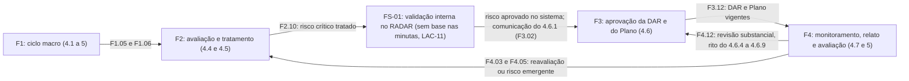

# Mapa de processos da gestão de riscos

> **O que é:** o mapa que mostra onde cada fluxo do RADAR entra no ciclo da Metodologia de Gestão de Riscos (minuta SEI `024421455`, itens 4.1 a 5), quem participa e como os fluxos se encadeiam.
> **Situação normativa (20/11/2026):** Política (SEI `024241420`) e Metodologia são **minutas** ainda não publicadas. F3 e F4 modelam o texto saneado e as escolhas de 20/11/2026, parte delas ainda não aplicada ao texto ([[registro-alertas-f4-f5]]). O FS-01 não tem base nas minutas (LAC-11).
> **Fontes:** [[Modelagem_Fluxos_Gestao_Riscos_2026-11-20]] §2 (subprocessos SP0 a SP7); [[Modelagem_F4_v2_e_F3_v3_2026-11-20]] §1 e §6 (atores); diagnóstico §5.2 (numeração oficial dos fluxos); `supabase/referencia/20261115_cadeia-valor.csv` (Cadeia de Valor).

## 1. Os fluxos e o ciclo da Metodologia

| Fluxo | Itens da Metodologia | Artigos da Política | Atores | Arquivo |
| --- | --- | --- | --- | --- |
| **F1** — ciclo de gestão de riscos (macro), v2 | 4.1 a 5 (visão geral: contexto, identificação, análise, avaliação, tratamento, Plano, monitoramento e avaliação) | arts. 7º, IV; 8º, §§ 1º e 2º; 9º; 12, V e XI; 13; 15, X; 17, I | Gestor de riscos, CGOV, CTGRIC, CIG, Presidente | [[F1-ciclo-gestao-riscos]] |
| **F2** — avaliação e tratamento, v1 | 4.4, 4.5 e 4.5.1 ("Tabela 8"); 4.7.1 (KRI) | arts. 8º, §§ 1º e 2º; 17, I | Gestor de riscos | [[F2-avaliacao-tratamento]] |
| **FS-01** — validação interna do risco no RADAR (3 degraus) | **nenhum** (decisão da CGOV; fica antes da comunicação do 4.6.1) | nenhum (decisões P1 a P8, P-B1-1 a P-B1-8 e D1) | Unidade (gestor de riscos), chefia imediata, homologador (GR, Diretor ou Presidente), GABIN, CGOV | [[FS-01-validacao-interna-risco]] |
| **F3** — aprovação e publicação da DAR e do Plano, v3 (partes 1 e 2) | 4.6.1 a 4.6.11 e Anexo III | arts. 9º; 12, XI; 13, §§ 1º a 3º; 16; 17, II | Gestores de riscos, CGOV, CTGRIC, CIG, Presidente, chefia imediata (só ciência), AUDIT | [[F3-aprovacao-dar-plano]] |
| **F4** — monitoramento, relato e avaliação, v2 (partes 1 a 3) | 4.7, 4.7.1, 4.7.2 e 5 | arts. 3º; 9º; 12, XII; 13, II e VI; 15, IX e X; 16 | Gestor de riscos, CGOV, CTGRIC, CIG, chefia imediata (só ciência), AUDIT | [[F4-monitoramento-relato-avaliacao]] |

**Sem F-05 e sem F-06** (diagnóstico §5.2): a DAR tramita junto com o Plano no F3, e a avaliação anual está no F4, parte 3. Os itens 4.1 a 4.3 (contexto, identificação e análise) não têm fluxo próprio: aparecem como F1.01 e F1.02, porque são lineares e feitos pelo gestor (SP1 e SP2). O SP0 (instrumentos e DAR) não tinha fluxo na minuta (F1-02); o rito da DAR está hoje no F3.

**Como ler os IDs:** atividade = `Fn.NN` (com ponto), por exemplo `F3.07` = passo 7 da tabela oficial do F3 v3 (a CGOV encaminha ao CTGRIC). Alerta = `F4-10` (com hífen). F1, F2 e FS-01 não têm tabela oficial: a numeração foi atribuída nesta documentação.

## 2. Como os fluxos se encadeiam

- **F1 → F2:** a avaliação e o tratamento (F1.05 e F1.06) são detalhados no F2.
- **F2 → FS-01 → F3:** a norma manda o gestor comunicar o risco crítico à CGOV (4.6.1, F3.02). **No RADAR**, antes dessa comunicação, a ficha passa pelos 3 degraus do FS-01 (envio, validação e, se crítica, homologação). Esse encaixe é decisão da CGOV ainda sem base nas minutas (F3-04, LAC-11).
- **F3 → F4:** com a DAR e o Plano publicados (F3.11) e divulgados (F3.12), começa o monitoramento (F4.01).
- **F4 → F3:** a revisão substancial do Plano (F4.12) volta ao rito do F3 (F3.07 a F3.14).
- **F4 → F2:** a reavaliação (F4.03, F4.04) e o risco emergente (F4.05, hipótese IV) reabrem a análise e o tratamento (no F1, a seta de `GES_MON` para `GES_AN`).

## 3. Lugar na Cadeia de Valor do ICMBio

No arquivo `supabase/referencia/20261115_cadeia-valor.csv`, a gestão de riscos é o processo:

| Código (`proc_id`) | Processo (`proc`) | Tipo | Macroprocesso (`macro_id`) | Unidade (`icmbio_id`) | Supervisor | Orientador | Situação |
| --- | --- | --- | --- | --- | --- | --- | --- |
| **1.05.2** | Gestão de riscos | Gerencial | 1.05 — Governança e gestão estratégica | 10.0008 | CGGE | Presidente | válido |

Todos os fluxos deste mapa (F1 a F4 e FS-01) pertencem a esse processo. Dois processos vizinhos do mesmo arquivo tocam os fluxos:

- **1.03.4 — Gestão da integridade** (macroprocesso 1.03, Avaliação e controle; supervisor CGGE): na identificação (F1.01), a Metodologia (4.2.2.1) classifica o risco em subcategorias e remete ao Programa Integra+ (Portaria ICMBio nº 253/2026), sem descrevê-lo ([[Modelagem_Fluxos_Gestao_Riscos_2026-11-20]], "Conferência com as regras de negócio"); no RADAR, isso vira o Teste de Integridade com as 6 subcategorias do Quadro 3 (`AGENTS.md`, regra 5).
- **1.03.3 — Auditoria** (macroprocesso 1.03; supervisor AUDIT): a avaliação independente fora da aprovação (F3.15) e no PAINT (F4.17).
