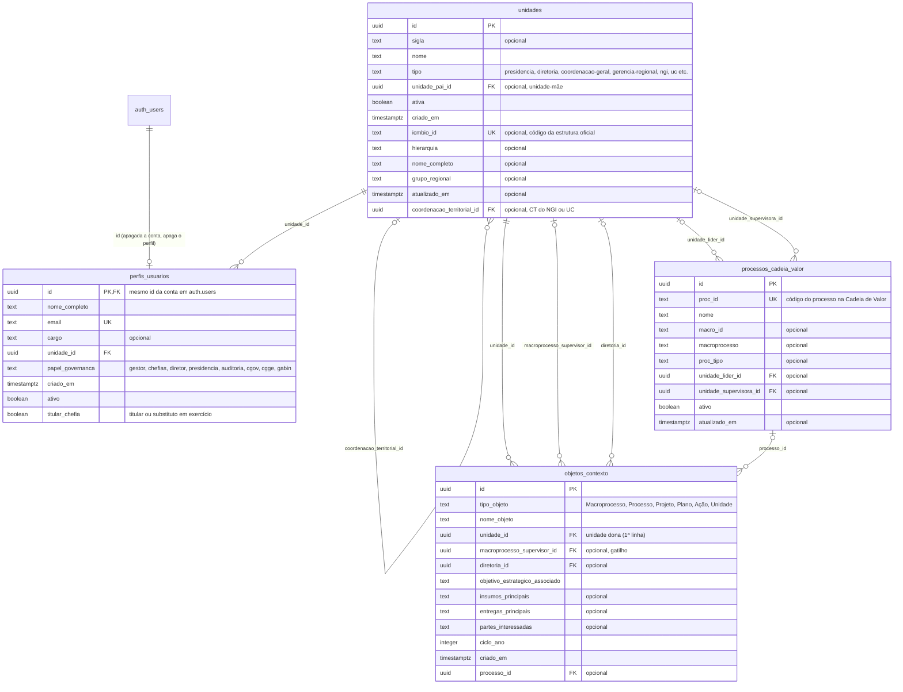
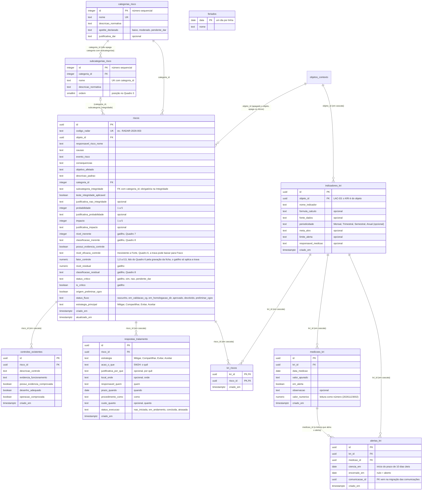
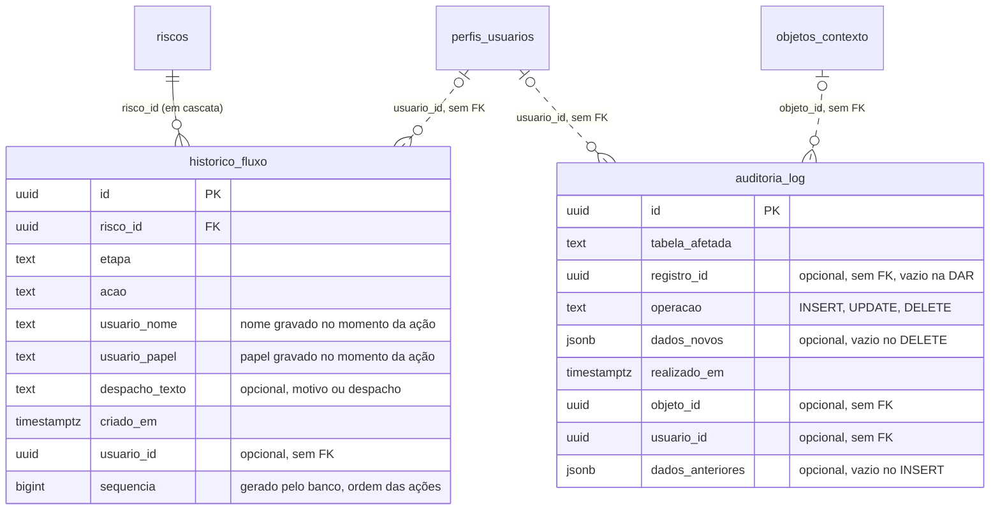

# DER lógico do RADAR (notação pé-de-galinha)

O **DER lógico** (Diagrama Entidade-Relacionamento) é o desenho **do banco que existe**: cada caixa é uma
tabela do PostgreSQL/Supabase, cada linha dentro da caixa é uma coluna com o seu tipo, e cada traço entre
caixas é uma chave estrangeira. Ele traduz o [[mer-conceitual]] para tabelas.

**De onde vem:** do **estado final das 14 migrações que mudam a estrutura** de `supabase/migrations/` (de `20261109001` até
`20261122004`; a `20261122002` só troca funções, a `20261122003` só acrescenta um gatilho e a `20261123001` só põe travas de linha nos gatilhos de `kri_riscos`), e não do design v2.0. As colunas, os tipos e as chaves foram conferidos no banco local
com as 12 primeiras migrações aplicadas (consulta ao `information_schema` e ao `pg_constraint`, só a estrutura, em
2026-11-21); a 13ª (`20261122001`, tabela `subcategorias_risco`, chave estrangeira composta e fim da coluna `subcategorias_permitidas`, [[0019-categorias-e-subcategorias-literais-sem-conversao-automatica|ADR-0019]]) foi acrescentada a partir do próprio arquivo da migração, e a 14ª (`20261122004`, LAC-03: `indicadores_kri.objeto_id`, tabela `kri_riscos`, fim de `indicadores_kri.risco_id`, campos do KRI que aceitam vazio) também. O teste `tests/unit/documentacao.spec.ts` ("DER contém exatamente as tabelas criadas nas
migrações") reprova se uma tabela for criada numa migração e não aparecer aqui, ou o contrário.

O documento anterior, [[modelo-dados-mer]], fica como histórico das migrações.

## Como ler

- **Tipos:** `uuid` (identificador único gerado pelo banco), `text`, `integer`, `bigint`, `numeric`
  (número com casas decimais), `boolean` (sim/não), `date`, `timestamptz` (data e hora com fuso) e `jsonb`
  (lista ou objeto JSON).
- **Chaves:** `PK` = chave primária (identifica a linha); `FK` = chave estrangeira (aponta para outra
  tabela); `UK` = valor único (não se repete na tabela).
- **Obrigatório ou não:** o comentário `"opcional"` marca a coluna que aceita vazio (`NULL`); as demais são
  `NOT NULL`. O domínio de cada coluna (os valores do `CHECK`) fica no `dicionario-dados.md` (Tarefa 15).
- **Pontas das linhas:** `||` exatamente um, `o|` zero ou um, `|{` um ou mais, `o{` zero ou mais (ver a
  tabela do [[mer-conceitual]]). Linha **cheia** (`--`) = chave estrangeira declarada no banco; linha
  **tracejada** (`..`) = ligação lógica **sem** chave estrangeira, de propósito.
- **Calculado pelo banco:** o comentário `"gatilho"` marca a coluna que o banco preenche sozinho; quem
  preenche a ficha não informa esse valor (RN-013).

O desenho foi dividido em **3 blocos** para ficar legível. Uma tabela aparece com as colunas no seu bloco
e, nos outros blocos, só como caixa vazia, para mostrar a ligação.

## Bloco 1 — Organização e acesso

`auth_users` representa a tabela `auth.users`, do Supabase (fora do esquema `public`): é a conta de login,
e por isso aparece sem colunas.

## Bloco 2 — Risco e tratamento

"Em cascata" (`ON DELETE CASCADE`) quer dizer que, ao apagar a linha de cima, o banco apaga também as de
baixo. Exemplo: apagar um risco em rascunho apaga os seus controles, ações e as ligações dele com os KRIs
(`kri_riscos`). O KRI em si só é apagado, com as medições dele, quando fica **órfão**, isto é, sem nenhum
risco ligado (gatilho da migração `20261122004`, com a trava de linha da `20261123001` para duas remoções ao mesmo tempo); um KRI que ainda serve a outro risco do objeto continua.
O risco aprovado não pode ser apagado (RN-050).

## Bloco 3 — Fluxo e auditoria

**Por que a trilha não tem chave estrangeira:** `auditoria_log` precisa sobreviver à exclusão do que ela
registra. Se `objeto_id` fosse chave estrangeira, apagar um objeto obrigaria a apagar (ou a esvaziar) a
sua história. Por isso `objeto_id`, `usuario_id` e `registro_id` são só `uuid`, sem `FK`
(`20261115005_trilha_auditoria.sql`). O `usuario_id` guarda o `auth.uid()` de quem mexeu, que é o mesmo `id`
de `perfis_usuarios`, e fica vazio quando o administrador altera o banco direto. Nas linhas da DAR
(`categorias_risco`, de id numérico), `registro_id` fica vazio e o id vai no retrato da linha: em
`dados_novos->>'id'` nas operações `INSERT` e `UPDATE`, e em `dados_anteriores->>'id'` no `DELETE`, em que
`dados_novos` fica vazio.

Em `historico_fluxo`, `usuario_nome` e `usuario_papel` são gravados como texto para mostrar quem agiu e
com que papel **naquele dia**, mesmo que a pessoa mude de perfil depois.

## Resumo das 15 tabelas

| Tabela | Bloco | Criada em | Chaves estrangeiras declaradas |
| --- | --- | --- | --- |
| `unidades` | 1 | `20261109001` (colunas novas em `20261115001`) | `unidade_pai_id`, `coordenacao_territorial_id` → `unidades` |
| `perfis_usuarios` | 1 | `20261109001` (colunas novas em `20261115001`) | `id` → `auth.users` (em cascata); `unidade_id` → `unidades` |
| `processos_cadeia_valor` | 1 | `20261115001` | `unidade_lider_id`, `unidade_supervisora_id` → `unidades` |
| `objetos_contexto` | 1 | `20261109001` (`processo_id` em `20261115001`) | `unidade_id`, `macroprocesso_supervisor_id`, `diretoria_id` → `unidades`; `processo_id` → `processos_cadeia_valor` |
| `categorias_risco` | 2 | `20261109001` | nenhuma |
| `subcategorias_risco` | 2 | `20261122001` | `categoria_id` → `categorias_risco` |
| `feriados` | 2 | `20261123002` | nenhuma (lista de feriados que não contam como dia útil nos prazos do alerta do KRI, LAC-03) |
| `riscos` | 2 | `20261109001` | `objeto_id` → `objetos_contexto` (em cascata); `categoria_id` → `categorias_risco`; (`categoria_id`, `subcategoria_integridade`) → `subcategorias_risco` (`20261122001`) |
| `controles_existentes` | 2 | `20261109001` | `risco_id` → `riscos` (em cascata) |
| `respostas_tratamento` | 2 | `20261109001` | `risco_id` → `riscos` (em cascata) |
| `indicadores_kri` | 2 | `20261109001` (`objeto_id` em `20261122004`) | `objeto_id` → `objetos_contexto` (em cascata); a ligação aos riscos fica em `kri_riscos` (`risco_id` saiu em `20261122004`) |
| `kri_riscos` | 2 | `20261122004` | `kri_id` → `indicadores_kri` (em cascata); `risco_id` → `riscos` (em cascata) |
| `medicoes_kri` | 2 | `20261109001` (`valor_numerico` em `20261123002`) | `kri_id` → `indicadores_kri` (em cascata) |
| `alertas_kri` | 2 | `20261123002` | `kri_id` → `indicadores_kri` (em cascata); `medicao_id` → `medicoes_kri` (a leitura que abriu o alerta) |
| `historico_fluxo` | 3 | `20261109001` (`usuario_id` e `sequencia` em `20261115004`) | `risco_id` → `riscos` (em cascata) |
| `auditoria_log` | 3 | `20261109001` (`objeto_id`, `usuario_id`, `dados_anteriores` em `20261115005`) | nenhuma, de propósito |

As entidades **propostas** pelas lacunas (Ciclo, Plano de Gestão de Riscos, Comunicação de evento,
Relatório e Avaliação de maturidade) **não** entram aqui: o DER mostra só o que existe no banco. Elas estão
no [[mer-conceitual]].
