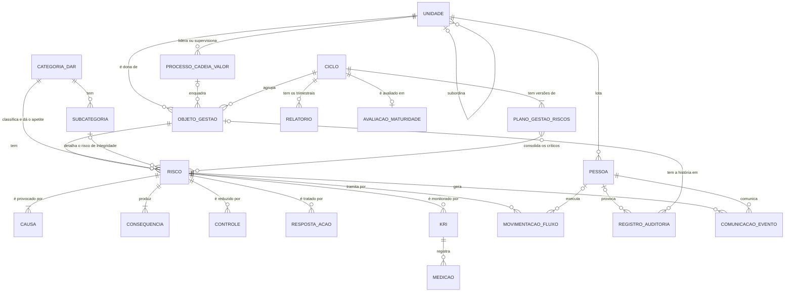

# MER conceitual do RADAR

O **Modelo Entidade-Relacionamento (MER) conceitual** mostra **as coisas do negócio** que o RADAR precisa
guardar (as *entidades*) e **como elas se ligam** (os *relacionamentos*), sem falar ainda de tabela, coluna
ou tipo de dado. É o desenho que um servidor da CGOV consegue ler e conferir com a Política (SEI
`024241420`) e a Metodologia (SEI `024421455`) sem saber banco de dados.

O desenho do banco que existe de fato, com tabelas, colunas e tipos, é o [[der-logico]]. A análise das
formas normais fica em `normalizacao.md` e o significado de cada coluna em `dicionario-dados.md` (Tarefa 15
do plano [[2026-11-20-reestruturacao-documentacao-plan]]).

## Como ler a cardinalidade (pé-de-galinha)

Cada ponta da linha diz **quantos** de um lado se ligam a **um** do outro lado:

| Símbolo na ponta | Lê-se | Exemplo |
| --- | --- | --- |
| `\|\|` | exatamente um | todo risco tem **exatamente uma** categoria |
| `o\|` | zero ou um | o objeto **pode ou não** estar ligado a um processo |
| `\|{` | um ou mais | todo risco tem **uma ou mais** causas |
| `o{` | zero ou mais | a unidade tem **zero ou mais** objetos |

Assim, `UNIDADE ||--o{ OBJETO` lê-se: "cada objeto pertence a exatamente uma unidade; cada unidade tem zero
ou mais objetos".

## Entidades que o RADAR já guarda

| Entidade | O que é, em linguagem simples |
| --- | --- |
| Unidade | Uma parte da estrutura do ICMBio (Presidência, Diretoria, Coordenação-Geral, Gerência Regional, Coordenação Territorial, NGI, UC, base avançada etc.), organizada em árvore. |
| Pessoa (perfil) | O servidor com acesso ao sistema, lotado em uma unidade, com um papel de governança (gestor, chefia, Diretor, CGOV, AUDIT...) e a marca de titular da chefia. |
| Processo da Cadeia de Valor | Um processo (ou macroprocesso) da Cadeia de Valor do ICMBio, com unidade líder e unidade supervisora. |
| Objeto de gestão | Aquilo cujos riscos se avaliam (Quadro 1 da Metodologia): macroprocesso, processo, projeto, plano, ação ou unidade. |
| Risco | O evento incerto que afeta um objetivo do objeto, com probabilidade, impacto, nível inerente, eficácia dos controles, nível residual e criticidade. |
| Causa | O que pode provocar o evento de risco (sintaxe do item 4.2.1). |
| Consequência | O efeito do evento sobre o objetivo, se ele acontecer. |
| Controle | A medida que já existe para reduzir o risco, com a evidência de que funciona (Quadro 6). |
| Resposta / Ação de tratamento | A estratégia (Mitigar, Compartilhar, Evitar, Aceitar) e a ação planejada no formato 5W2H. |
| KRI | O Indicador-Chave de Risco que acompanha o risco, com fórmula, fonte, periodicidade, meta e limite de alerta. |
| Medição | Cada leitura do KRI em uma data, que diz se passou do limite de alerta. |
| Categoria / DAR | A categoria do risco (Quadro 2) e o apetite declarado para ela na Declaração de Apetite a Riscos (DAR). |
| Subcategoria | Cada uma das 6 subcategorias do Quadro 3 da categoria Integridade; o risco de Integridade recebe exatamente uma (RN-017). Tabela `subcategorias_risco`, desde 2026-11-22. |
| Movimentação do fluxo | Cada passo do risco no fluxo interno (enviar, validar, homologar, devolver, reabrir), com quem fez e o despacho. |
| Registro de auditoria | A anotação automática de toda criação, alteração e exclusão nas tabelas da ficha, com o antes e o depois. |

## Entidades propostas pelas lacunas

As lacunas entre a norma e o sistema ([[lacunas-norma-sistema]]) mostram coisas que as minutas exigem e que
o RADAR ainda **não guarda**. Elas entram no desenho como **propostas**, marcadas no diagrama com o
comentário `%% proposta LAC-NN`. Nenhuma tem tabela no banco; criá-las depende de decisão da CGOV e de
migração autorizada.

| Entidade proposta | Lacuna | O que a norma pede |
| --- | --- | --- |
| Ciclo | LAC-01, LAC-10 | O ciclo anual de gestão de riscos, com calendário de reuniões (4.6.11) e reavaliação anual de cada risco (4.7). Hoje só existe o ano do objeto (`ciclo_ano`). |
| Plano de Gestão de Riscos | LAC-01, LAC-02, LAC-07 | O Plano único consolidado pela CGOV, com versões (vigente, reapresentada), manifestação do CTGRIC, deliberação do CIG e publicação por portaria. |
| Comunicação de evento | LAC-04 | A comunicação do gestor à CGOV em até 10 dias úteis (4.7.2, incisos I a VI), inclusive a do alerta do KRI (LAC-03). |
| Relatório | LAC-05 | O relatório trimestral da CGOV ao CTGRIC e ao CIG sobre a carteira de riscos críticos. |
| Avaliação de maturidade | LAC-06 | A avaliação gerencial anual de efetividade, adequação e maturidade, com ciência à AUDIT. |

## Diagrama

## Os relacionamentos, um por um

**Já guardados no banco**

1. **Unidade subordina Unidade:** cada unidade tem no máximo uma unidade-mãe, e uma unidade pode ter várias filhas; é a árvore do Regimento Interno (a Presidência é a raiz, sem mãe).
2. **Unidade lota Pessoa:** cada pessoa com acesso está ligada a exatamente uma unidade (RN-031), e uma unidade pode ter várias pessoas ou nenhuma.
3. **Unidade lidera ou supervisiona Processo da Cadeia de Valor:** um processo tem uma unidade líder e uma supervisora (a Coordenação-Geral que supervisiona o macroprocesso); a mesma unidade pode liderar ou supervisionar vários processos.
4. **Unidade é dona de Objeto de gestão:** todo objeto pertence a exatamente uma unidade (a 1ª linha), e é por ela que se decide quem lê e quem grava os riscos (RN-021 a RN-027).
5. **Processo da Cadeia de Valor enquadra Objeto de gestão:** o objeto pode estar ligado a um processo ativo da Cadeia de Valor, ou a nenhum (RN-035).
6. **Objeto de gestão tem Risco:** todo risco nasce de exatamente um objeto, e um objeto pode ter zero ou mais riscos.
7. **Categoria / DAR classifica Risco:** todo risco tem exatamente uma categoria, a dominante (RN-015), e o apetite da categoria na DAR decide se o residual é **risco crítico** (RN-005).
7a. **Subcategoria detalha Risco de Integridade:** o risco da categoria Integridade tem exatamente uma das 6 subcategorias do Quadro 3, e o de outra categoria não tem nenhuma (RN-017; banco, desde 2026-11-22).
8. **Risco é provocado por Causa:** todo risco tem pelo menos uma causa (sintaxe do 4.2.1); hoje as causas ficam juntas em um texto só, ponto que a normalização (Tarefa 15) vai tratar.
9. **Risco produz Consequência:** todo risco tem pelo menos uma consequência; hoje também ficam juntas em um texto só.
10. **Risco é reduzido por Controle:** o risco pode ter zero ou mais controles; sem controle, a eficácia é Inexistente (fator 1,0).
11. **Risco é tratado por Resposta / Ação:** o risco pode ter zero ou mais ações 5W2H; o risco crítico deve ter pelo menos uma (RN-019), regra que o banco impõe desde a LAC-13 (`fn_trava_risco_critico`, migração `20261122002`: sem "Aceitar" e com ao menos uma ação, ao enviar, validar e homologar; aplicada na nuvem do piloto em 2026-11-22).
12. **Risco é monitorado por KRI:** o risco pode ter zero ou mais KRIs; cada KRI pertence a um único risco (o grupo de riscos correlatos do 4.7.1 ainda não existe, LAC-03).
13. **KRI registra Medição:** cada medição pertence a exatamente um KRI, que pode ter zero ou mais medições.
14. **Risco tramita por Movimentação do fluxo:** cada movimentação é de exatamente um risco, e o risco acumula zero ou mais movimentações, em ordem.
15. **Pessoa executa Movimentação do fluxo:** a movimentação guarda quem a fez; pode ficar sem pessoa quando o banco é alterado direto pelo administrador.
16. **Pessoa provoca Registro de auditoria:** cada registro guarda quem fez a mudança, ou fica sem pessoa quando a mudança vem do administrador do banco.
17. **Objeto de gestão tem a história em Registro de auditoria:** o registro aponta para o objeto a que a mudança pertence (sem amarração rígida, para a trilha sobreviver se o objeto for apagado); a troca de perfil e a mudança da DAR não pertencem a objeto.

**Propostos pelas lacunas**

18. **Ciclo agrupa Objeto de gestão** (LAC-01, LAC-10): cada objeto seria avaliado dentro de um ciclo anual, no lugar do simples ano (`ciclo_ano`) de hoje.
19. **Ciclo tem versões de Plano de Gestão de Riscos** (LAC-01, LAC-02, LAC-07): cada ciclo teria pelo menos uma versão do Plano (a vigente e as reapresentadas em 30 dias, 4.6.8).
20. **Plano de Gestão de Riscos consolida Risco** (LAC-01): um Plano reúne vários riscos críticos, e o mesmo risco pode aparecer em várias versões do Plano; a ressalva de incompletude (4.6.3) ficaria nessa ligação.
21. **Risco gera Comunicação de evento** (LAC-04): cada comunicação seria de um risco (incisos I, II, III e V do 4.7.2) e guardaria o prazo de 10 dias úteis; o risco emergente (inciso IV) ainda não tem risco gravado, e a forma de ligá-lo fica para a decisão da CGOV.
22. **Pessoa comunica Comunicação de evento** (LAC-04): toda comunicação teria um autor, o gestor que a fez.
23. **Ciclo tem os Relatórios trimestrais** (LAC-05): cada relatório seria de um ciclo, com quatro por ano.
24. **Ciclo é avaliado em Avaliação de maturidade** (LAC-06): cada ciclo teria no máximo uma avaliação anual, com o registro da ciência à AUDIT.

## Fora do desenho

- **Usuário de login** (`auth.users`, do Supabase): é a conta de acesso, não uma entidade do negócio. A Pessoa (perfil) é ligada a ela um para um; ver [[der-logico]].
- **Cobrança de pendências** (LAC-09) e **revisão do Plano** (LAC-07): dependem do Plano e da Comunicação de evento propostos e serão desenhadas junto com eles, se a CGOV decidir criá-los.
