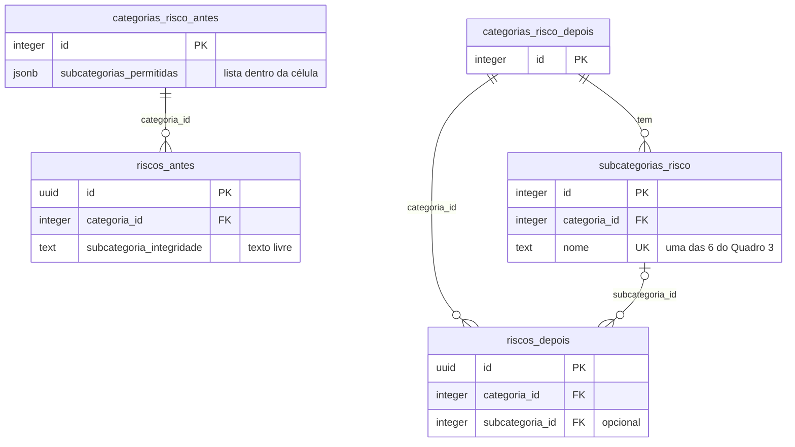
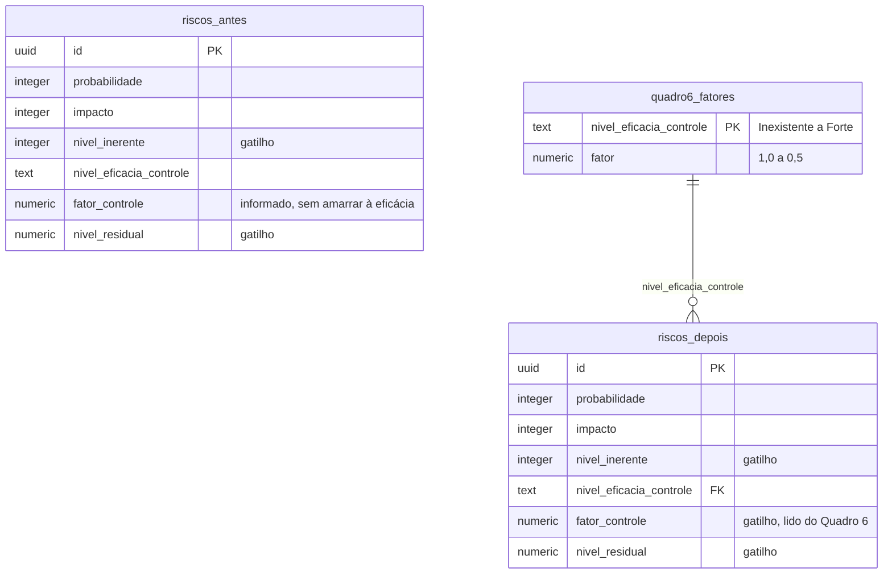
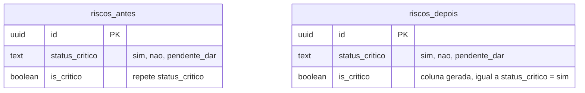
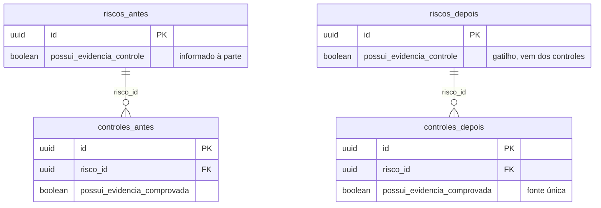
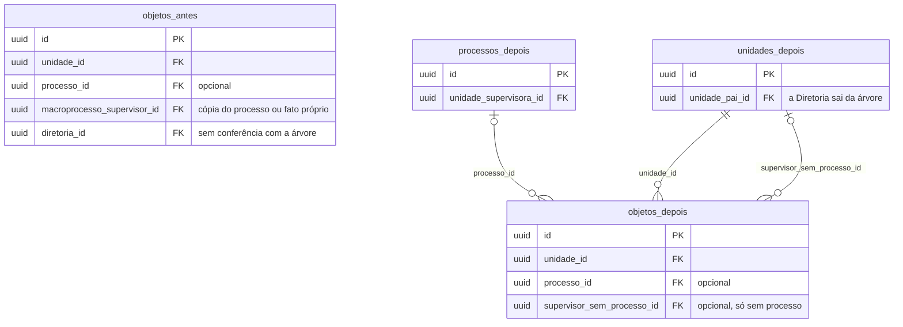
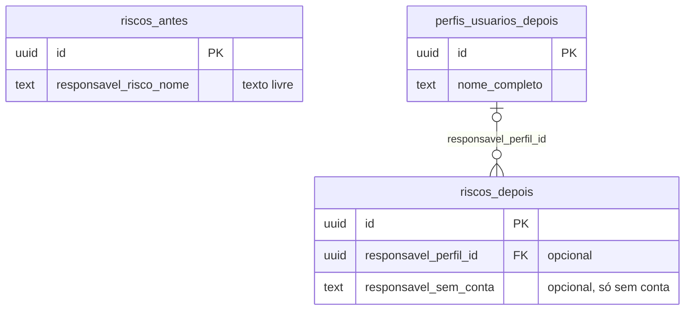
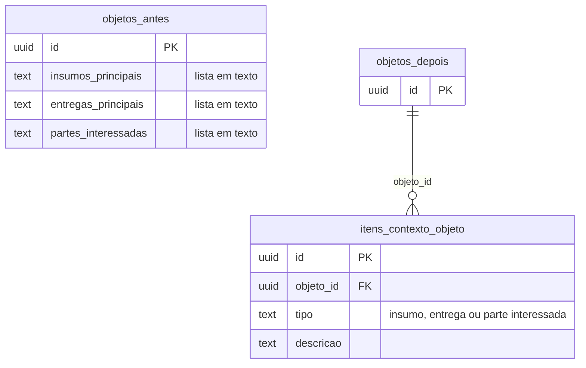

# Normalização do banco do RADAR (1FN, 2FN e 3FN)

**Normalizar** é organizar as tabelas de modo que **cada fato fique guardado em um lugar só**. Quando o
mesmo fato está em dois lugares, um dia os dois discordam, e o sistema passa a mostrar duas verdades. As
três primeiras **formas normais** são o teste clássico:

| Forma normal | Pergunta, em linguagem simples | Exemplo de violação |
| --- | --- | --- |
| **1FN** | Cada célula guarda **um só valor**? | uma coluna "causas" com três causas separadas por vírgula |
| **2FN** | Cada coluna depende da **chave inteira**? (só pode falhar quando a chave tem mais de uma coluna) | numa chave (pedido, produto), o nome do produto depende só do produto |
| **3FN** | Alguma coluna depende de **outra coluna que não é chave**? | guardar a cidade e também o estado: o estado depende da cidade, não da chave |

A notação `X → Y` (**dependência funcional**) quer dizer: "conhecendo X, eu sei Y". Exemplo:
`(probabilidade, impacto) → nivel_inerente`, porque o Quadro 7 dá um único valor para cada par.

Cada forma normal recebe um destes três resultados:

- **conforme**: nada a corrigir;
- **desnormalização deliberada (ADR-NNNN)**: a repetição é proposital e a decisão está registrada num ADR;
- **dívida (cartão no Kanban)**: a repetição não tem decisão registrada e pode gerar dado inconsistente.
  O cartão está no [[quadro]], com a classe `#divida`.

O ponto de partida foi o achado **E2** do diagnóstico [[2026-11-20-diagnostico-documentacao-radar]]. A
estrutura analisada é a do [[der-logico]] (12 tabelas, estado final das migrações até `20261117001`).
Nenhuma proposta abaixo foi aplicada: mudar o banco depende de plano autorizado e de nova migração.

## Resumo por tabela

**Chaves candidatas** são as colunas (ou grupos de colunas) que identificam a linha sozinhas. Todas as
chaves primárias do RADAR são de uma coluna só (`uuid` ou número sequencial). Por isso **nenhuma tabela
pode violar a 2FN**: a dependência parcial só existe quando a chave tem mais de uma coluna. As chaves
naturais (`codigo_radar`, `email`, `proc_id`, `icmbio_id`, `nome` da categoria) também são de uma coluna.

| Tabela | Chaves candidatas | 1FN | 2FN | 3FN |
| --- | --- | --- | --- | --- |
| `unidades` | `id`; `icmbio_id` (quando preenchido) | conforme | conforme | conforme (§ 3.9) |
| `perfis_usuarios` | `id`; `email` | conforme | conforme | dívida (§ 3.10) |
| `processos_cadeia_valor` | `id`; `proc_id` | conforme | conforme | dívida (§ 3.8) |
| `objetos_contexto` | `id` | dívida (§ 2.7) | conforme | dívida (§ 2.5 e § 2.6) |
| `categorias_risco` | `id`; `nome` | dívida (§ 2.1) | conforme | conforme |
| `riscos` | `id`; `codigo_radar` | dívida (§ 3.1) | conforme | desnormalização deliberada (ADR-0003, § 2.2 e § 3.2) e dívida (o fator do § 2.2, § 2.3, § 2.4 e § 2.6) |
| `controles_existentes` | `id` | conforme | conforme | conforme |
| `respostas_tratamento` | `id` | conforme | conforme | dívida (§ 2.6); `status_execucao` conforme (§ 3.5) |
| `indicadores_kri` | `id` | conforme | conforme | dívida (§ 2.6) |
| `medicoes_kri` | `id` | conforme | conforme | conforme (§ 3.6) |
| `historico_fluxo` | `id`; `sequencia` | conforme | conforme | conforme (§ 3.3) |
| `auditoria_log` | `id` | conforme (§ 3.4) | conforme | conforme |

## 1. Dependências funcionais de cada tabela

Em todas as tabelas, a chave primária determina as demais colunas (`id → todas`). A lista abaixo mostra só
as dependências **entre colunas que não são chave** (as que podem violar a 3FN) e as chaves naturais.

| Tabela | Dependências além de `id → todas` |
| --- | --- |
| `unidades` | `icmbio_id → todas`. A árvore (`unidade_pai_id`) determina a Diretoria acima, mas a Diretoria não é gravada aqui. |
| `perfis_usuarios` | `email → todas`. Fora da tabela: `id → auth.users.email` (o mesmo e-mail também está na conta de login). |
| `processos_cadeia_valor` | `proc_id → todas`; `macro_id → macroprocesso`. |
| `objetos_contexto` | `processo_id → macroprocesso_supervisor_id` (quando há processo); `unidade_id → diretoria_id` (pela árvore). |
| `categorias_risco` | `nome → todas`. |
| `riscos` | `codigo_radar → todas`; `(causas, evento_risco, consequencias, objetivo_afetado) → descricao_padrao`; `(probabilidade, impacto) → nivel_inerente`; `nivel_inerente → classificacao_inerente`; `nivel_eficacia_controle → fator_controle` (Quadro 6, depois da trava); `(nivel_inerente, fator_controle) → nivel_residual`; `nivel_residual → classificacao_residual`; `(classificacao_residual, apetite da categoria) → status_critico`; `status_critico → is_critico`. Fora da tabela: a evidência dos controles (`controles_existentes`) determinaria `possui_evidencia_controle`. |
| `historico_fluxo` | `sequencia → todas`. |
| demais | nenhuma. |

## 2. Os pontos do diagnóstico E2

### 2.1 `subcategorias_permitidas` em JSONB (1FN: dívida)

**O problema.** `categorias_risco.subcategorias_permitidas` guarda **uma lista** dentro de uma célula
(`jsonb`, ex.: `["Conflito de interesses", "Nepotismo"]`). Isso quebra a 1FN. Na prática, o banco não
consegue garantir que `riscos.subcategoria_integridade` seja uma das subcategorias da lista: a coluna do
risco aceita texto livre, e a lista atual nem é a do Quadro 3 (LAC-15, RN-017).

**Proposta.** Uma tabela de subcategorias, com chave estrangeira no risco.

### 2.2 Os campos calculados de `riscos` (3FN: desnormalização deliberada, ADR-0003)

**O problema.** `descricao_padrao`, `nivel_inerente`, `classificacao_inerente`, `fator_controle`,
`nivel_residual`, `classificacao_residual`, `status_critico` e `is_critico` dependem de outras colunas
(ver a seção 1). Pela 3FN, eles não deveriam ser gravados: bastaria calculá-los na hora da leitura.

**Por que ficam gravados.** O risco precisa mostrar o valor **que valia quando foi validado e homologado**.
O cálculo pode mudar (por exemplo, numa nova versão do Quadro 7), e a DAR muda o apetite da categoria. Se o
valor fosse calculado só na leitura, a ficha aprovada mudaria sozinha, sem rastro. Gravado, o valor entra
na trilha de auditoria (`dados_anteriores` e `dados_novos`) a cada mudança. A decisão está no
[[0003-gravar-valores-calculados-no-risco]].

**Como a repetição é controlada.** Quem preenche a ficha não informa esses valores (RN-013): o gatilho
`trigger_calcular_risco_radar` (migração `20261109001`) recalcula o texto padrão, o inerente, as
classificações, o residual e a criticidade a cada gravação; a função de gravação da ficha (migração
`20261117001`) lê o fator no Quadro 6 a partir da eficácia escolhida; e a mudança da DAR recalcula os riscos
aprovados da categoria (`20261116004`, RN-054).

**O furo.** O gatilho **não deriva o fator a partir da eficácia**: ele só aplica a trava de evidência e
multiplica. Quem grava `riscos` direto, sem a função de gravação da ficha (a tabela aceita `UPDATE` de quem
tem a permissão da RLS, além da semente e do importador), pode gravar um par incoerente, como eficácia
`Forte` com fator `1,00`. O `CHECK` só confere se o fator é um dos cinco valores. Isso é **dívida** e tem
cartão: fazer o gatilho ler o fator da eficácia. Como mexe no cálculo, a correção depende de pergunta ao
responsável e de migração autorizada (`AGENTS.md`).

### 2.3 `is_critico` × `status_critico` (3FN: dívida)

**O problema.** As duas colunas dizem a mesma coisa: `is_critico` é verdadeiro **se e somente se**
`status_critico = 'sim'` (o gatilho grava as duas juntas). Uma depende da outra (`status_critico →
is_critico`). Hoje só o gatilho as grava, então elas não divergem; mas o código precisa lembrar das duas, e
as funções do fluxo usam a expressão `is_critico OR status_critico = 'pendente_dar'` em vários lugares.

**Proposta.** Guardar só `status_critico` (três valores: `sim`, `nao`, `pendente_dar`) e transformar
`is_critico` numa coluna gerada pelo banco (`GENERATED ALWAYS AS (status_critico = 'sim') STORED`), que não
pode ser gravada à mão.

### 2.4 `possui_evidencia_controle` repetido em `riscos` (3FN: dívida)

**O problema.** Cada controle tem `possui_evidencia_comprovada` em `controles_existentes`, e o risco tem
outro `possui_evidencia_controle`. A trava do Quadro 6 (RN-004) usa **só o do risco**. Nada liga os dois:
o risco pode dizer "tem evidência" com todos os controles sem evidência, e a trava deixa de valer.

**Proposta.** Derivar a evidência do risco a partir dos controles: o risco tem evidência quando pelo menos
um controle tem evidência comprovada. O gatilho calcula o valor a cada gravação de controle. A regra
"pelo menos um" é uma escolha que a CGOV precisa confirmar, porque a eficácia hoje é avaliada para o
conjunto dos controles.

### 2.5 `macroprocesso_supervisor_id` e `diretoria_id` (3FN: dívida)

**O problema.** Em `objetos_contexto`:

- `macroprocesso_supervisor_id` **repete** a unidade supervisora do processo quando o objeto tem
  `processo_id` (`processo_id → unidade_supervisora_id`). A repetição é **controlada**: o gatilho
  `trg_regras_objeto_contexto` copia o valor do processo, e `trg_propagar_supervisor_processo` atualiza os
  objetos quando o processo muda de supervisora (`20261116002`, RN-036). Sem processo, a coluna é um fato
  próprio, que só a CGOV preenche. A coluna existe porque a regra de leitura do Coordenador-Geral (RN-024)
  a consulta. É uma desnormalização intencional, **mas sem ADR**; por isso fica como dívida, com cartão
  para registrar o ADR ou separar os dois casos.
- `diretoria_id` depende da unidade dona (`unidade_id → Diretoria acima na árvore`). **Ninguém confere**:
  a tela grava o valor que recebe, e nenhum gatilho compara com a árvore. Um objeto pode apontar para uma
  Diretoria que não está acima da sua unidade.

**Proposta.** Tirar `diretoria_id` da tabela e obtê-la pela árvore, numa função ou visão. Manter o
supervisor só para o objeto **sem** processo, com o nome que diz isso.

### 2.6 `responsavel_risco_nome` (3FN: dívida)

**O problema.** O responsável pelo risco é gravado como **texto livre**. O mesmo servidor pode aparecer
escrito de jeitos diferentes, e o sistema não sabe se ele tem conta, se ainda está na unidade nem quais
riscos são dele. É também **dado pessoal** (nome; ver o [[dicionario-dados]]). O mesmo vale para
`respostas_tratamento.responsavel_quem` e `indicadores_kri.responsavel_medicao`, que ficam no mesmo cartão.

**Proposta.** Uma chave estrangeira opcional para `perfis_usuarios`, mantendo o nome em texto só para o
responsável que não tem conta no sistema.

### 2.7 Listas em texto em `objetos_contexto` (1FN: dívida)

**O problema.** `insumos_principais`, `entregas_principais` e `partes_interessadas` costumam guardar
**listas** dentro de um texto ("SEI; planilha de metas; relatório"). O banco não consegue contar, filtrar
nem conferir os itens. A dívida é de prioridade baixa: são campos descritivos do contexto (Quadro 1), e
nenhuma regra os usa.

**Proposta.** Uma tabela de itens do objeto, com o tipo do item.

## 3. Outros pontos encontrados

1. **Causas e consequências em texto único (1FN: dívida).** `riscos.causas` e `riscos.consequencias` juntam
   várias causas e consequências num texto só, embora o [[mer-conceitual]] diga que o risco tem uma ou mais
   de cada. A proposta é uma tabela de causas e outra de consequências, uma linha por item, com o texto
   padrão do item 4.2.1 (RN-014) montado a partir delas. Cartão próprio.
2. **`descricao_padrao` (3FN: desnormalização deliberada, ADR-0003).** O texto padrão é montado pelo gatilho
   a partir de causa, evento, consequência e objetivo. Entra no ADR-0003 junto com os valores calculados:
   o texto aprovado fica gravado como foi aprovado.
3. **`historico_fluxo.usuario_nome` e `usuario_papel` (conforme).** Parecem repetir o perfil, mas guardam o
   nome e o papel **no dia da ação**, um fato histórico que o perfil atual não reproduz (a pessoa pode mudar
   de papel). Dependem da linha do histórico, não de `usuario_id`.
4. **`auditoria_log.dados_anteriores` e `dados_novos` em JSONB (conforme).** São o retrato da linha inteira,
   guardado como um documento único e nunca editado (RN-097). O banco não consulta as colunas de dentro
   como atributos, então o retrato é um valor atômico para o que a tabela faz.
5. **`respostas_tratamento.status_execucao = 'atrasada'` (conforme).** Dependeria do prazo e da **data de
   hoje**, que não é coluna da tabela. Hoje é marcado à mão. A comunicação do atraso é a LAC-04 (inciso V).
6. **`medicoes_kri.em_alerta` (conforme).** Não é derivável: `valor_apurado` e `limite_alerta` são texto
   livre, sem regra para comparar. Hoje é marcado à mão (LAC-03).
7. **`riscos.estrategia_principal` × `respostas_tratamento.estrategia` (conforme).** Uma é a resposta
   escolhida para o risco; a outra, a estratégia de cada ação. Podem ser diferentes, então não há
   dependência funcional. A regra "risco crítico não aceita Aceitar" é a LAC-13.
8. **`processos_cadeia_valor.macroprocesso` (3FN: dívida).** O nome do macroprocesso depende do seu código
   (`macro_id → macroprocesso`) e se repete em cada processo do mesmo macroprocesso. A carga da Cadeia de
   Valor grava os dois juntos, então hoje eles não divergem. A proposta é uma tabela de macroprocessos.
   Prioridade baixa; cartão próprio.
9. **`unidades.hierarquia`, `nome_completo` e `grupo_regional` (conforme).** São atributos descritivos da
   própria unidade, copiados do cadastro oficial pela carga da estrutura (`icmbio_id → hierarquia`), e não
   dependem de outra coluna que não seja chave.
10. **`perfis_usuarios.email` (3FN: dívida).** O e-mail também está na conta de login (`auth.users`). Se a
    pessoa trocar o e-mail da conta, o perfil fica com o antigo. Cartão: sincronizar os dois ou ler o
    e-mail só da conta.

## 4. Cartões criados no Kanban

Os cartões `[dívida]` desta análise estão no Backlog do [[quadro]], com a classe `#divida` e a origem
`normalizacao §N`: 2.1, 2.2 (fator × eficácia), 2.3, 2.4, 2.5 (dois cartões), 2.6, 2.7, 3.1, 3.8 e 3.10.
