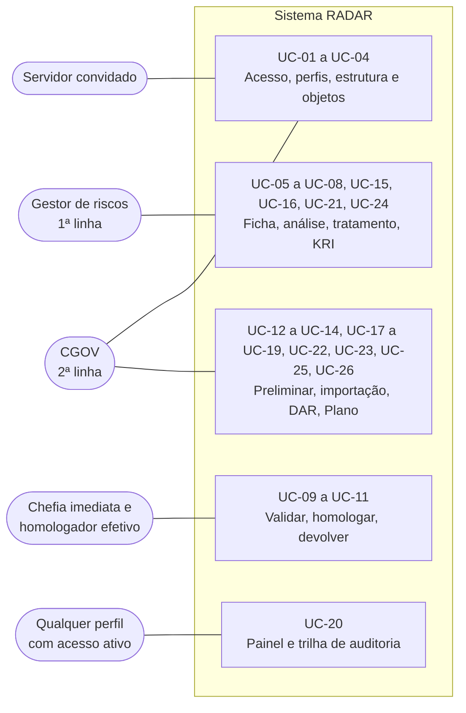
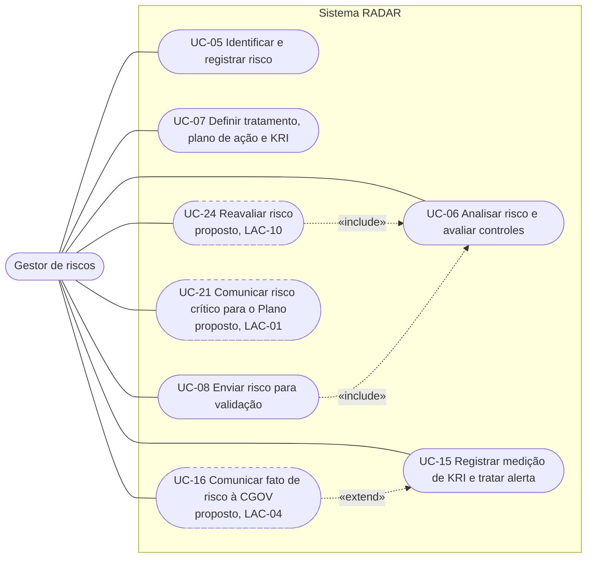
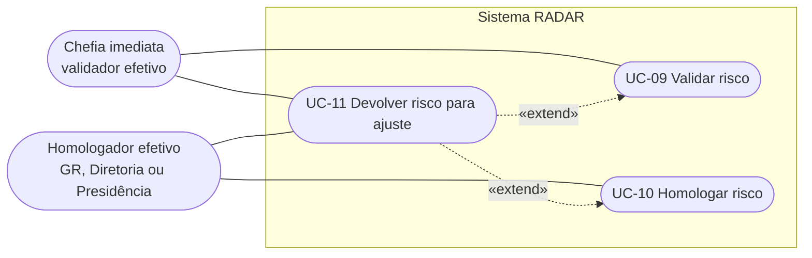
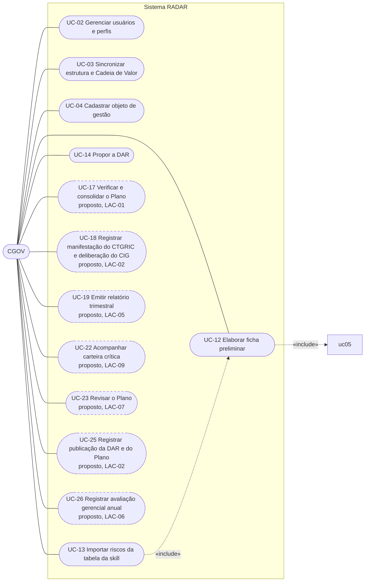
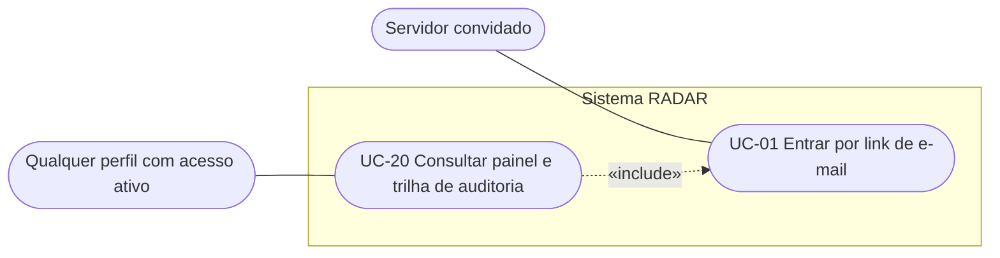

# UML 1 — Casos de uso

> Mermaid não tem diagrama de casos de uso nativo ([[0016-diagramas-em-mermaid-sem-c4]]). Por isso usamos
> `flowchart LR`: **ator** = nó fora da caixa; **fronteira do sistema** = `subgraph RADAR`; **caso de uso** = nó
> arredondado dentro dela; `-. «include» .->` e `-. «extend» .->` são as relações entre casos de uso.
>
> Os 26 casos de uso estão em [[casos-de-uso/README|docs/20-nivel2-requisitos/casos-de-uso]]. Como passam de 25
> nós, o desenho é dividido por grupo de atores. **Linha tracejada em volta e rótulo "(proposto)"** = caso de uso
> que ainda não existe no sistema (situação "proposto" na lacuna LAC-NN indicada em cada UC).

## Visão geral: quem faz o quê

## 1. Gestor de riscos (1ª linha)

## 2. Chefias (validação e homologação)

## 3. CGOV (2ª linha, Secretaria-Executiva do CTGRIC)

## 4. Acesso e consulta (todos os perfis)

> **Atores que não usam o sistema:** CTGRIC, CIG e Presidente decidem fora do RADAR; a CGOV registra o resultado
> (UC-18 e UC-25). Por isso não aparecem como atores.
