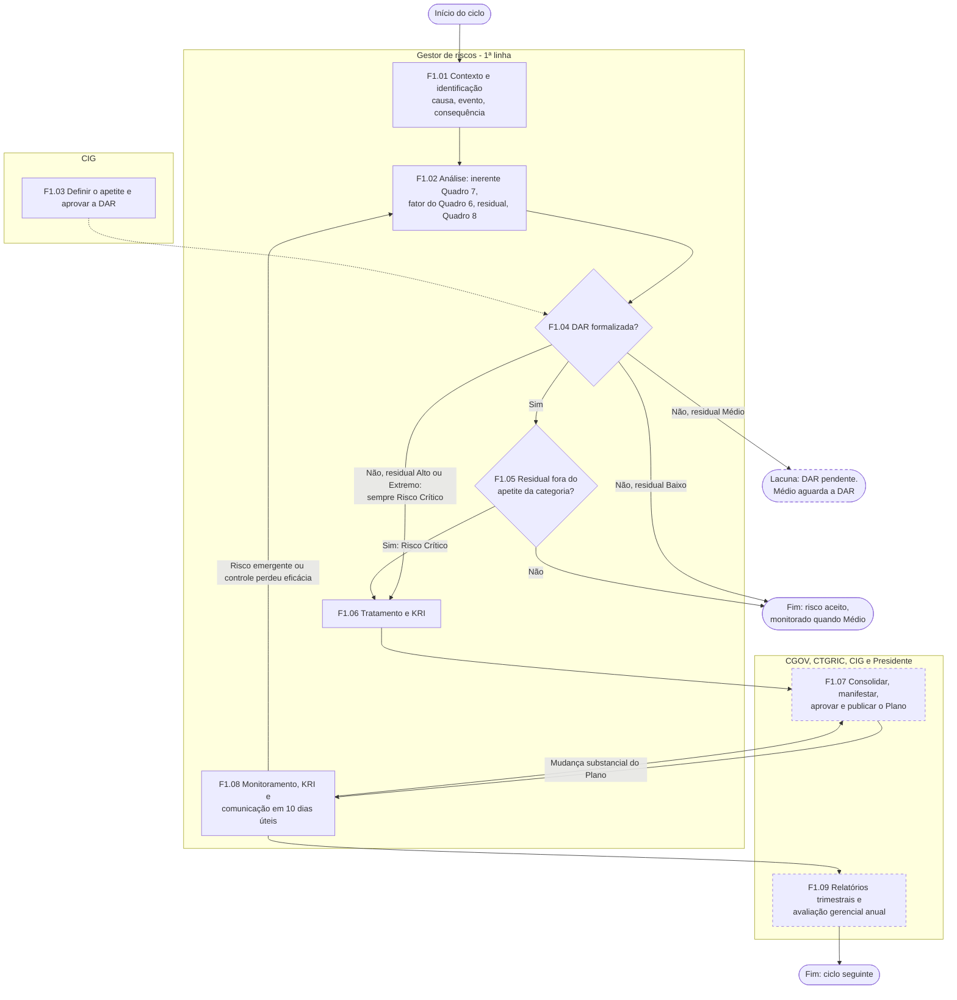
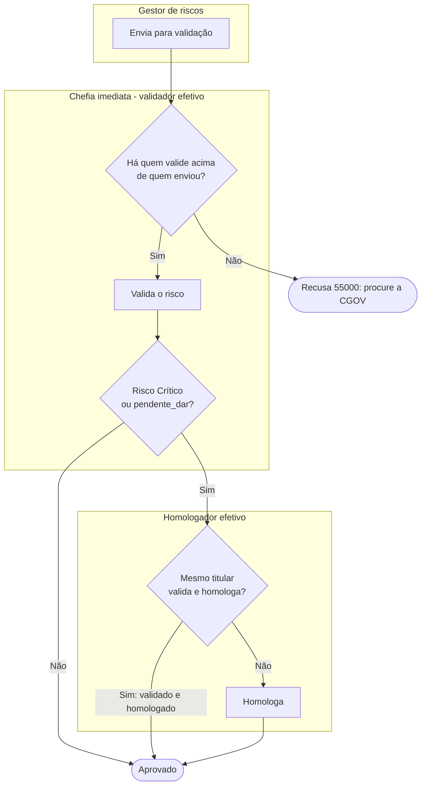
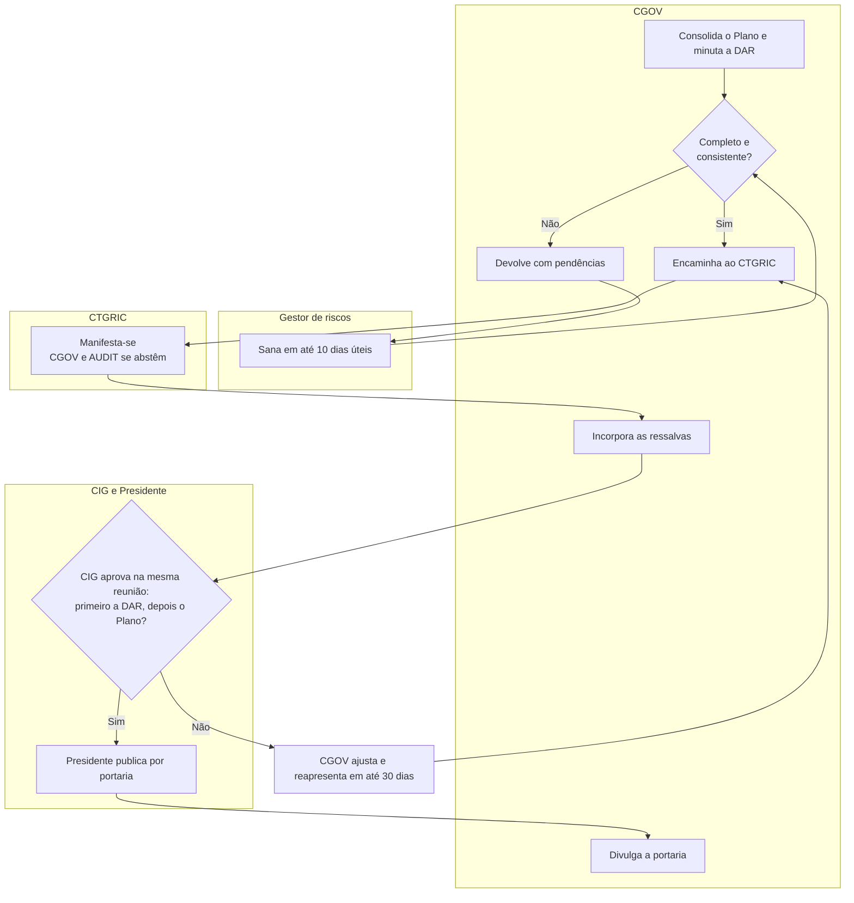

# UML 2 — Diagramas de atividades

> Mermaid: `flowchart TD` com **raias** (`subgraph`), decisões em losango `{}` (sem paralelismo: o fluxo da norma é sequencial). Origem: [[F1-ciclo-gestao-riscos]] (atividades F1.01 a F1.09),
> [[F3-aprovacao-dar-plano]] e [[FS-01-validacao-interna-risco]]. Mostra a **norma**: onde o RADAR ainda não
> implementa a etapa, ela vem tracejada (lacunas [[lacunas-norma-sistema]]).

## 1. Ciclo de gestão de riscos (F1)

> No RADAR de hoje, o trecho `F1.01 a F1.06` e a decisão `F1.05` estão implementados; `F1.07` e `F1.09` não
> (LAC-01, LAC-02, LAC-05). Em `F1.05`, "Risco Crítico" é o residual fora do apetite da DAR, não o nível Extremo.

## 2. Validação interna do risco (FS-01), implementada

## 3. Aprovação do Plano e da DAR (F3), proposta

> Todo o diagrama 3 é **proposta** (LAC-01 e LAC-02): hoje esse rito acontece fora do RADAR, por SEI e reunião.
