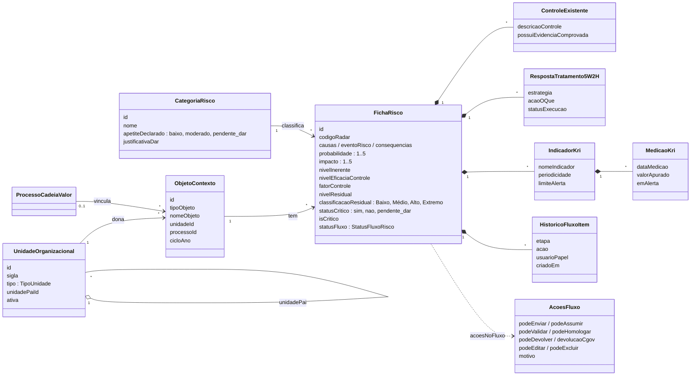
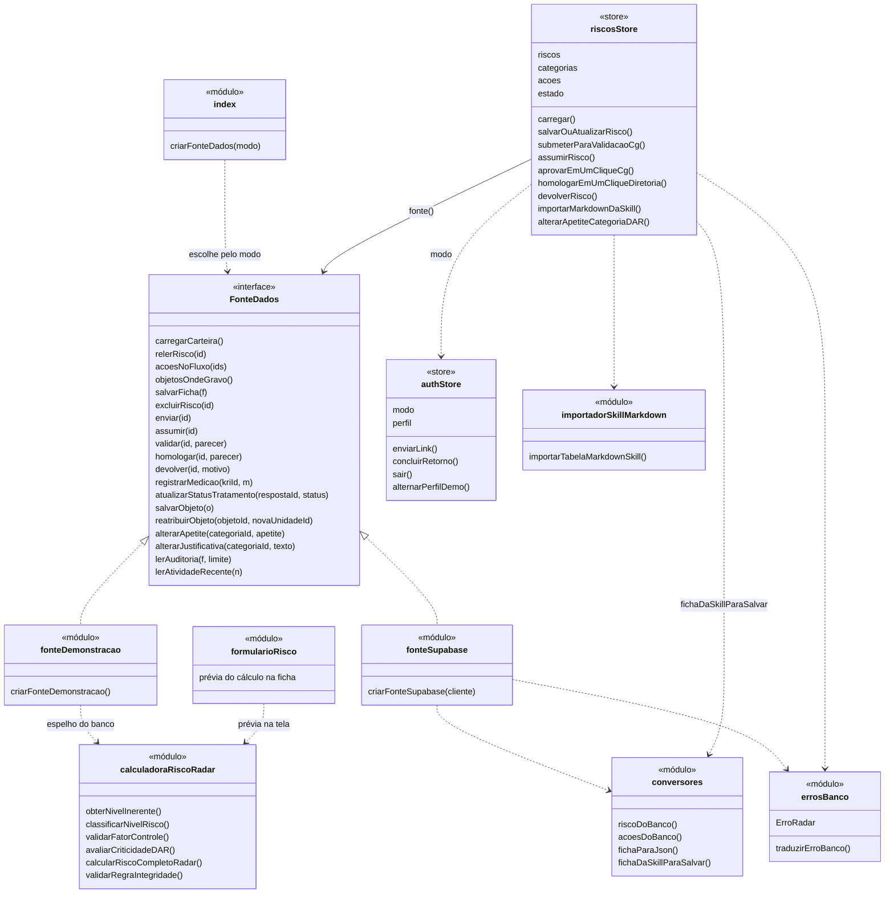

# UML 3 — Classes (domínio, stores e camada de dados)

> `classDiagram` a partir de `src/types/radar.types.ts`, `src/services/dados/`, `src/stores/` e
> `src/utils/calculadoraRiscoRadar.ts`. Os nomes das operações são os **nomes reais** das funções (conferidos
> em 2026-11-21). Só os atributos principais aparecem; a lista completa está em
> [[dicionario-dados]] (banco) e no próprio arquivo de tipos. As stores do Pinia e os módulos de funções não são
> classes no código; aqui são desenhados como classes (estereótipos `«store»` e `«módulo»`) só para mostrar
> responsabilidades e dependências.

## 1. Domínio (tipos do front)

## 2. Stores, camada de dados e cálculo

> **Regra de ouro:** o valor gravado vem do gatilho do banco; `calculadoraRiscoRadar` é só o **espelho** para
> a prévia e para o modo demonstração ([[0006-ler-inerente-do-quadro-7-no-banco-com-espelho-em-typescript]],
> [[0009-dois-modos-demonstracao-e-real]]).
