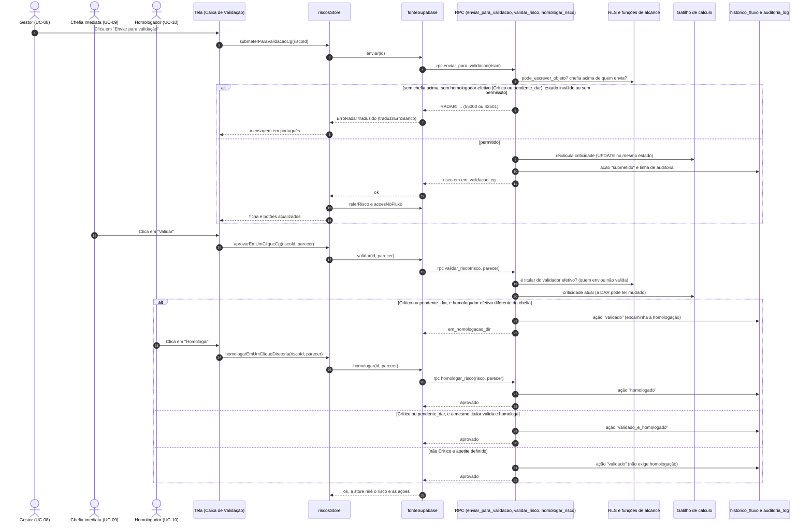
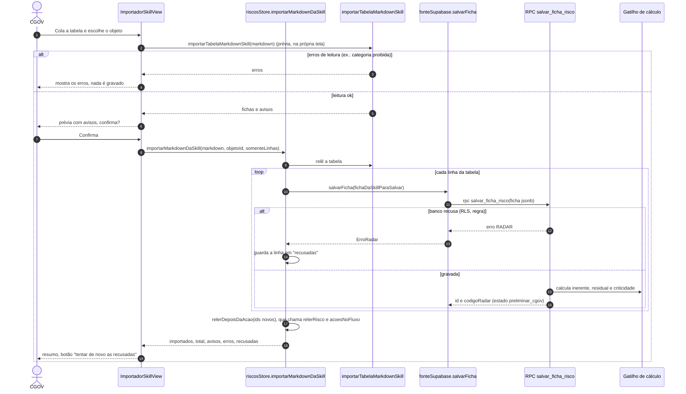

# UML 4 — Diagramas de sequência

> Dois `sequenceDiagram`, no modo real (Supabase). Os nomes de funções, RPCs e tabelas são os do código
> (`riscosStore.ts`, `fonteSupabase.ts`, migrações `20261115004`, `20261116001`, `20261116004` e `20261117001`).

## (a) UC-08 → UC-09 → UC-10: do envio à homologação

O gestor envia, a chefia valida e, se o risco for **Crítico** (residual fora do apetite da DAR), o homologador
aprova. A tela pergunta antes ao banco o que cada pessoa pode fazer (`acoes_no_fluxo`).

## (b) UC-13: importar riscos da tabela da skill

Hoje só a CGOV importa. A prévia não grava nada; cada linha é gravada sozinha, e uma linha recusada não
impede as outras (a tela oferece tentar de novo só as recusadas).

