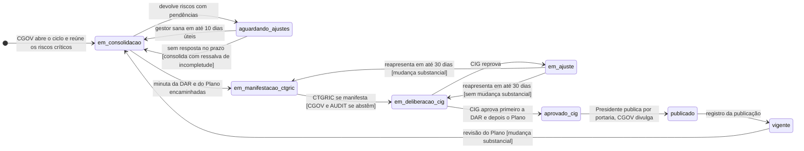

# UML 5 — Máquina de estados

## 1. `riscos.status_fluxo` (implementado)

São **6 estados**, de `20261115004_fluxo_aprovacao.sql`,
`20261116001_fluxo_presidencia.sql`, `20261116003_preliminar_cgov.sql` e `20261116004_dar_reavalia_aprovados.sql`.
Cada seta traz a **ação** gravada em `historico_fluxo.acao` e a **guarda** (condição). Estado `aprovado` =
integrado ao Plano de Gestão de Riscos; **Risco Crítico** = residual fora do apetite da DAR (não é o nível Extremo).

```mermaid
stateDiagram-v2
  direction LR
  [*] --> preliminar_cgov : CGOV cria a ficha preliminar (UC-12)
  [*] --> rascunho : unidade cria a ficha (UC-05)
  preliminar_cgov --> rascunho : assumido [titular ou gestor da unidade]
  preliminar_cgov --> [*] : excluir [unidade que grava no objeto ou CGOV]
  rascunho --> em_validacao_cg : submetido [há chefia acima de quem envia, se Crítico ou pendente_dar, há homologador efetivo]
  rascunho --> [*] : excluir
  devolvido --> em_validacao_cg : submetido [idem]
  devolvido --> [*] : excluir
  em_validacao_cg --> aprovado : validado [não Crítico e apetite da categoria definido]
  em_validacao_cg --> aprovado : validado_e_homologado [Crítico ou pendente_dar, e a mesma chefia valida e homologa]
  em_validacao_cg --> em_homologacao_dir : validado [Crítico ou pendente_dar, e homologador efetivo diferente]
  em_validacao_cg --> devolvido : devolvido_ajuste [validador efetivo, motivo obrigatório]
  em_validacao_cg --> devolvido : devolvido_ajuste [CGOV, só se sem validador efetivo]
  em_homologacao_dir --> aprovado : homologado [titular do homologador efetivo]
  em_homologacao_dir --> devolvido : devolvido_ajuste [homologador efetivo, motivo obrigatório]
  em_homologacao_dir --> devolvido : devolvido_ajuste [CGOV, só se sem homologador efetivo]
  aprovado --> em_validacao_cg : reaberto_mudanca_nota [edição de P, I, controle (evidência ou eficácia), tratamento 5W2H, definição do KRI, categoria ou objeto, ou mudança de criticidade; recusa se não houver validador efetivo]
  aprovado --> em_homologacao_dir : reaberto_mudanca_dar [a mudança da DAR faz o risco virar Crítico]
```

Observações (conferidas nos testes `supabase/tests/050_fluxo.test.sql` e `073_dar_reavalia.test.sql`):

- Risco `aprovado` **não se exclui**; edita-se, o que o reabre (decisão D2, [[0011-fluxo-em-tres-degraus-com-segregacao]]).
- Quem enviou (ou reabriu) nunca valida nem homologa: a validação **sobe um nível**; sem nível acima, o banco recusa
  (`55000`) já no envio.
- A mudança da DAR leva **direto a `em_homologacao_dir`**, sem passar pela validação ([[0012-mudanca-da-dar-recalcula-e-reabre-aprovados]]).
  Se não houver homologador efetivo, o histórico registra o aviso e a CGOV devolve a ficha à unidade.
- Quem deixa de ser Crítico, ou vai a `pendente_dar` sem virar Crítico, **continua `aprovado`** (só a criticidade é
  recalculada).
- Editar ficha em `em_validacao_cg` ou `em_homologacao_dir` é bloqueado ("travada"); medição de KRI continua livre.

## 2. Ciclo do Plano de Gestão de Riscos — **proposta (LAC-01 e LAC-02)**

> **Isto não existe no sistema.** É um desenho para quando o RADAR tiver a entidade "Plano" (LAC-01) e o rito do
> CTGRIC e do CIG (LAC-02); os nomes dos estados são sugestões, a validar com a CGOV. Hoje cada risco termina
> sozinho em `aprovado`.

