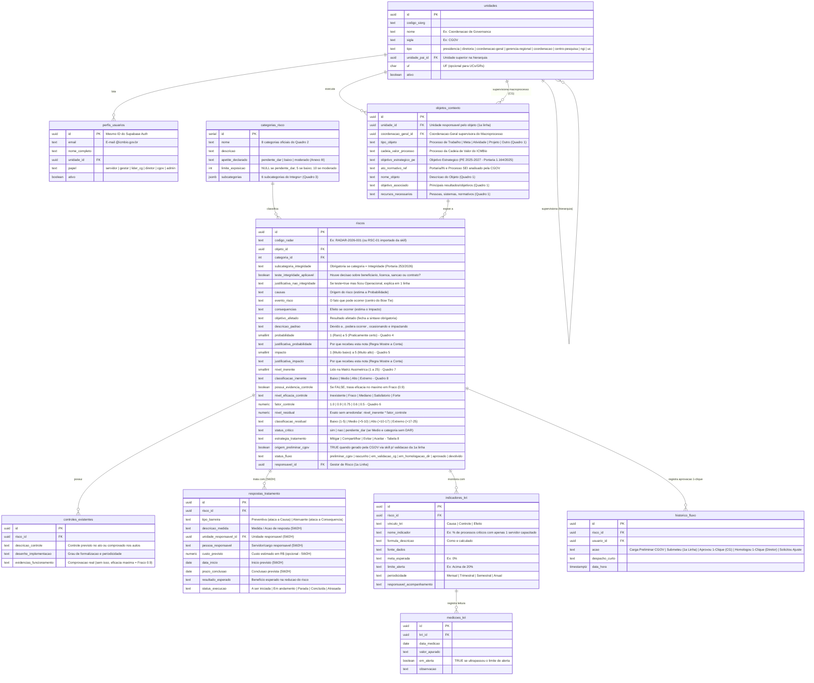

# Documento de Design e Arquitetura — Sistema RADAR (`cgov-riscos`) — Versão 2.0

**Projeto:** Sistema Web de Gestão de Riscos do ICMBio — **RADAR** (Rede de Avaliação, Diagnóstico e Ação em Riscos)  
**Versão do Documento:** 2.0 (Revista e alinhada com a skill `cgov-gestao-riscos-v4`)  
**Repositório Oficial:** `/home/lpchagas/projetos/cgov-riscos`  
**Base Normativa (Regime B — RADAR):**
- Minuta da Política de Gestão de Riscos — RADAR (SEI `024241420`)
- Minuta da Metodologia de Gestão de Riscos (SEI `024421455`, Anexos I a III)
- Portaria ICMBio nº 5.592/2025 (Art. 37, p.u., IX — Competência CGOV/CTGRIC)
- Portaria ICMBio nº 4.529/2025 (CTGRIC — CGOV como Secretaria-Executiva)
- Portaria ICMBio nº 4.101/2023 (Política de Governança — Comitê Gestor / CIG)
- Portaria ICMBio nº 253/2026 (Programa de Integridade — **Integra+**)
- Portaria ICMBio nº 1.164/2025 (Planejamento Estratégico 2025–2027)

**Unidade Responsável:** Coordenação de Governança — CGOV / ICMBio  
**Data:** 09/11/2026  

---

## 1. Intenção e o "Porquê" do Projeto

### 1.1. Qual problema estamos resolvendo?
O Instituto Chico Mendes de Conservação da Biodiversidade (ICMBio) está em transição do modelo antigo de riscos (Regime A — Portarias 255/2020 e 975/2021) para o novo modelo da **Política de Gestão de Riscos — RADAR (Regime B — SEI `024241420` e `024421455`)**.

Para acelerar a implantação nas unidades sem deixar os gestores diante de uma "tela em branco", a equipe técnica da **CGOV** utilizará a skill `cgov-gestao-riscos-v4` (no Claude Code, fora deste sistema) sobre os atos normativos que disciplinam os processos da **Cadeia de Valor** ligados aos **Objetivos Estratégicos do ICMBio (PE 2025–2027)**, gerando **versões preliminares das fichas de riscos**.

O **Sistema Web RADAR (`cgov-riscos`)** nasce exatamente para receber essas fichas preliminares (ou permitir novos cadastros), apoiar os **Gestores de Risco (1ª linha)** na validação e definição de tratamentos/KRIs, viabilizar a **aprovação hierárquica em 1 clique** (*Gestor → Coordenação-Geral / Gerência Regional → Diretoria*) e consolidar o **Plano de Gestão de Riscos** único pela **CGOV (2ª linha)**.

### 1.2. Os 3 Propósitos deste Projeto
1. **Operacionalizar a Política e a Metodologia RADAR (Regime B):** Garantir 100% de rigor metodológico nas etapas de Contexto, Identificação (*Bow Tie*), Análise (Inerente e Residual com trava de evidência), Avaliação frente à Declaração de Apetite a Riscos (**DAR**), Tratamento (5W2H + *Bow Tie*) e Monitoramento contínuo por **KRIs**.
2. **Protótipo Validável pela CGTI (TI do ICMBio):** Construir um protótipo funcional, seguro, documentado e empacotado em **Container Docker**, pronto para ser apresentado à **Coordenação-Geral de Tecnologia da Informação (CGTI)** visando sua implantação oficial em produção no ICMBio.
3. **Jornada Prática de Aprendizado e "Segundo Cérebro":** Servir como escola prática de desenvolvimento web completo (**Vue.js 3**, **Padrão Digital de Governo `@govbr-ds/core`**, **PostgreSQL no Supabase**, **Vercel** e **Docker**), utilizando o **Obsidian** integrado ao **Claude Code** e ao **Google Antigravity** como memória viva do projeto.

---

## 2. Diagnóstico e Refinamento com a Skill `cgov-gestao-riscos-v4`

### 2.1. O que corrigimos em relação às tentativas anteriores (`v1.1`, `v1.2` e `v2.1`)

| Versão Analisada | Onde os dados ficavam | Como foi construído | Diagnóstico Arquitetural (Em linguagem simples) |
|---|---|---|---|
| **v1.1** (`sharepoint_listas.md`) | 13 Listas no Microsoft SharePoint | React dentro do Teams + Scripts PowerShell | **Bloqueio de permissão:** Exigia que a TI corporativa liberasse permissões avançadas no Azure/SharePoint antes mesmo de o aplicativo existir. |
| **v1.2** (`sharepoint_listas.md`) | As mesmas 13 Listas no SharePoint (idênticas à v1.1) | Microsoft Power Apps + Power Automate | **Limitação da ferramenta:** O SharePoint obrigava a repetir textos (nome da unidade, nome do risco) em várias listas para contornar o limite de 5.000 itens. |
| **v2.1** (`MER_v2.1.md`) | 13 Tabelas no PostgreSQL (Supabase) | Vue.js 3 + Supabase + Edge Functions | **Tecnologia certa, mas modelo desatualizado:** Copiou as listas do SharePoint e usava cálculo por multiplicação simples (`P × I`), sem KRIs e sem as regras da nova Portaria RADAR. |

### 2.2. O que a análise da Skill `cgov-gestao-riscos-v4` adicionou a esta Versão 2.0 do Design

Ao analisar o arquivo `cgov-gestao-riscos-v4.zip`, identifiquei **7 regras de ouro** do trabalho da CGOV que foram incorporadas ao desenho do sistema:

1. **Ponte com as Fichas Preliminares da CGOV (Importação de Markdown + Selo "Preliminar"):**
   - A skill gera tabelas padronizadas em Markdown com riscos numerados (`RSC-01`, `RSC-02`...) a partir da análise de atos normativos (Portarias/INs), mas lembra que **probabilidade e impacto gerados a partir do texto normativo são preliminares**, devendo ser validados pelo Gestor de Riscos da unidade (1ª linha), já que a CGOV atua na consistência metodológica (2ª linha) sem invadir o mérito da 1ª linha.
   - **No Sistema RADAR:** Criamos na tela da CGOV um **Importador de Fichas Markdown** (basta colar a tabela gerada pelo Claude Code para criar os rascunhos no banco!) e adicionamos o status inicial `preliminar_cgov` (*"Ficha Preliminar CGOV — Aguardando confirmação do Gestor"*).
2. **Trava de Evidência na Eficácia dos Controles (§3.3 e §3.9 da Skill):**
   - Pela regra metodológica, **um controle sem evidência comprovada de funcionamento não pode receber nota melhor que "Fraco" (fator `0,9`)**.
   - **No Sistema RADAR:** Se o gestor não preencher o campo de evidência documental/operacional do controle existente, o seletor de eficácia bloqueia automaticamente as opções *Mediano (0,75)*, *Satisfatório (0,6)* e *Forte (0,5)*, exibindo um aviso educativo!
3. **Estado `"Pendente de DAR"` e Simulação Dupla de Apetite (§2 e §3.4 da Skill):**
   - Enquanto a **DAR (Declaração de Apetite a Riscos)** não estiver formalmente aprovada pelo Comitê Interno de Governança (CIG / Comitê Gestor), o sistema não deve inventar um apetite definitivo.
   - **No Sistema RADAR:** Cada categoria de risco pode estar com apetite `baixo`, `moderado` ou `pendente_dar`. Enquanto estiver `pendente_dar`, riscos **Altos (>10 a 17)** e **Extremos (>17 a 25)** já são marcados como **Críticos** (pois exigem tratamento nos dois cenários do Anexo III), e riscos **Médios (>5 a 10)** recebem o alerta `"Crítico se Apetite Baixo (Pendente de DAR)"`.
4. **Teste Guiado de Integridade — Programa Integra+ (Portaria nº 253/2026) (§3.2 da Skill):**
   - O sistema nunca permitirá misturar categorias como *"Operacional com interface de Integridade"*. Ao cadastrar um risco, um assistente rápido pergunta: *"Este processo envolve definir beneficiário, conceder licença/autorização, fiscalizar/aplicar sanção ou contratar/atestar?"*. Se sim, apresenta as **6 subcategorias do Quadro 3** e orienta o gestor a separar o risco Operacional (erro/atraso) do risco de Integridade (favorecimento/pressão), vinculando este último ao **Integra+ / SITAI**.
5. **Disciplina Rigorosa de Siglas e Vocabulário Institucional (§0 e §3.5 da Skill):**
   - **Proibição de "PGR" para riscos:** No ICMBio, `PGR` é o *Programa de Gestão para Resultados e Inovação* (Portaria 1.572/2023). O sistema sempre escreverá **Plano de Gestão de Riscos** por extenso e usará **DAR** para a Declaração de Apetite a Riscos.
   - **Estratégias exatas do Quadro/Tabela 8:** O sistema usará estritamente **Mitigar, Compartilhar, Evitar e Aceitar** (nunca "Reduzir" ou "Transferir"). Além disso, se o gestor selecionar **Evitar**, o sistema exibirá o alerta da Portaria: *"No ICMBio, Evitar significa encerrar o processo organizacional — decisão restrita à instância superior de governança"*.
6. **Regra "Mostre a Conta" sem Arredondamento Prévio (§3.3 e §5 da Skill):**
   - As faixas do Quadro 8 (`1 a 5` Baixo, `>5 a 10` Médio, `>10 a 17` Alto, `>17 a 25` Extremo) são aplicadas ao valor residual exato, **sem arredondar para inteiro** (`10,2` é **Alto**; `17,1` é **Extremo**). Toda ficha de risco exibe a barra visual **"Memória de Cálculo Auditável"** mostrando cada passo da conta.
7. **Plano de Tratamento em Formato 5W2H combinado com *Bow Tie* (§3.5 da Skill):**
   - Enquanto o instrumento específico do Plano de Gestão de Riscos não fixar outro layout, a tabela `respostas_tratamento` adota o formato completo **5W2H** sugerido pela skill (Tipo de barreira Preventiva/Atenuante, Medida/Ação, Unidade Responsável, Pessoa Responsável, Custo Previsto, Início, Conclusão, Resultado Esperado e Situação).

---

## 3. Objetivos, Não-Objetivos e Anti-Objetivos

### 3.1. Objetivos (O que o sistema PRECISA fazer)
- Permitir a **carga rápida de fichas preliminares** geradas pela CGOV (via colagem de tabela Markdown da skill `cgov-gestao-riscos-v4`) e o cadastro guiado do ciclo completo da Metodologia RADAR.
- Aplicar todas as travas metodológicas do Regime B (Matriz Assimétrica do Quadro 7, Fatores do Quadro 6 com trava de evidência, Teste de Integridade do Quadro 3, Apetite da DAR e KRIs).
- Oferecer **validação hierárquica em 3 degraus com "Aprovação em 1 Clique"** (*Gestor → Coordenação-Geral/Gerência Regional → Diretoria*) e consolidação do **Plano de Gestão de Riscos** pela **CGOV**.
- Adotar o visual oficial do Governo Federal (**Padrão Digital de Governo — `@govbr-ds/core`**).
- Funcionar na nuvem gratuita (**Supabase + Vercel**) durante o protótipo e contar com empacotamento **Docker** pronto para entrega à **CGTI/ICMBio**.
- Manter um **Segundo Cérebro no Obsidian** com notas didáticas para seu aprendizado e memória de contexto para o Claude Code e o Google Antigravity.

### 3.2. Não-Objetivos (O que fica de fora deste projeto)
- **A execução da skill de IA sobre textos brutos de Portarias:** A leitura de PDFs/Markdown de atos normativos para extrair riscos preliminares continua sendo feita no Claude Code com a skill `cgov-gestao-riscos-v4`. O Sistema Web RADAR **recebe** o produto dessa análise (as fichas preliminares), mas não embute um robô de IA pago dentro do site.
- Integração direta via API com SEI, SIAPE ou PETRVS (usaremos campos de texto/código para referenciar o processo SEI, a norma e o Objetivo Estratégico).
- Riscos operacionais de entregas individuais do PGD (que pertencem ao componente `S10` do projeto `pgd-icmbio`, conforme distinção da própria skill).

### 3.3. Anti-Objetivos (O que seria considerado um fracasso)
- **Burocracia para chefias:** A validação por Coordenadores-Gerais e Diretores deve ser feita em **1 clique**.
- **Misturar réguas ou siglas:** Nunca usar a fórmula antiga (multiplicação `P × I`), nunca chamar o nível mais alto de "Crítico" (o nível é **Extremo**; **Risco Crítico** é o risco cujo residual está fora do apetite da DAR) e nunca usar a sigla "PGR" para o Plano de Gestão de Riscos.
- **Código "caixa-preta":** Todo bloco de código relevante será comentado em linguagem clara, com exemplos práticos no caderno de aprendizado do Obsidian.

---

## 4. Viabilidade e Arquitetura de Containers (Docker) para a CGTI

> **O que é o Docker em linguagem simples?**  
> O **Docker** funciona como um **contêiner de transporte padronizado**: ele empacota o nosso aplicativo Vue.js já compilado junto com um servidor web super leve (**Nginx**) dentro de uma **Imagem** fechada. Quando apresentarmos o protótipo à **CGTI/ICMBio**, a equipe técnica deles poderá subir o sistema inteiro em qualquer servidor institucional com um único comando (`docker compose up -d`), sem precisar instalar Node.js ou bibliotecas manualmente.

### Como os ambientes convivem no projeto:
1. **Desenvolvimento e Homologação Rápida (Fases 1 a 5):** Você desenvolve no VS Code (WSL), versiona no GitHub e publica automaticamente na **Vercel** conectado ao **Supabase**.
2. **Empacotamento para Produção no ICMBio (Fase 6 — Docker):** Criamos e testamos no seu próprio WSL o `Dockerfile` e o `docker-compose.yml` comentados linha por linha, acompanhados do guia técnico para a CGTI.

---

## 5. Abordagem Arquitetural Selecionada

Mantemos a **Abordagem 1** escolhida anteriormente:
- **Frontend:** Aplicação **Vue.js 3** (Vite + TypeScript + Pinia + Vue Router) utilizando componentes Vue puros e didáticos estilizados diretamente com o CSS oficial do **`@govbr-ds/core`**.
- **Backend e Banco de Dados:** **PostgreSQL no Supabase**, com a Matriz Assimétrica (Quadro 7), o cálculo do Risco Residual (Quadro 6), a trava de evidência de controles e a segurança por unidade (**Row Level Security — RLS**) implementados diretamente no banco de dados (com espelho em TypeScript no navegador para atualização instantânea da tela).

---

## 6. Desenho Detalhado da Solução (Atualizado — v2.0)

### 6.1. Estrutura do Projeto e "Segundo Cérebro" no Obsidian
Além da documentação viva e do caderno de aprendizado, guardaremos uma cópia de referência das regras da skill `cgov-gestao-riscos-v4` em `docs/01-normativos/` para que o Claude Code e o Antigravity mantenham 100% de alinhamento terminológico:

```text
/home/lpchagas/projetos/cgov-riscos/
├── CLAUDE.md                        # Instruções mestras para o Claude Code
├── AGENTS.md                        # Instruções mestras para o Google Antigravity
├── .obsidian/                       # Configuração do Cofre Obsidian (ignora node_modules e dist)
├── docs/                            # SEGUNDO CÉREBRO NO OBSIDIAN
│   ├── 00-memoria/
│   │   ├── MOC-Radar.md             # Mapa Central do projeto com conexões [[...]]
│   │   ├── ESTADO-ATUAL.md          # Onde paramos e próximo passo
│   │   └── GLOSSARIO-ACESSIVEL.md   # Vocabulário oficial (RADAR, DAR, KRI, siglas proibidas)
│   ├── 01-normativos/
│   │   ├── politica-radar-024241420.md
│   │   ├── metodologia-radar-024421455.md
│   │   └── matriz-regras-regime-b.md # Tabelas completas (inclusive a tabela de apoio 25x5 da skill)
│   ├── 02-arquitetura-cgti/
│   │   ├── modelo-dados-mer.md
│   │   ├── seguranca-rls.md
│   │   └── guia-docker-cgti.md
│   ├── 03-caderno-aprendizado/      # Aulas curtas e práticas sobre o código que construímos
│   └── superpowers/specs/           # Este documento de Design e o Plano de Implementação
├── supabase/
│   ├── migrations/                  # Scripts SQL comentados passo a passo
│   └── seed.sql                     # 8 Categorias, 6 Subcategorias, Unidades e Caso de Controle (Anexo II)
├── src/                             # Código Vue.js 3 comentado
├── Dockerfile                       # Receita da imagem Docker para a CGTI
├── docker-compose.yml               # Orquestrador local do container
└── nginx.conf                       # Servidor web interno do container
```

---

### 6.2. Modelo de Dados Atualizado (Com Suporte às Fichas Preliminares da CGOV e Regras da Skill)

Refinamos as tabelas `categorias_risco`, `objetos_contexto`, `riscos`, `controles_existentes` e `respostas_tratamento` para refletir exatamente os insumos gerados pela skill `cgov-gestao-riscos-v4`:



---

### 6.3. Exemplo Prático das Novas Travas da Skill no Código (Comentado para Aprendizado)

Veja como a calculadora em TypeScript fica ainda mais inteligente ao incorporar a **Trava de Evidência de Controle** e o estado **`Pendente de DAR`** da sua skill `cgov-gestao-riscos-v4`:

```typescript
// arquivo: src/utils/calculadoraRiscoRadar.ts

/**
 * 1. MATRIZ DE RISCO ASSIMÉTRICA DO ICMBIO (Quadro 7 da Metodologia SEI 024421455)
 * O nível inerente é LIDO na célula (nunca multiplicado), pois o Impacto pesa mais que a Probabilidade.
 */
export const MATRIZ_QUADRO_7: Record<number, Record<number, number>> = {
  5: { 1: 15, 2: 19, 3: 22, 4: 24, 5: 25 }, // Impacto 5: Muito Alto
  4: { 1: 10, 2: 14, 3: 18, 4: 21, 5: 23 }, // Impacto 4: Alto
  3: { 1: 6,  2: 9,  3: 13, 4: 17, 5: 20 }, // Impacto 3: Médio
  2: { 1: 3,  2: 5,  3: 8,  4: 12, 5: 16 }, // Impacto 2: Baixo
  1: { 1: 1,  2: 2,  3: 4,  4: 7,  5: 11 }, // Impacto 1: Muito Baixo
};

/**
 * 2. CLASSIFICAÇÃO DO RISCO SEM ARREDONDAMENTO PRÉVIO (Quadro 8 + Regra §3.3 da Skill)
 * Exemplo importante da Skill: se o residual der 10,2, ele é > 10, portanto já é "Alto" (não arredonda para 10!).
 * Se der 17,1, ele é > 17, portanto já é "Extremo".
 */
export function classificarNivelRisco(valorExato: number): 'Baixo' | 'Médio' | 'Alto' | 'Extremo' {
  if (valorExato <= 5) return 'Baixo';
  if (valorExato <= 10) return 'Médio';
  if (valorExato <= 17) return 'Alto';
  return 'Extremo';
}

/**
 * 3. TRAVA DE EVIDÊNCIA DOS CONTROLES (Regra §3.3 da Skill)
 * "Um controle sem evidência de funcionamento não passa de Fraco (fator 0,9)."
 */
export function validarFatorControle(
  fatorEscolhido: 1.0 | 0.9 | 0.75 | 0.6 | 0.5,
  possuiEvidenciaComprovada: boolean
): { fatorFinal: 1.0 | 0.9 | 0.75 | 0.6 | 0.5; avisoTrava?: string } {
  if (!possuiEvidenciaComprovada && fatorEscolhido < 0.9) {
    return {
      fatorFinal: 0.9, // Limita automaticamente a "Fraco" (0,9)
      avisoTrava:
        'Atenção (Metodologia RADAR): Controles sem evidência comprovada de funcionamento são limitados ao nível Fraco (fator 0,9).',
    };
  }
  return { fatorFinal: fatorEscolhido };
}

/**
 * 4. AVALIAÇÃO FRENTE À DECLARAÇÃO DE APETITE A RISCOS - DAR (Anexo III + Regra §3.4 da Skill)
 * Determina se o risco é um "Risco Crítico" (que exige Tratamento + KRI e compõe o Plano de Gestão de Riscos).
 */
export function avaliarCriticidadeDAR(
  classeResidual: 'Baixo' | 'Médio' | 'Alto' | 'Extremo',
  apetiteCategoria: 'baixo' | 'moderado' | 'pendente_dar'
): { statusCritico: 'sim' | 'nao' | 'pendente_dar'; explicacao: string } {
  // Altos e Extremos estão fora do apetite tanto no cenário Baixo quanto no Moderado:
  if (classeResidual === 'Alto' || classeResidual === 'Extremo') {
    return {
      statusCritico: 'sim',
      explicacao: 'Risco Crítico: exige pelo menos 1 Medida de Tratamento e 1 KRI (Art. 8º da Política RADAR).',
    };
  }
  // Riscos Baixos são aceitos em qualquer cenário:
  if (classeResidual === 'Baixo') {
    return {
      statusCritico: 'nao',
      explicacao: 'Dentro do apetite a riscos: aceitável sem necessidade de novos controles.',
    };
  }
  // Riscos Médios dependem de a DAR definir apetite Baixo ou Moderado para a categoria:
  if (apetiteCategoria === 'baixo') {
    return {
      statusCritico: 'sim',
      explicacao: 'Risco Crítico (Apetite Baixo para esta categoria): exige tratamento e KRI.',
    };
  }
  if (apetiteCategoria === 'moderado') {
    return {
      statusCritico: 'nao',
      explicacao: 'Dentro do Apetite Moderado: recomenda-se apenas monitoramento.',
    };
  }
  // Quando a DAR ainda não foi aprovada pelo CIG/Comitê Gestor:
  return {
    statusCritico: 'pendente_dar',
    explicacao:
      'Pendente de DAR: Como o risco residual é Médio, será Crítico caso o CIG aprove Apetite Baixo para esta categoria, ou apenas monitorado caso aprove Apetite Moderado.',
  };
}
```

---

### 6.4. Fluxo Completo: Da Ficha Preliminar da CGOV até a Homologação em 1 Clique

Com o contexto da skill `cgov-gestao-riscos-v4`, o fluxo do sistema passa a contemplar o **Passo 0 (Opcional)** onde a CGOV alimenta as fichas preliminares extraídas dos atos normativos:

```text
[PASSO 0 (Opcional): CARGA PRELIMINAR DA CGOV]
   Técnico da CGOV cola no sistema a Tabela Markdown gerada pela skill "cgov-gestao-riscos-v4".
   O sistema cria as fichas com selo [Proposta Preliminar CGOV] na caixa da Unidade responsável.
         │
         ▼
[1º Degrau: GESTOR DE RISCOS — 1ª LINHA (UC / NGI / Centro / Coordenação)]
   Revisa a ficha preliminar (ou cria uma nova), confirma Probabilidade/Impacto reais,
   anexa evidências dos controles, preenche Tratamento (5W2H) + KRI e clica em:
   [📤 Submeter para Coordenação-Geral]
         │
         ▼
[2º Degrau: LÍDER DE MACROPROCESSO (Coordenação-Geral / Gerência Regional)]
   Vê o Card Resumo com a "Memória de Cálculo Auditável" e 2 botões de 1 clique:
   ┌───────────────────────────────┐   ┌──────────────────────────────┐
   │  ✅ Aprovar em 1 Clique       │   │  ↩️ Solicitar Ajuste Rápido  │
   └───────────────────────────────┘   └──────────────────────────────┘
         │
         ├─► Se NÃO for Risco Crítico: Status vira "Aprovado" (Monitoramento na unidade).
         │
         └─► Se for RISCO CRÍTICO (ou Médio com opção de escalonamento): Sobe ao 3º Degrau!
                        │
                        ▼
[3º Degrau: DIRETORIA / ALTA GESTÃO]
   Vê apenas os Riscos Críticos da sua Diretoria e homologa em 1 clique:
   ┌──────────────────────────────────────────────────┐
   │  🏛️ Homologar para o Plano de Gestão de Riscos   │
   └──────────────────────────────────────────────────┘
         │
         ▼
[2ª Linha: CGOV (Secretaria-Executiva do CTGRIC)]
   Verifica consistência metodológica, consolida o Plano de Gestão de Riscos único
   e gera os relatórios executivos para o CTGRIC e o CIG (Comitê Gestor).
```

---

## 7. Plano de Ação Macro Atualizado (6 Fases de Construção e Aprendizado)

| Fase | Nome da Entrega | O que vamos construir | O que você vai aprender na prática |
|---|---|---|---|
| **Fase 1** | **Alicerce e Segundo Cérebro** | Estrutura do repositório `/home/lpchagas/projetos/cgov-riscos`, cofre **Obsidian**, `CLAUDE.md`/`AGENTS.md` com a disciplina de siglas da CGOV, e projeto base Vue 3 + Vite + `@govbr-ds/core`. | Organização de projetos profissionais, uso do Obsidian como memória de IA e estrutura de um app Vue 3. |
| **Fase 2** | **Banco de Dados RADAR no Supabase** | Criação das tabelas SQL, funções da Matriz Assimétrica (Quadro 7), trava de evidência (Quadro 6), carga das 8 Categorias + 6 Subcategorias e do **Caso de Controle do Anexo II** (nota 22 Extremo). | Banco de dados PostgreSQL, Chaves Estrangeiras, Triggers e como testar regras normativas direto no banco. |
| **Fase 3** | **Login e Identidade Visual Gov.br** | Autenticação Supabase Auth, cabeçalho/menu no Padrão Digital de Governo (`@govbr-ds/core`) e seletor rápido de perfil para simular Gestor, Coordenador-Geral, Diretor e CGOV. | Componentes Vue reutilizáveis, rotas protegidas (`Vue Router`) e gerenciamento de sessão (`Pinia`). |
| **Fase 4** | **Motor de Riscos + Importador da Skill CGOV** | Assistente passo a passo (Contexto → *Bow Tie* com sintaxe automática e Teste de Integridade → Calculadora com "Mostre a Conta" → Tratamento 5W2H e KRIs) + **Importador de Tabelas Markdown da Skill `cgov-gestao-riscos-v4`**. | Formulários reativos no Vue 3, parser simples de tabelas Markdown e gravação transacional no Supabase. |
| **Fase 5** | **Fluxo "1 Clique" e Painel CGOV / CTGRIC** | Caixa Executiva de aprovação em 1 clique para Coordenações-Gerais e Diretores + Painel da CGOV com simulação de cenários da DAR (Baixo vs. Moderado) e exportação para PDF/Excel. | Consultas filtradas por perfil, painéis gerenciais (Matrizes de Calor) e geração de relatórios. |
| **Fase 6** | **Publicação na Vercel + Container Docker para a CGTI** | Publicação contínua na Vercel + construção do `Dockerfile` (Vue + Nginx), `docker-compose.yml` e documentação técnica para apresentação à **CGTI/ICMBio**. | Deploy em nuvem e criação/execução de imagens **Docker** prontas para infraestrutura governamental. |

---

## 8. Decisões Técnicas Consolidadas (Para sua conferência)
1. **Caso de Controle Oficial (Anexo II da Portaria / §6 da Skill):** O exemplo do servidor único detentor do conhecimento (*Operacional, P=3, I=5 → Inerente 22 Extremo → Sem controle Fator 1,0 → Residual 22 Extremo + 3 KRIs trimestrais*) já virá pré-cadastrado na base inicial (`seed.sql`) e nos testes automatizados do sistema para comprovar à CGTI e ao CTGRIC que o motor calcula exatamente como manda a Portaria.
2. **Importador de Markdown da Skill `cgov-gestao-riscos-v4`:** Não consome API paga de IA; é um leitor determinístico em TypeScript que lê a tabela Markdown que você gerar no Claude Code e popula as fichas preliminares no banco de dados em 1 segundo.
3. **Harmonização CIG / Comitê Gestor (§8 item 1 da Skill):** Nos relatórios gerados pelo sistema, o título da instância decisória será parametrizável pela CGOV (*"Comitê Interno de Governança – CIG / Comitê Gestor do ICMBio"*), evitando retrabalho caso o texto final publicado no DOU ajuste a nomenclatura.
